# Life Log Club: a guide to every flow

This guide walks through what a member can do in Life Log Club today, screen by screen, with a diagram for each flow. The last part lists the bugs found and fixed while the app was built.

- For the product's goals, read [product_vision.md](../product_vision.md). For the learning design, read [learning_spec.md](../learning_spec.md).
- Each feature links to its proof page in [docs/proof](proof/), with screenshots at desktop and phone sizes and the tests that check it.
- The diagrams are Mermaid, so GitHub draws them in place.

## Contents

1. [The map of the app](#1-the-map-of-the-app)
2. [Joining and signing in](#2-joining-and-signing-in)
3. [Home, the worlds and + Log](#3-home-the-worlds-and--log)
4. [Mind: adding something to read](#4-mind-adding-something-to-read)
5. [Mind: reading](#5-mind-reading)
6. [Mind: key ideas, written in the background](#6-mind-key-ideas-written-in-the-background)
7. [Mind: recall after reading](#7-mind-recall-after-reading)
8. [Mind: the kinds of question](#8-mind-the-kinds-of-question)
9. [Mind: Review](#9-mind-review)
10. [Mind: the schedule](#10-mind-the-schedule)
11. [Mind: lessons, saved ideas, words and skills](#11-mind-lessons-saved-ideas-words-and-skills)
12. [Mind: teach it back](#12-mind-teach-it-back)
13. [Mind: Fading and Progress](#13-mind-fading-and-progress)
14. [Settings and the AI key](#14-settings-and-the-ai-key)
15. [Privacy](#15-privacy)
16. [Bugs found and fixed](#16-bugs-found-and-fixed)

---

## 1. The map of the app

Every screen is one or two clicks from Home. The four worlds are always in reach: in the sidebar on a desktop, and in the bottom bar on a phone, with **+ Log** in the middle.

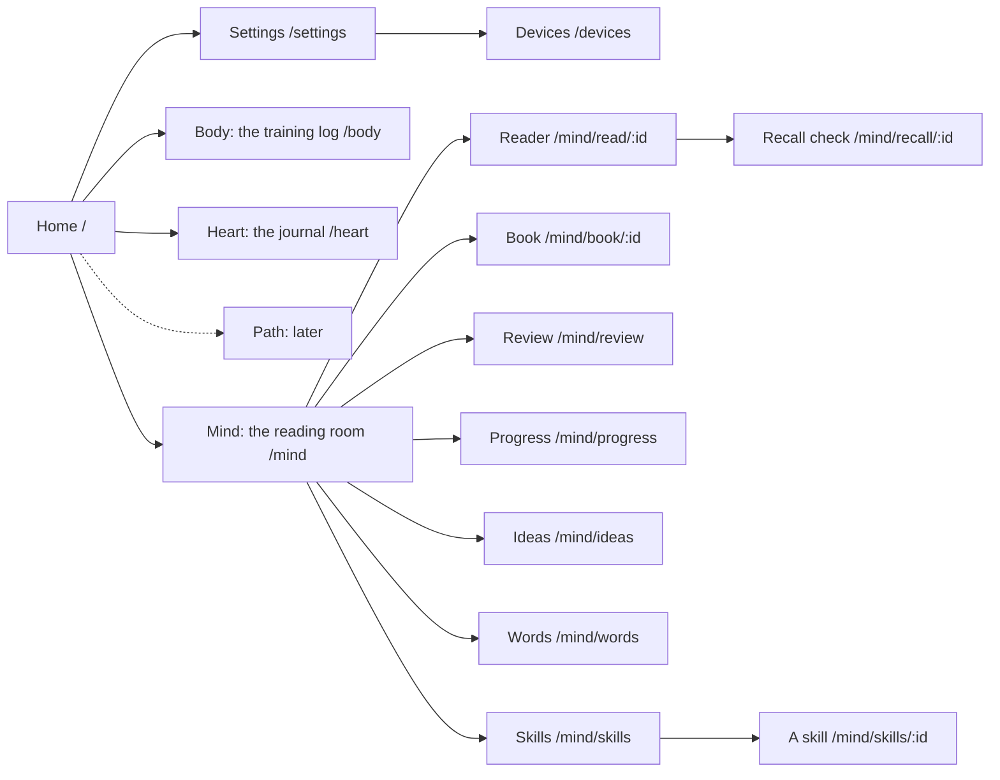

Shortcuts work everywhere:

| Key | What it does |
| --- | --- |
| `L` | Opens + Log |
| `1` to `4` | Home, Mind, Body, Heart |
| `Esc` | Closes a dialog |
| `R` | In the reader: recall this section |
| `1` `2` `3` | In Review: Guessing, Think so, Sure (or Forgot, Hard, Got it) |

## 2. Joining and signing in

Life Log Club is invite only. The owner runs `pnpm invite someone@example.com` and sends the link to that person.

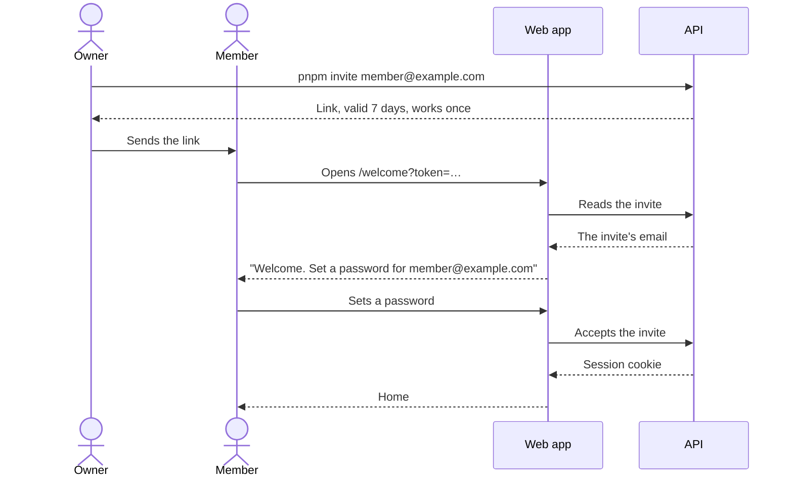

- A member stays signed in while they use a device. A device not used for 30 days must sign in again, and the sign-in page says why.
- **Devices** lists every signed-in device and signs out a lost one.
- Five wrong passwords for one email lock it for 15 minutes.
- An expired or used link says so: "This invite link has expired or was already used. Ask for a new one."

## 3. Home, the worlds and + Log

**Home** has one card for each pillar with its latest numbers, and the recent entries from every pillar. The Mind card shows how many ideas are due (one click opens Review) and, after 20 reviews in 30 days, one honest number: "Recalled 70% at review, last 30 days".

Each pillar is its own world, with its own colours and type:

| World | What it holds | Entry types |
| --- | --- | --- |
| **Mind**, the reading room | Readings, recall, review, lessons, ideas, words, skills | Lesson, Practice, Finished reading |
| **Body**, the training log | "Records come from every set you log." | Gym set, Meal, Sleep |
| **Heart**, the journal | "The people in your life, and how you feel." | Mood, Meeting, Moment |
| **Path** | Comes later | |

**+ Log** is one dialog for every type. It fills in the last values used, so a repeat log is one click on **Save**.

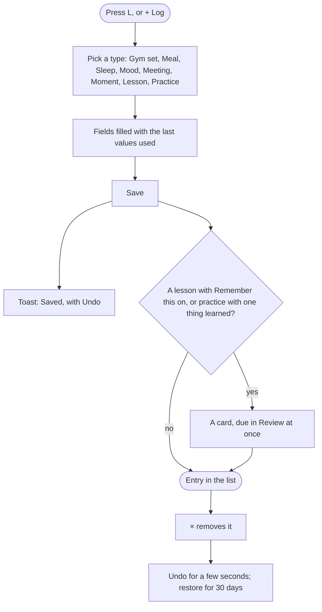

- Removing an entry shows **Undo**. A removed entry can come back for 30 days; then a nightly job deletes it.
- The text of a **Meeting** is about other people, so it is encrypted before it is stored.

## 4. Mind: adding something to read

The **Add a reading** box on Mind takes a link, pasted text, or a file. A new reading shows at once on its tile, and a background job does the rest.

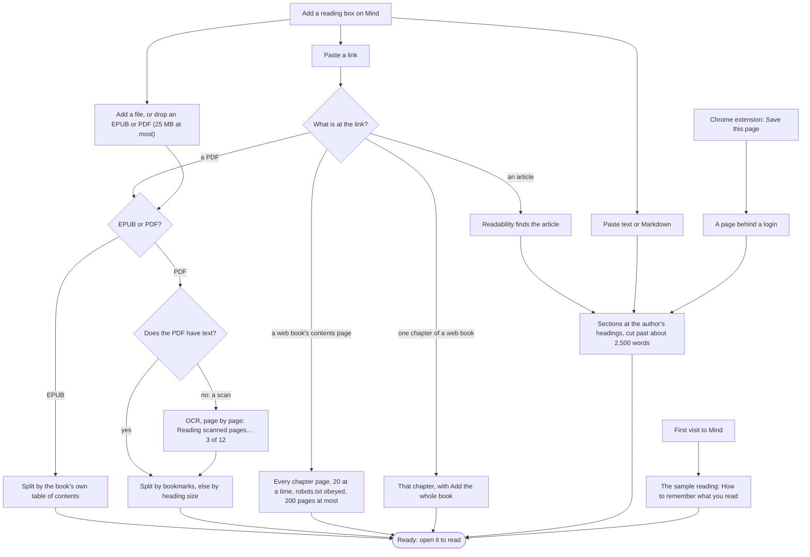

What a member sees on the tile while it imports:

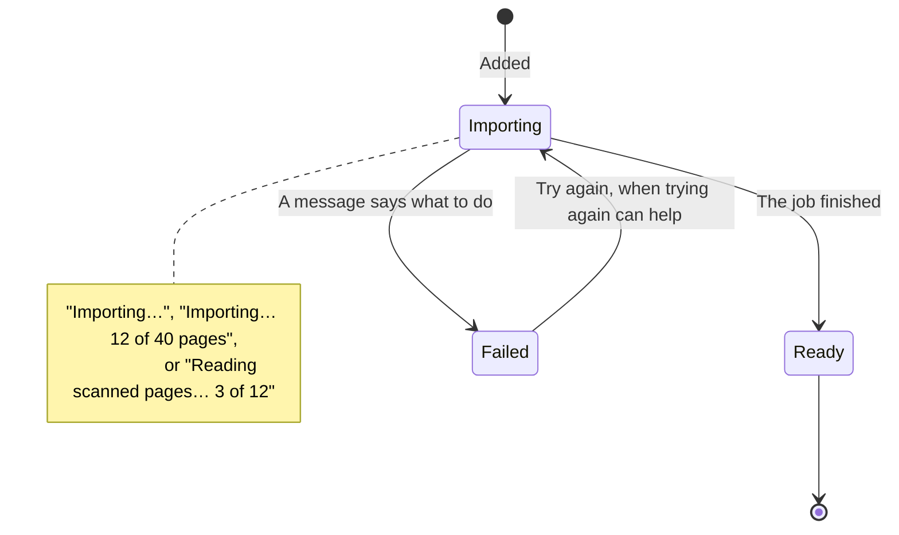

Details that matter to a member:

- **The same thing twice is one reading.** The same link, two links to the same page, or the same file again ("You already have this book.") opens the reading the member has.
- **Books are split by their own outline**, up to three levels. The cover, copyright, contents and index are left out. A bibliography is kept to read as a reference, with no recall. ([#2](https://github.com/rohitchoudharii/life-log/issues/2))
- **Scanned PDFs are read with OCR** on the server, with no AI key and no cost. Over 400 pages, the member is asked to split the file; a scan with no readable text says "Try a sharper scan, or a copy with text." ([#4](proof/issue-04.md))
- **Long articles with no headings** get AI headings from the member's key. The AI only says where the headings go; it never changes the text.
- **Pasted text** opens at once as a reading. Two `#` headings make two sections. ([#14](proof/issue-14.md))
- **The sample reading** lets a new member try the whole loop with no AI key: it comes with its key ideas and questions written by hand. ([#15](proof/issue-15.md))
- **New book** makes a book from articles, and **Add to book** puts an article in one. The book shows "2 of 5 chapters read" and **Continue**.
- **The Chrome extension** saves a page the server cannot open, such as a chapter behind a login, and warns when the page looks like a preview.
- **Links the server must not open** (private and local addresses, pages over 5 MB) fail with a message.

## 5. Mind: reading

The reader shows one section at a time, with the contents beside it on a desktop and behind **Contents** on a phone.

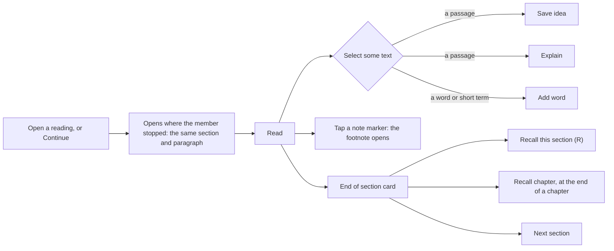

- **The place is kept.** The reader saves the paragraph at the top of the screen 2 seconds after scrolling stops. Opening the reading again goes back there. ([#7](proof/issue-07.md))
- **Text size and width** are set in the reader's header and kept.
- **Footnotes and endnotes** open in a popup from their marker. They are never part of what a section is recalled from.
- **Time read** counts only active time: a scroll, a key or the pointer in the last minute, with the tab visible.
- **Explain** opens a panel over the reader, so the place stays. It explains from first principles at once; **Analogy** and **Example** are one click away, and each is asked for once. "From the text: …" shows the sentence it relies on. ([#30](proof/issue-30.md))
- **Finish by** on a reading's tile sets a goal date: "0% · about 1 page a day to finish by 17 Nov". ([#22](proof/issue-22.md))
- **Finished** is one click. A milestone card shows the date, time read, ideas in review and how many were right, and asks for up to 3 key lessons, which become lesson cards. **Undo finished** takes it all back.

## 6. Mind: key ideas, written in the background

When a member spends 30 active seconds in a section, the app queues a job that writes the section's **key ideas** with the member's own AI key. Nothing is written at import, so a section that is skimmed past costs nothing. ([#9](proof/issue-09.md))

Each key idea has:

- a one-sentence statement,
- a **cue**: a short question that does not give the idea away,
- a **quote** copied from the section, and
- questions at rising levels (explain, apply and above).

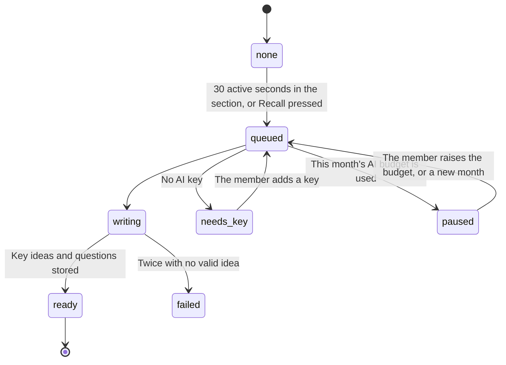

Checks in code keep the AI honest, and what fails is dropped:

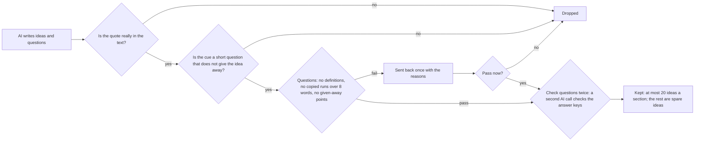

- When the AI writes a section's ideas, it also suggests up to 3 words worth learning, underlined in the text. ([#31](proof/issue-31.md))
- **Settings → Questions** chooses how many questions (Quick, Standard, Thorough) and which kinds (Mixed, Written, Choice). The **⋯** menu on a section rewrites its questions or its key ideas. ([#26](proof/issue-26.md))
- Every 6 hours, and 5 minutes after Review, a job writes a fresh question for each card that would otherwise be asked through its cue again. ([#27](proof/issue-27.md))

## 7. Mind: recall after reading

Recall is the heart of the Mind pillar: close the text, write down what you remember, then answer a question on each idea.

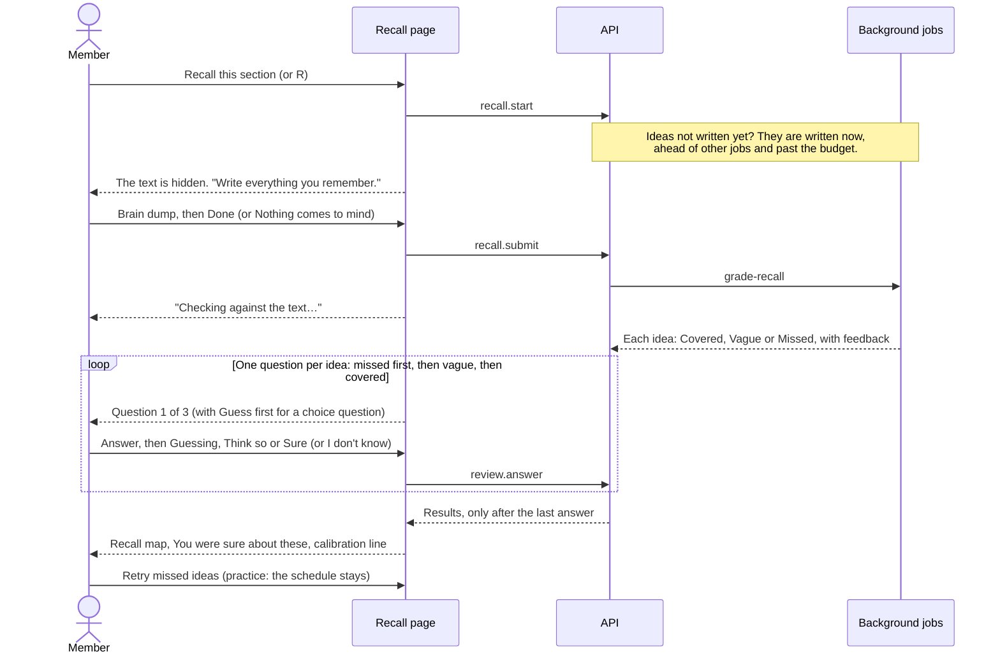

**The question fits the dump.** The dump mark decides how hard the first question is:

| Dump mark | First question | Why |
| --- | --- | --- |
| Missed | The idea's cue ("Which point did this part make?") | The simplest retrieval first |
| Vague | The lowest stored question (explain) | Fill in the gap |
| Covered | The highest stored question (apply, analyse) | Do not repeat what the dump said |

- **Results are held back until the last answer**, because one result could give away the next answer.
- **Confidence lowers credit, never raises it.** A right answer with **Guessing** counts as Hard. A wrong answer stays wrong however sure the member was.
- **You were sure about these** lists the confident mistakes first, because they are the ones most worth fixing.
- **Recall chapter**, at the end of a chapter's last section, takes one dump for the whole chapter and asks at most 10 questions, missed ideas first. Every other idea starts from its dump mark, so no idea is left out of Review. ([#21](proof/issue-21.md))

**Without an AI key** the loop still works ([#15](proof/issue-15.md)):

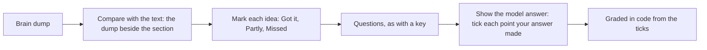

## 8. Mind: the kinds of question

| Type | What the member does | How it is graded |
| --- | --- | --- |
| Cue | Says the idea from its cue | AI judge, or the member's own check |
| Written (explain, apply, …) | Writes an answer | AI judge against must-have points, or the member's ticks |
| Multiple choice ([#24](proof/issue-24.md)) | Picks A to D; with Guess first, types a guess before the options show ([#25](proof/issue-25.md)) | In code. The result says why each wrong option is wrong |
| Worked problem ([#28](proof/issue-28.md)) | Gives one number with a unit, and may show working | In code; with working, the AI judges the working |
| Predict the output | Writes exactly what a piece of code prints | In code |
| Find the error | Says what is wrong with flawed code or a flawed claim, and why | AI judge |
| Order the steps ([#29](proof/issue-29.md)) | Puts shuffled steps in order | In code, with each pair in or out of place |
| Word tests ([#32](proof/issue-32.md)) | Fill the blank, say the meaning, or use the word | See section 11 |

**Guess first** is on by default. Typing a guess before the options show makes a choice question a real recall, not a recognition test. It can be turned off on the Review and Recall start screens and in Settings.

## 9. Mind: Review

**Review** asks the due cards one at a time, with the result after each answer. It opens in one click from the due count on Home or on Mind. ([#12](proof/issue-12.md))

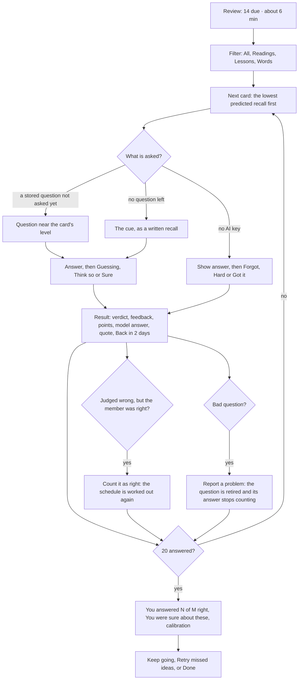

- **When the AI judge fails**, the card turns into a self-check, so the member is never stuck.
- **Already answered on another device** shows that line and moves on.
- **Teach it back** is offered on a missed answer (section 12).
- **The time estimate** uses the member's own median time per answer.

## 10. Mind: the schedule

Every card follows the same schedule: three short steps to build the memory, then FSRS, which fits the gaps to how memory fades. ([#17](proof/issue-17.md), [#18](proof/issue-18.md))

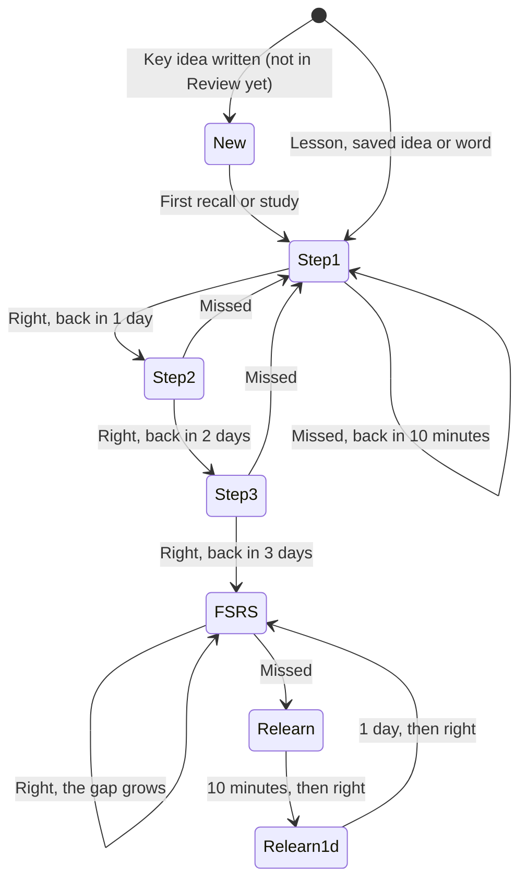

- **The member chooses how well to remember**: 80%, 85%, 90% (the default) or 95% in **Settings → Review**. Higher means more reviews. A new target applies from the next answer. ([#19](proof/issue-19.md))
- **Review serves the idea most likely forgotten first**, from each card's predicted recall now.
- **The schedule tunes itself to each member's memory**, once a month, after 1,000 answers ([#35](proof/issue-35.md)):

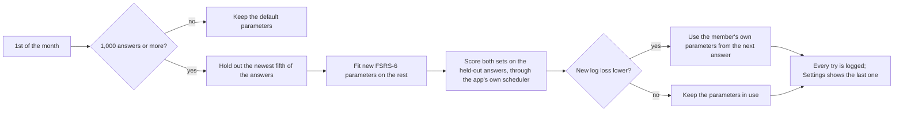

## 11. Mind: lessons, saved ideas, words and skills

Four more ways in to the same Review queue:

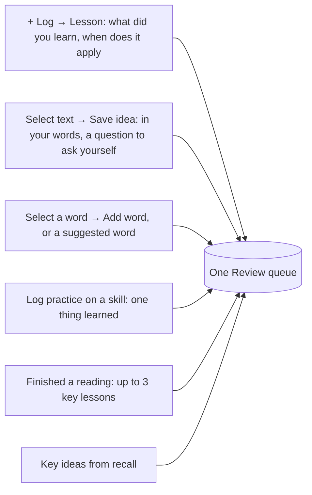

**Lessons** ([#13](proof/issue-13.md)). A lesson is due at once. With "When does it apply?" filled in, it is asked as "Salary talks: what's the lesson?". Without it, the member's AI writes a cue in the background. Untick **Remember this** to log a lesson with no card.

**Saved ideas** ([#23](proof/issue-23.md)). Select text, **Save idea**, then Save: two clicks. It comes back tomorrow. **Ideas** on Mind lists every saved idea by reading, with **Open passage**, which opens the reader at that paragraph.

**Words** ([#31](proof/issue-31.md), [#32](proof/issue-32.md)). The member's AI writes a meaning for the word in its sentence. The test grows harder as the word is learned:

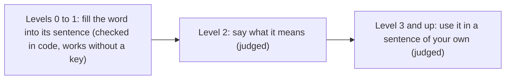

Each result shows the meaning and the sentence where the word was met. **Mind → Words** shows each word's next test.

**Skills** ([#34](proof/issue-34.md)). For something practised, such as piano or public speaking. A skill has a weekly target in minutes.

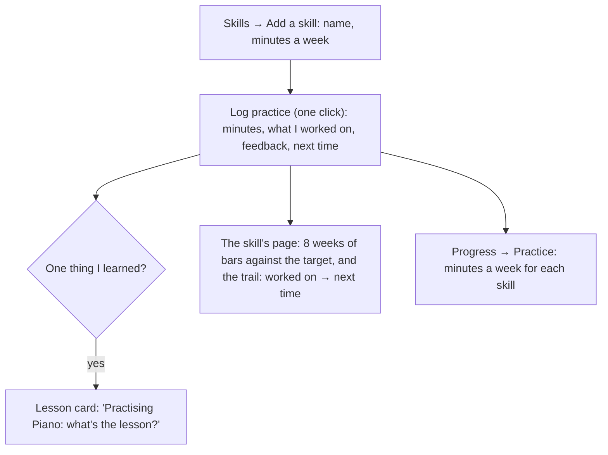

## 12. Mind: teach it back

Explaining an idea to someone who asks "why?" shows what is really understood. **Teach it back** opens a dialog with a curious AI student. ([#33](proof/issue-33.md))

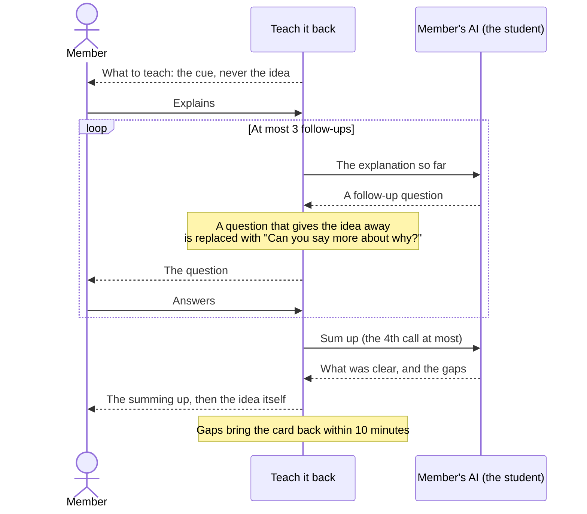

It is offered on a missed answer in Review, on missed and vague ideas in the recall results, and on each saved idea.

## 13. Mind: Fading and Progress

**Fading** on Mind shows up to 3 ideas past the steps that are most likely to slip, each with "about 91% likely to come back to you now" and **Review now** (one click). ([#20](proof/issue-20.md))

**Progress** answers "is this working?" over the last 12 weeks. Every number needs enough answers: under 20 it says "Not enough answers yet (3 of 20)" instead of a percentage.

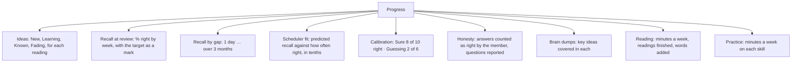

- **Scheduler fit** ([#36](proof/issue-36.md)) answers one question: does the schedule know my memory? A bar that reaches its mark says yes. When it does not, one line names the tenths that are off and says that tuning fixes this at 1,000 answers.
- **Time read sits below recall**, because time alone is not learning.

## 14. Settings and the AI key

| Panel | What it does |
| --- | --- |
| **AI key** | Add an Anthropic or OpenAI key. It is checked by listing its models (free), stored encrypted, and used for this member's AI work only. |
| **AI usage** | "This month: 12 calls · about $0.40 of $5", the monthly budget, and **Earlier months** with calls and tokens for each month ([#8](proof/issue-08.md), [#36](proof/issue-36.md)) |
| **Review** | The target: 80%, 85%, 90% or 95%, and the last tuning of the schedule |
| **Questions** | How many, which kinds, Check questions twice, Guess first |
| **Devices** | Every signed-in device, with Sign out |

**The budget stops background AI, never AI the member is waiting for:**

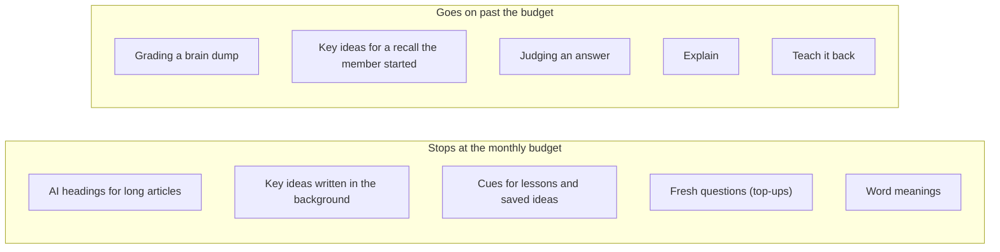

A budget of $0 means no background AI at all. Mind shows one calm line when the budget is used, with a link to Settings.

## 15. Privacy

- **Each member sees only their own data.** Postgres row-level security enforces this on every table, not only the API code. A test checks every table in the database for a policy.
- **Text about other people is encrypted** before it is stored: meeting notes, brain dumps and teach-back conversations.
- **Text from a page or a member is material, never instructions**: it goes to the AI inside tags, and the prompts say so.
- **AI uses the member's own key**, and no other member's data is ever sent with it.

## 16. Bugs found and fixed

These bugs were found while the issues were built and tested. Where a test could catch the bug, a test now fails without the fix.

| Issue | What went wrong | The fix |
| --- | --- | --- |
| [#7](proof/issue-07.md) | The reader kept one view for every section, so the saved place was only ever scrolled to in the first section. | Each section gets its own view, and the reader is placed before the first paint. |
| [#11](proof/issue-11.md) | On a cue answer, the result showed the same sentence three times. | The point list is left out when its only point is the model answer. |
| [#12](proof/issue-12.md) | Proof screenshots of scrolled pages drew the top bar in the middle. | The proof helper scrolls to the top before each full-page capture. |
| [#14](proof/issue-14.md) | The link parser cut an address at its first `)`, so `…/wiki/Flow_(psychology)` lost its end. | Addresses may hold one level of parentheses, as in Markdown. |
| [#15](proof/issue-15.md) | A sample question copied 10 words in a row from the text. | The question is reworded; the quality check caught it. |
| [#15](proof/issue-15.md) | "A device unused for 30 days must sign in again" failed now and then: a request still in flight met the expired session and cleared the cookie. | The test waits until the page has no requests in flight. It then passed 32 times in a row. |
| [#18](proof/issue-18.md) | Moving old cards to the new schedule skipped on-time review answers that FSRS would have called early. | Only early right *recall* answers are skipped; a test proves all five answers count. |
| [#18](proof/issue-18.md) | The local database missed `review_log.reveal` and had a wrong migration bookkeeping row. | Added the column and fixed the row; the later migrations applied. |
| [#21](proof/issue-21.md) | A server test expected two cards in a fixed order that Postgres does not promise; it failed about one run in four. | The test checks the cards in any order. |
| [#21](proof/issue-21.md) | An e2e test could read another test's member, because both made cards with the same name. | It finds its own member by email. |
| [#22](proof/issue-22.md) | Every article with more than one section offered **Recall chapter** at its end. | Recall chapter shows only on readings with more than one chapter. |
| [#28](proof/issue-28.md) | Stored questions were graded without their defaults, so a worked problem's working was never judged. | The content is parsed with its type's schema before grading. |
| [#28](proof/issue-28.md) | The "what is X" rule refused "What is wrong with this code?", the way a find-the-error question asks. | "What is wrong / missing / the error" is allowed. |
| [#31](proof/issue-31.md) | The reader never saw a section's writing start, so new ideas and suggested words showed only after a reload. | The heartbeat loads the section again, and the reader follows the writing until it is done. |
| [#32](proof/issue-32.md) | A fill-the-blank result showed the word twice in large type. | The duplicate is gone. |
| [#35](proof/issue-35.md) | (Avoided) The FSRS optimizer's own `evaluate` returned the same tiny loss for any parameters on a member-sized log, so every fit would have looked equal. | The held-out score is computed in code, through the scheduler that sets the due times. |
