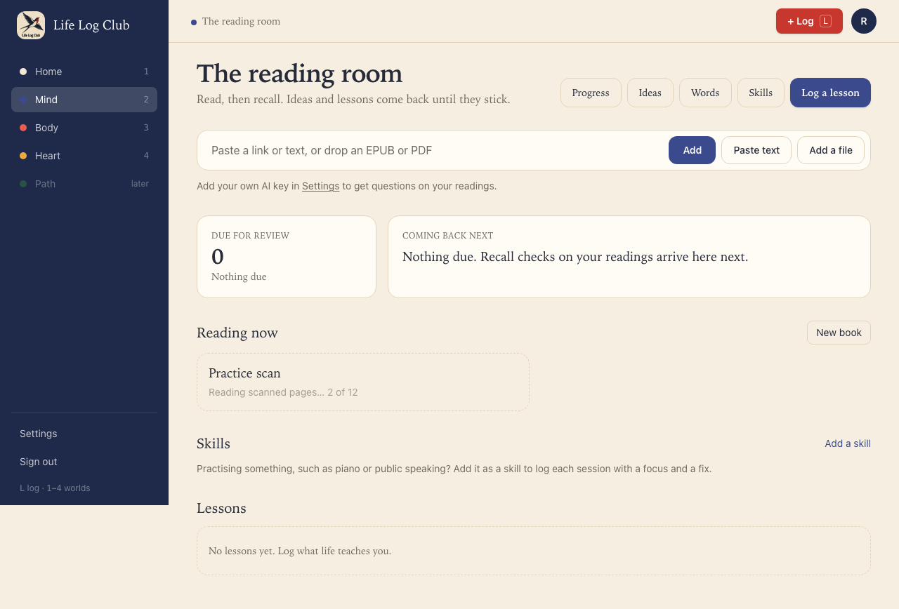
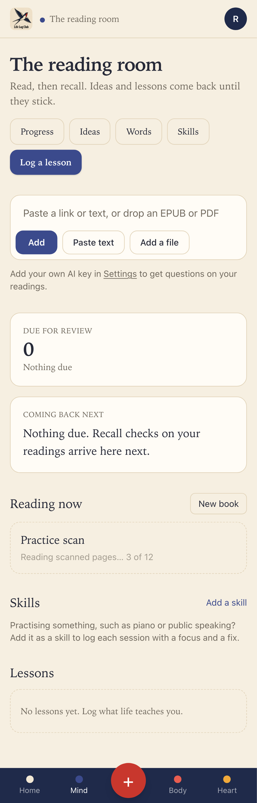
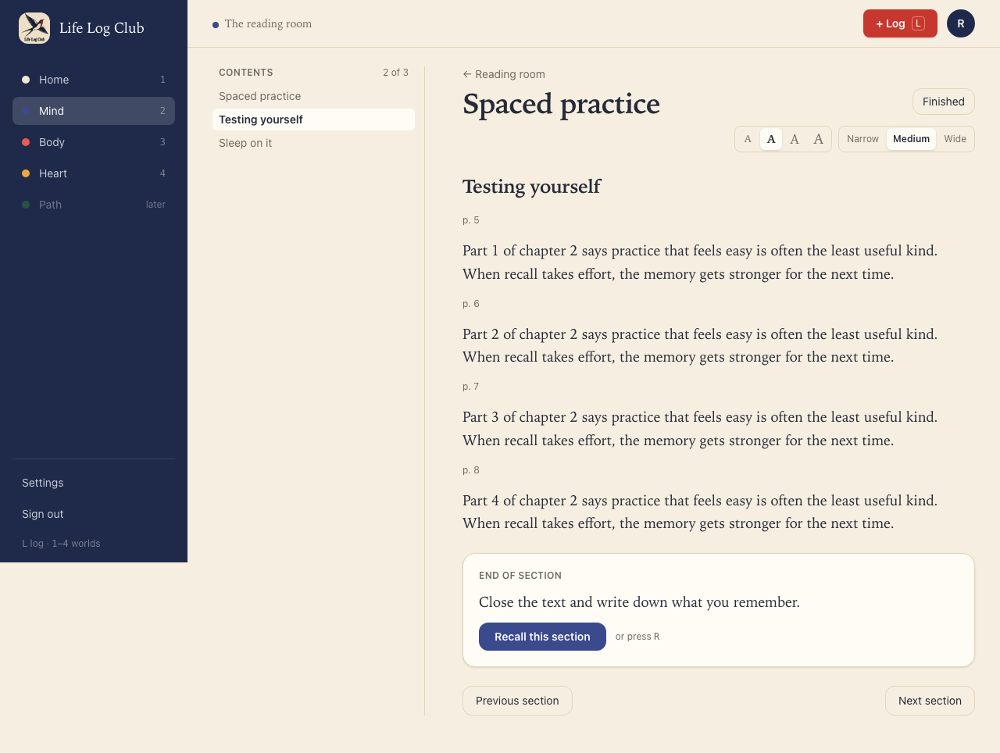
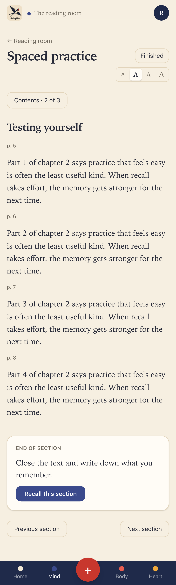

# Issue #4: Read scanned PDFs with OCR

Planned for later; built after Release 9. Builds on #2's PDF rules.

## What was built

- **A PDF with almost no text is read with OCR.** When pdf.js finds too little text (the same test that used to refuse the file), each page is drawn at about 150 dots per inch with `@napi-rs/canvas` and read with Tesseract (`tesseract.js`, English). This runs on the server, in the import job's worker thread: no AI key, no cost, and nothing is downloaded at run time, because the English data ships as the `@tesseract.js-data/eng` package.
- **#2's rules do the rest.** Each line OCR reads becomes one text item where it stands on the page, sized by its row height. So the same code finds chapters by heading size, joins lines into paragraphs, and keeps page numbers, as for a PDF with a text layer.
- **Progress on the tile.** While the scan is read, the reading's tile says "Reading scanned pages… 3 of 12". The worker reports each page; the job stores it in `readings.scan_progress` (migration 0024), and `Reading.progress` gains `scan: true`.
- **Limits.** Each page restarts a 60-second limit, so a long scan has time but a stuck page does not hang the import. Scans over 400 pages (about 10 minutes of OCR) are refused with "This scanned PDF has more than 400 pages. Split it into parts and add each one." The import job's 30-minute limit covers the longest allowed scan.
- **When OCR finds nothing**, the message says what to do: "This PDF is scanned pages, and no text could be read from them. Try a sharper scan, or a copy with text." It replaces "…can't read it yet".

## Decisions for the learner

- **No setting and no extra step.** A member drops a scanned book the same way as any other, and it reads like any other: chapters, page numbers, recall at the end of each section.
- **Lines read with low confidence (under 40%) are left out**, so smudges and page edges do not turn into noise in the text the member recalls from.
- **English only for now.** Members read in English today; another language is one more data package.

## Proof

### Reading the scan

### The scan opens to its chapters

### Tests

- `apps/server/src/import/test-books.ts` gains `scannedPdf(pages)`: it draws a text PDF's pages to JPEG and builds a PDF of only those images, so tests have a real scan with no text layer.
- `apps/server/src/import/reading.test.ts`, **reads a scan with OCR into its chapters by the same rules as a PDF with text**: a two-page scan imports as "Spaced practice" with chapters "Spaced practice" and "Testing yourself", `scanProgress` 2 of 2, and chapter 2's three lines joined into one paragraph with the exact words. A blank page still fails, now with the new message.
- `e2e/mind-add.spec.ts`, **a scanned PDF is read page by page, then opens to its chapters** (desktop and phone): a 12-page scan shows "Reading scanned pages… N of 12", then opens with contents "Spaced practice", "Testing yourself", "Sleep on it" and the text of page 7.
- `e2e/mind-add.spec.ts`, **a scanned PDF with no readable text fails with a message saying what to do** (desktop and phone), with no Try again button.

Full run: `pnpm typecheck`, `pnpm test` (server 143 passed) and `pnpm e2e` (170 passed, 40 skipped) are green.
