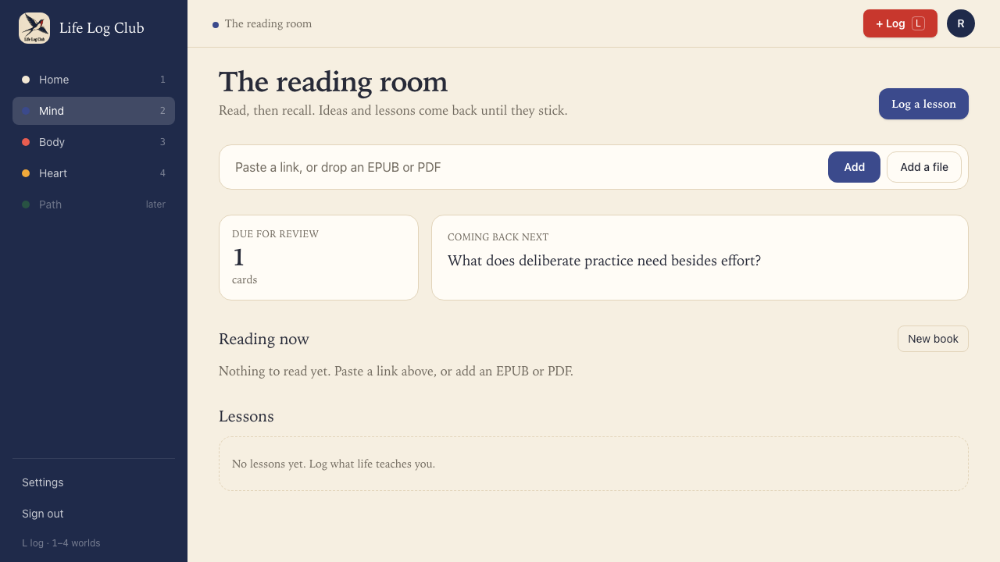
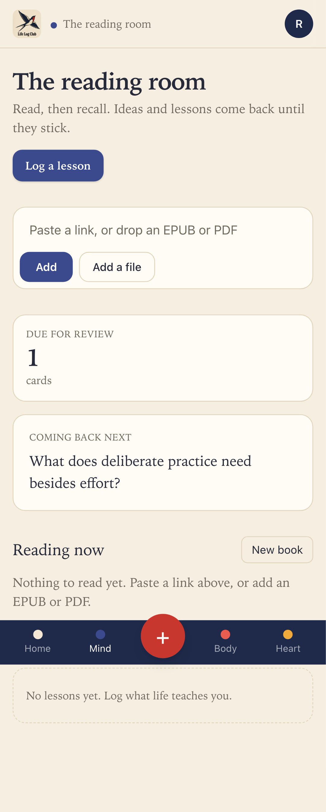

# Issue #6: Add key ideas and questions to the data model

Release 1, task 1 of 31. Spec: `learning_spec.md` sections 4.2, 4.3 and 7.5.

## What was built

No UI. This is the data the recall loop stands on.

- **Cards** now hold key ideas from readings, not only ideas and lessons added by hand. New columns: `reading_id`, `section_id`, `position`, `origin` (`ai` or `member`), `quote` (the sentence of the source the idea rests on), `details` (for words later), `level` (index into the question levels), `started_at` and `deleted_at`. `kind` also accepts `word`.
- **Questions** is a new table: one card has several questions at rising levels. A question has a `type`, a `level`, its `content` (answer key included), a `prompt_version`, and `retired_at` and `report` for questions a member reports.
- **Review log** rows can now say much more about an answer: `answer_id` (client-chosen, unique, so a double tap counts once), `question_id`, `ask` (`question`, `cue` or `self`), `mode` (`recall`, `review` or `practice`), `correct`, `response`, `confidence`, `feedback`, `graded_by`, `overridden_at`, `predicted_recall` and `scheduler`.
- Every new table has `user_id` and the same row-level security policy as the rest, so a member only ever sees their own rows.
- `packages/domain/src/questions.ts`: the question type registry, ported from the old app with `short_answer` only. It owns the content shape, what the learner may see before answering (`toPrompt`), the response it accepts, and the grading. The judge only marks each must-have point covered, vague or missing; `scoreRubric` turns that into a score of 0 to 4 in code, and `ratingForScore` turns the score into a rating.
- `packages/domain/src/ideas.ts`: `pickQuestion` (the next question for a card: unasked, at its level, easier first) and `answerIdea` (a right answer moves a card up a level, a wrong one moves it down; only the first answer in one sitting sets the schedule, but a later wrong answer still counts).

## Behaviour that changed

- Only **started** cards are in the review queue, and removed cards are not. A key idea the AI writes waits until the member first recalls it. Existing cards were backfilled with `started_at = created_at`, so nothing already due disappeared. Cards added by hand (`review.add`) start at once, as before.

## Decisions

- Question levels keep the old spelling (`analyze`), so ported prompts and tests work unchanged.
- The old mastery rule (3 right days, then monthly) was not ported: FSRS replaces it in Release 2.

## Proof

Tests:

- `packages/domain/src/questions.test.ts`: ported short-answer grading, `scoreRubric`, `answerIdea` and `pickQuestion` tests (26 domain tests pass).
- `apps/server/src/learning/rls.test.ts`: member B sees none of member A's cards, questions or answers, and can't write a question for A.
- `e2e/review.spec.ts`: an answer from the queue is logged as `ask = self`, `mode = review`, `scheduler = steps-ease-v1`, and the 1, 2, 3 day steps still hold.
- Full run: `pnpm typecheck`, `pnpm test` (144 tests) and `pnpm e2e` (80 passed) are green.

Existing review still works: a card added by hand is due at once on Mind.

| Desktop | Phone |
| --- | --- |
|  |  |

Run again with `PROOF=issue-06 pnpm exec playwright test e2e/worlds.spec.ts`.
