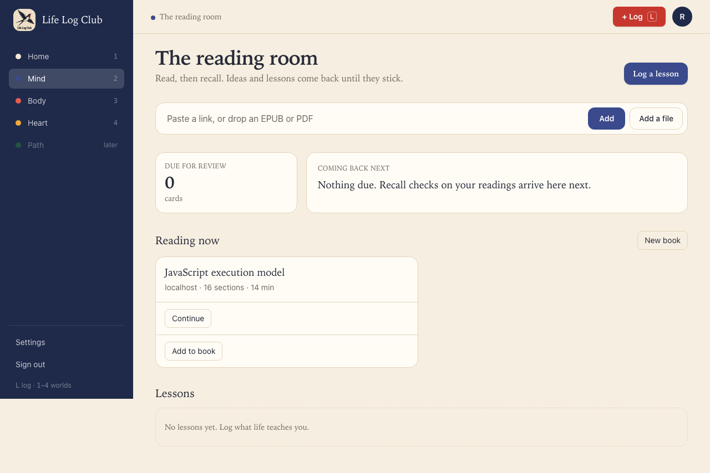
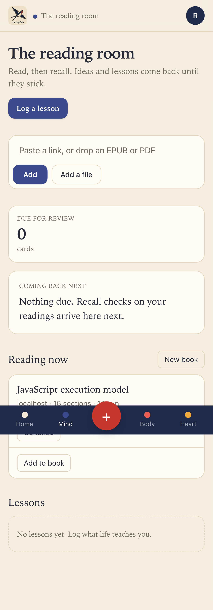
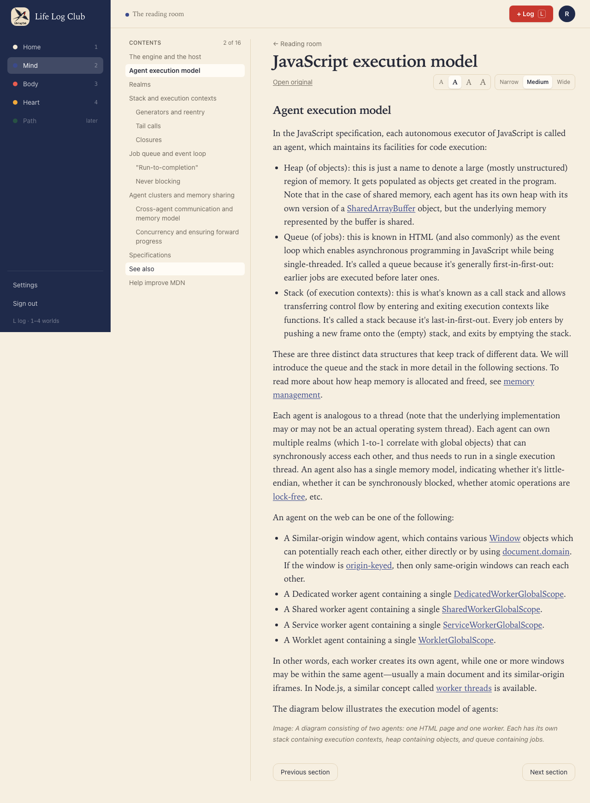
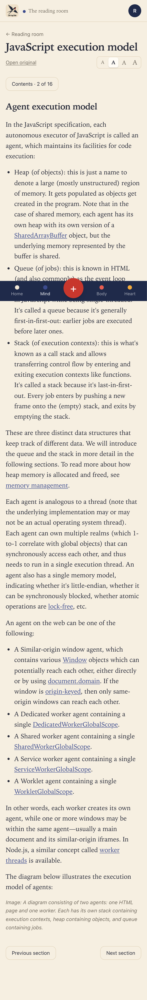

# Issue #7: Remember where the member stopped reading

Release 1, task 2 of 31. Spec: `learning_spec.md` section 7.2.

## What was built

- **Position memory.** `readings.position` holds the section and the block at the top of the screen, and `readings.last_opened_at` when it was saved. The reader saves it 2 seconds after scrolling stops (`readings.savePosition`), and at once when the member moves to another section. Opening the reading again opens at that section and scrolls that block to the top.
- **Continue on a reading.** A reading on Mind that the member has opened, and not finished, shows **Continue**. A book's Continue already opened its next chapter; that chapter now also opens where the member stopped.
- **Seen signal.** `readings.seen({ sectionId, seconds })` is a heartbeat the reader sends for every 30 seconds (`SEEN_SECONDS` in `packages/contract`) the member spends in one section with some activity: a scroll, a key or the pointer in the last minute, with the tab visible. The first heartbeat sets `sections.first_seen_at`; every heartbeat adds to the day's `reading_time`. Issue #9 queues the writing of key ideas from it.
- **Read sections.** `sections.read_at` is set the first time a section's end is on screen. `readings.markRead` now takes the section; reaching the end of the last section still marks the whole reading read, as books count it.

## Behaviour that changed

- A member who leaves a reading and comes back is where they were, not at the start.
- Each section now records when it was first seen and first read; the contents list can show these dots in a later issue.

## Bug found and fixed

- The reader kept one `SectionView` for every section, so its "scroll to the saved block once" flag carried over from the first section and the saved place was never scrolled to. Each section now gets its own view (`key={section.id}`), and the reader is placed before the first paint, so the first section doesn't flash.

## Decisions

- Reading days in `reading_time` are UTC until members can set a time zone (spec 4.3 adds `preferences.timezone` later).
- The block is the finest place kept, as the spec says. A long block partly scrolled past opens at its top.
- On phones, the full-page captures below draw the fixed bottom bar where the first screen ends. On a real phone the page has room under its last line (`pb-28`), so nothing is hidden.

## Proof

Tests (in `e2e/mind-read.spec.ts`, at desktop and phone sizes):

- **Continue opens the section where the member stopped, and a section is seen after 30 seconds in it.** Opens a reading, goes to section 2, leaves for Mind, clicks **Continue**, and checks section 2's title. With Playwright's clock, 25 active seconds leave `first_seen_at` empty, and 31 set it; the first section, open for a moment only, stays unseen.
- **Reloading keeps the place within a section.** Scrolls to the end of a long section, waits for the save, reloads, and checks the saved block is back at the top of the screen.
- `e2e/mind-books.spec.ts` still passes: Continue opens a book's first chapter not read, and reaching its end marks it read.
- Full run: `pnpm typecheck`, `pnpm test` (144 tests) and `pnpm e2e` (84 passed, 18 skipped) are green.

| Desktop | Phone |
| --- | --- |
|  |  |
|  |  |

Run again with `PROOF=issue-07 pnpm exec playwright test e2e/mind-read.spec.ts`.
