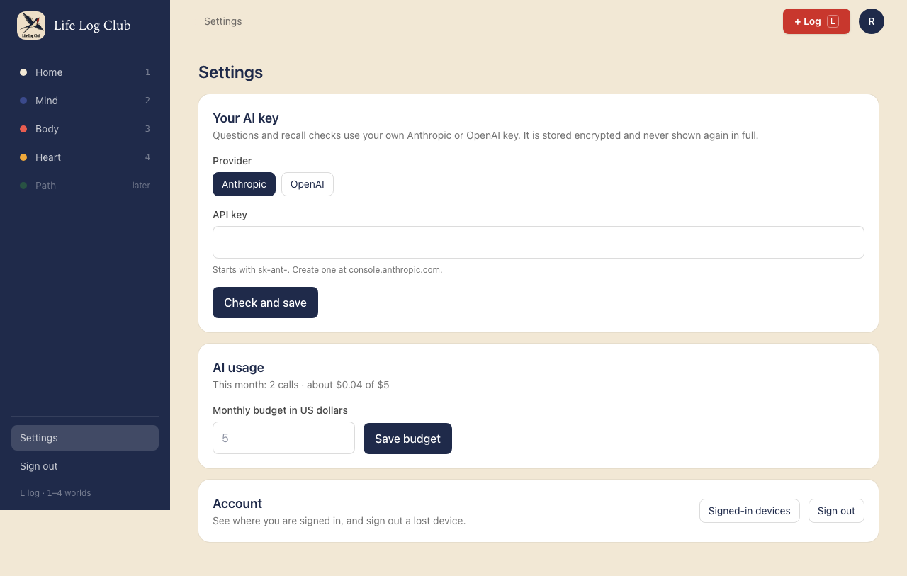
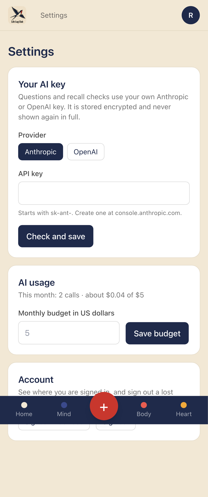
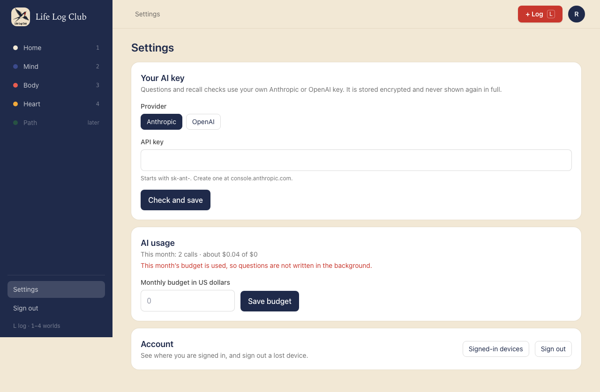
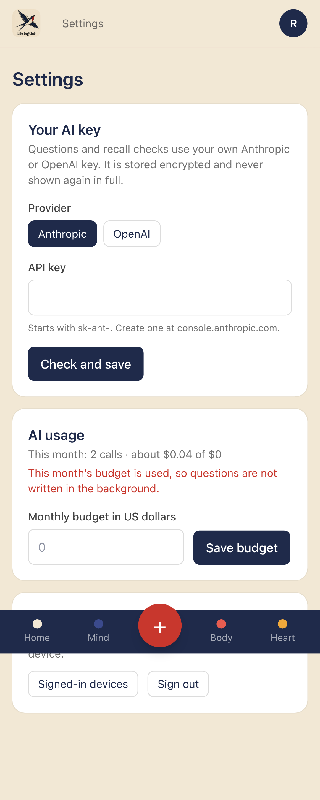
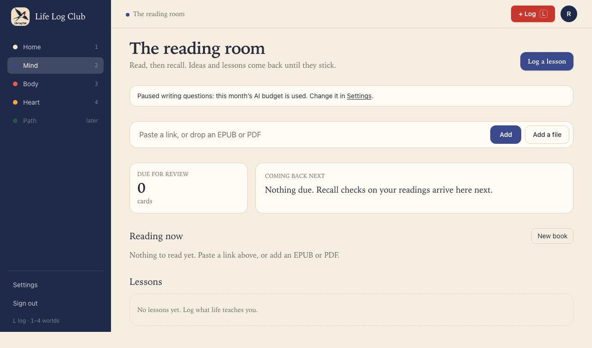
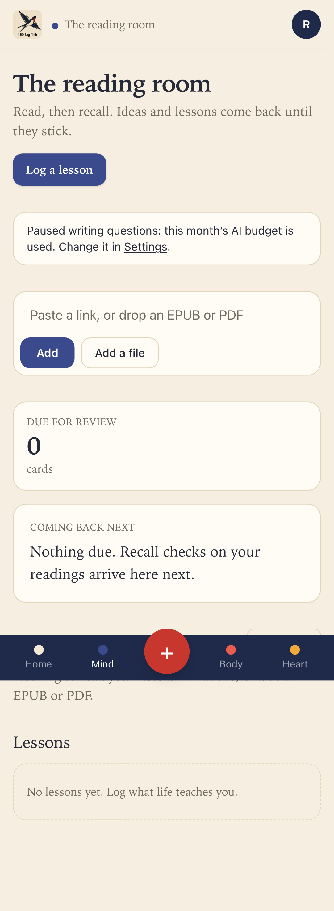

# Issue #8: Track AI usage and stop at a monthly budget

Release 1, task 3 of 31. Spec: `learning_spec.md` section 6.3.

## What was built

- **Prices.** `packages/llm/src/prices.ts` is a small hand-kept table of list prices per million tokens by model family (Haiku, Sonnet, Opus, and the small and large OpenAI families). `estimateCost` gives null for a model with no known price.
- **This month's usage.** `monthUsage` in `apps/server/src/learning/ai.ts` adds up this calendar month's `ai_calls` rows (UTC) by model: calls, tokens and an estimated cost, against the member's budget. `ai.usage` returns it.
- **Preferences.** A new `preferences` table, one row per member, with every setting the spec lists (time zone, question amount and style, quality check, Guess first, review target, AI budget, review batch) and their defaults. The row is written with its defaults the first time it is read. `preferences.get` and `preferences.update` expose the budget for now; later issues add their own settings.
- **The one budget check.** `withinBudget(userId)` is false once this month's estimated spend reaches the budget (default $5). Background AI work calls it before it spends. Today that is the AI headings for long articles without headings; the key-idea writing of issue #9 will call it too. Work the member waits on, such as grading, does not ask.
- **Settings → AI usage.** The line "This month: 2 calls · about $0.04 of $5", a field to change the monthly budget, and a red line once the budget is used. For a model with no known price, the line shows tokens instead of money.
- **Mind.** One calm line when the budget is used: "Paused writing questions: this month's AI budget is used. Change it in Settings.", with a link to Settings.

## Behaviour that changed

- A member who has used this month's budget gets no AI headings on new long articles until next month or a higher budget; the article is cut by length instead, as without a key.

## Decisions

- The month is the calendar month in UTC until members can set their time zone.
- A model with no known price counts in calls and tokens but not in money, so it can't reach the budget. Money is never guessed.
- A budget of $0 means "no background AI spending at all".

## Proof

Tests:

- `apps/server/src/import/reading.test.ts`: a member with a key and a $0 budget adds a long article without headings; no AI call is made (no `ai_calls` row) and the article stays one section, cut by length.
- `e2e/ai-key.spec.ts`, **Settings shows this month's AI use against the budget**: two calls this month (10,000 tokens in and 2,000 out each, on Haiku) and one from 40 days ago give "This month: 2 calls · about $0.04 of $5"; Mind has no paused line. A budget of 0 shows "… of $0", and Mind shows the paused line, whose Settings link opens Settings. Desktop and phone.
- Full run: `pnpm typecheck`, `pnpm test` (144 tests) and `pnpm e2e` (86 passed, 18 skipped) are green.

| Desktop | Phone |
| --- | --- |
|  |  |
|  |  |
|  |  |

Run again with `PROOF=issue-08 pnpm exec playwright test e2e/ai-key.spec.ts`.
