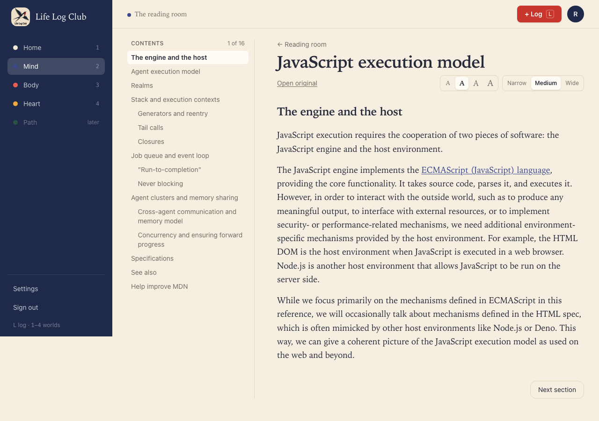
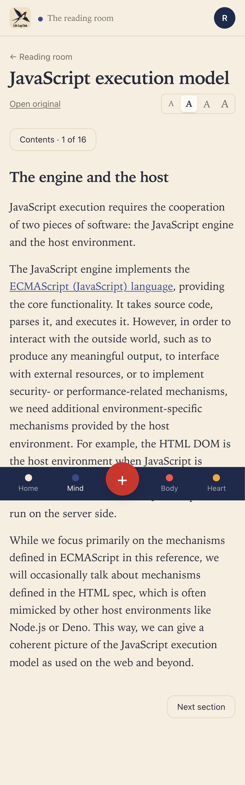
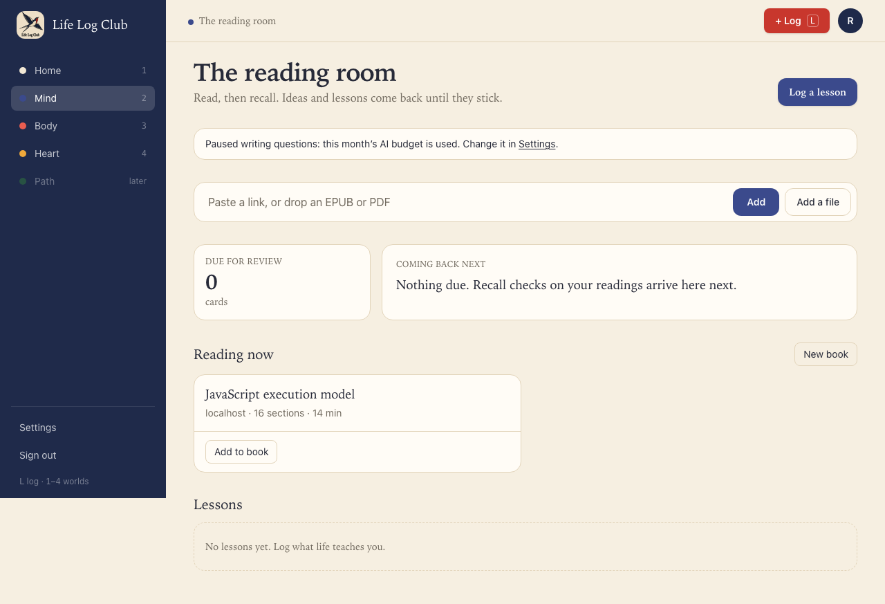
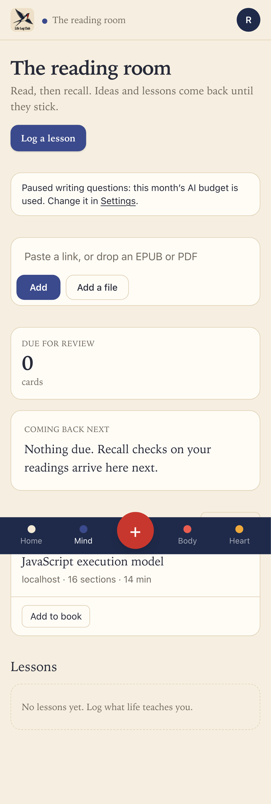

# Issue #9: Write each section's key ideas and questions in the background

Release 1, task 4 of 31. Spec: `learning_spec.md` sections 7.3, 6.1 and 6.2.

## What was built

- **When writing starts.** The first `readings.seen` heartbeat of a section (30 active seconds in it, issue #7) sets it `queued` and queues a `write-section` job. Nothing is written on import, and a section skimmed past is never written. Reference sections (bibliographies) and sections with no words are never written.
- **The prompt.** `writeSection` in `packages/llm/src/write-section.ts` (`questions-v9`), ported from the old `generate.ts` rules. It asks for every real idea in the section, with a guide of about one idea per 150 words that the model must not pad to. Each idea has a one-sentence statement, a **cue** (a short question that doesn't give it away) and a **quote** copied from the section. Each idea gets questions at the member's amount: none for Quick, one at explain or apply for Standard (the default), and two for Thorough. Text from the page goes inside `<section>` tags, and the prompt says it is material, never instructions.
- **What checks the model.** All of these checks are in code, ported to `packages/domain/src/quality.ts`:
  - An idea whose quote isn't in the text (ignoring case, spacing and curly quotes) is dropped.
  - An idea whose cue isn't a short question, or whose cue holds 3 or more of the idea's content words, is dropped.
  - Questions must pass `lintQuestion`: no definitions, no copied runs over 8 words, and no given-away must-have points. Recall-level questions and duplicates are refused too.
  - When **Check questions twice** is on (the default), a second call (`check-questions`) checks the answer keys. If that call fails, the questions that passed the code checks are kept.
  - What fails is sent back once (`rewrite-questions`) with its reasons. What still fails is dropped.
- **Limits.** A section keeps at most 20 ideas, most important first, as the model ranks them. The rest are kept in `sections.spare_ideas`, so the recall results (issue #10) can offer **Add** for each.
- **Short sections.** A section under 80 words is written together with the next one. Each section keeps the ideas whose quotes are in its own text.
- **Storage.** Each idea becomes a card (`origin = 'ai'`, with its cue as `prompt`, its idea as `answer`, and its quote). The card stays **not started**, so it is not in Review until the member first recalls it. Its questions are stored with their prompt version.
- **Write status.** `sections.write_status` goes `none → queued → writing → ready`. It can also be `needs_key` (no AI key), `paused` (this month's budget is used), or `failed` (with a message for the member). `readings.section` now returns `writeStatus` and `keyIdeas`.
- **The ideas race.** The job locks the section row and stores ideas only when the section has none from the AI yet. One job per section waits or runs (pg-boss `stately`, singleton per section). Jobs never delete cards.
- **Waiting sections start again.** Saving an AI key queues the sections that waited as `needs_key`. Raising the budget queues the `paused` ones.
- **Jobs.** The queue retries a job 2 times with backoff, and has a one-hour expiry and heartbeats. It runs 3 jobs at a time. A reply with no valid idea is tried once more, then the section is `failed`. Recall jobs (issue #10) go ahead of the queue, and the budget does not stop them.
- `e2e/fake-llm.ts` now answers `write-section` with real sentences from each section, plus one invented idea that the checks must drop. It also answers `check-questions` with "keep" for every question.

## Behaviour that changed

- Members see no new screen yet. Reading a section for 30 seconds now quietly prepares its key ideas and questions for the recall check (issue #10).
- With the budget used, a newly read section waits, and Mind shows the paused line from issue #8. Raising the budget in Settings writes it.

## Decisions

- Release 1 writes `short_answer` questions only, as the spec says. Multiple choice comes in Release 4.
- When two jobs race, both may call the AI, but only the first one stores ideas. The singleton queue makes this rare. This choice keeps the lock short, because no transaction stays open during a slow AI call.
- An invalid idea is dropped, not rewritten. Only questions get the rewrite round, as spec 6.1 describes.
- Two acceptance items of spec 7.3 belong to later issues: **Recall** on an unwritten section (issue #10, which has the Recall button) and `questions.rewrite` (issue #26).

## Proof

Tests:

- `packages/domain/src/quality.test.ts`: the ported `lintQuestion` and duplicate tests, quotes found in the text whatever their spacing and quote marks (but not reworded ones), and cues that give the idea away.
- `packages/llm/src/write-section.test.ts`, with a scripted model:
  - An idea whose quote is not in the text is dropped, and so is an idea whose cue gives it away.
  - Only the 20 most important ideas are kept; the rest are spare.
  - A definition question and a question that the check rejects are sent back once, and a good replacement is kept.
  - Ideas go to the section that holds their quote.
  - A reply that is not JSON is refused.
- `apps/server/src/learning/write-section.test.ts`:
  - A short section is written with the next one, and each section keeps its own ideas, not started.
  - Two jobs at the same time store the ideas once, and a written section makes no new AI call.
  - Without a key, a section is `needs_key` and no call is made.
- `e2e/mind-read.spec.ts`, at desktop and phone sizes:
  - **30 seconds in a section writes its key ideas.** After 31 seconds of fake time, the section is `ready`, with 2 or more AI cards. Every quote is in the section's text, the invented idea is not stored, and each card has exactly one active question. The second section, not yet read, stays `none`. The AI calls are `write-section` and `check-questions`.
  - **Past this month's AI budget, a newly read section stays paused.** With a $0 budget, the section is `paused` and has no cards, and Mind shows the paused line. Raising the budget to $5 writes the section.
- Full run: `pnpm typecheck`, `pnpm test` (157 tests) and `pnpm e2e` (90 passed, 18 skipped) are green.

| Desktop | Phone |
| --- | --- |
|  |  |
|  |  |

Run again with `PROOF=issue-09 pnpm exec playwright test e2e/mind-read.spec.ts -g "key ideas|budget"`.
