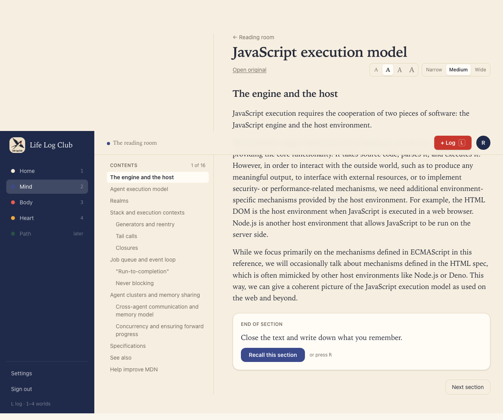
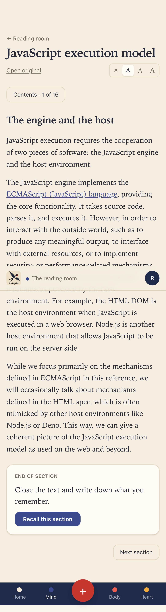
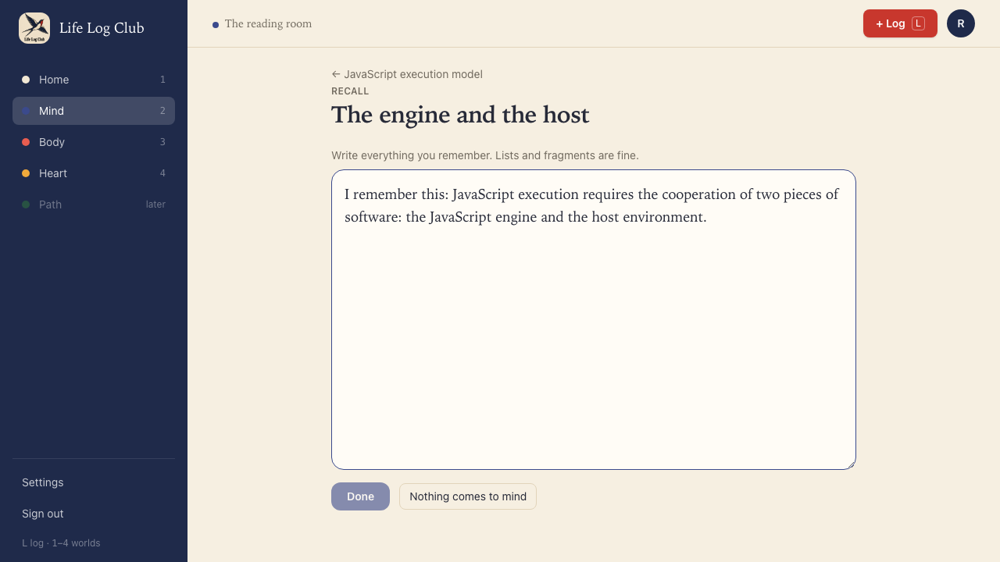
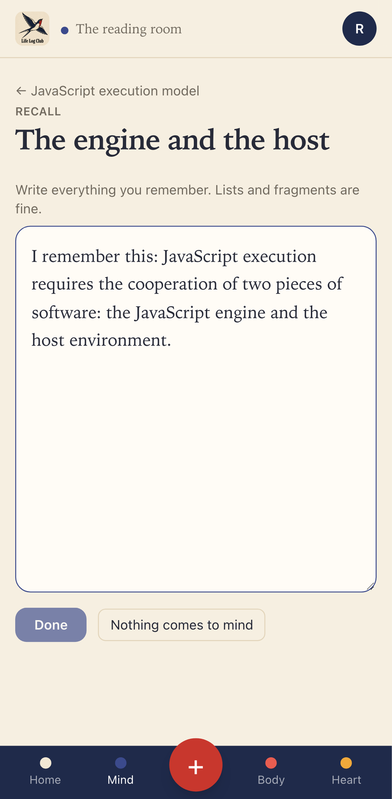
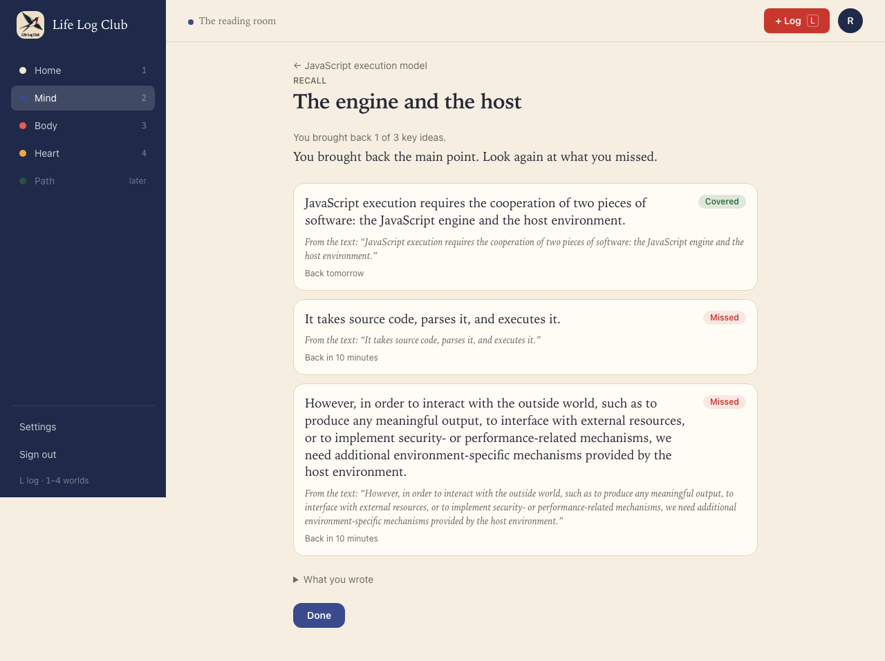
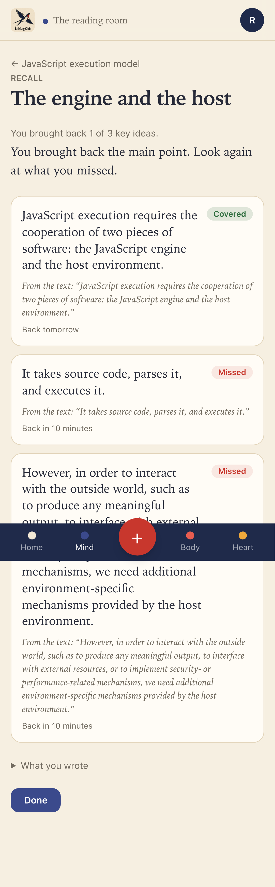
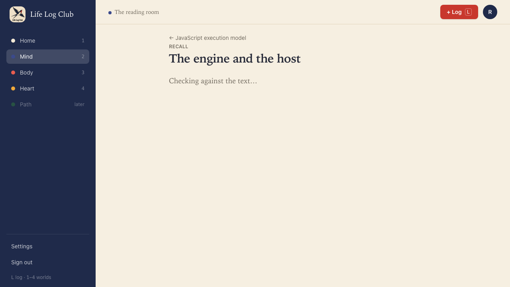
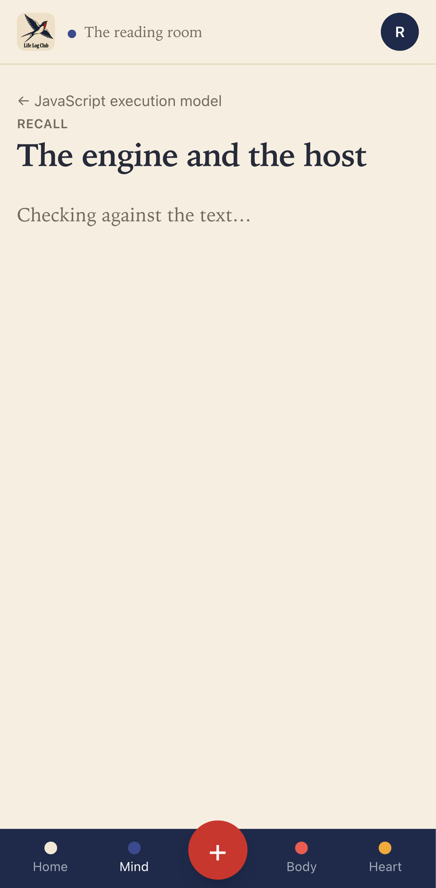
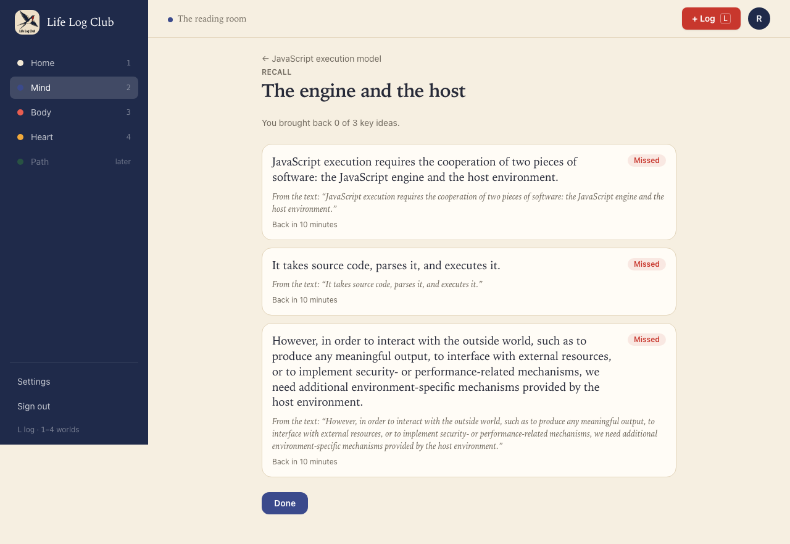
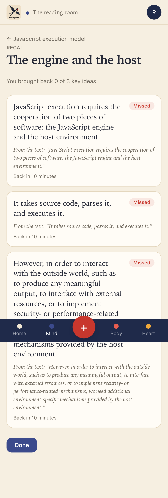

# Issue #10: Brain dump after a section, graded against its key ideas

Release 1, task 5 of 31. Spec: `learning_spec.md` section 7.4 (steps 1, 2 and 4, and "How cards start").

## What was built

- **Recall this section.** An index card at the end of every section with words ("End of section · Close the text and write down what you remember."). One click, or the `R` key, starts a recall check (`recall.start`) and opens `/mind/recall/$attemptId`. Bibliography sections have no card.
- **The brain dump.** The text is hidden. The page shows the reading, the section title and one large box: "Write everything you remember. Lists and fragments are fine." **Done** sends the dump. **Nothing comes to mind** sends an empty dump, which marks every idea missed without an AI call.
- **Recall before the ideas exist.** If the member presses Recall before the 30 seconds that start writing, the section's key ideas are written now: ahead of other jobs and past the monthly budget, because the member is waiting. The dump opens at once. After **Done**, the page shows "Checking against the text…" and checks again every 2 seconds. When the writing ends, the write job wakes every attempt in that reading that waits on it.
- **Grading.** The `grade-recall` job (ported from the old `recall.ts`, prompt `recall-v2`) marks each key idea covered, vague or missing, and writes 1 to 3 sentences of feedback. A mark the reply doesn't give clearly counts as missing. The dump goes inside `<dump>` tags, which the prompt treats as material, never instructions. The job is retried 2 times; then the attempt is `failed`, with **Try again**. Without an AI key the attempt is saved as `self`, and the page points to Settings (issue #15 adds self-marking).
- **Results.** The recall map: each key idea with its mark (Covered, Vague, Missed), its quote ("From the text: …") and when it comes back ("Back tomorrow", "Back in 10 minutes"). Then "You brought back N of M key ideas", the feedback, and the dump under **What you wrote**. **Done** goes back to the reader at the next section.
- **How cards start.** Each key idea's card starts from its dump mark: covered is `good` (back in 1 day), vague is `hard` (back in 1 day, the same step), missed is `again` (back in 10 minutes). `started_at` is set, so the card enters Review. Its level is set by the mark for the questions of issue #11: missed starts at recall (its cue), vague at explain, and covered at its highest stored question. Each mark is logged in `review_log` with `mode = 'recall'`. `sections.recalled_at` records the first finished recall.
- **Privacy.** The dump is encrypted at rest (`recall_attempts.text_ct`), as you decided. The table is under row-level security like every other member table.

## Behaviour that changed

- The recall loop now works from the reader: read, Recall, dump, results. After a recall, the section's ideas are in Review: missed ones in 10 minutes, the rest tomorrow.
- Grading a dump uses the member's AI key, but it is not stopped by the budget, because the member is waiting (spec 6.3).

## Decisions

- No questions yet. Issue #11 adds them between the dump and the results; the levels are already set for it.
- An idea marked vague is rated `hard`. On the first step that brings it back in 1 day, the same as covered, which is what the scheduler does today.
- **Done** with an empty box is disabled, so an empty dump is always the honest **Nothing comes to mind**.
- Times on the results round up, so a card due in 10 minutes reads "Back in 10 minutes" a few seconds later too.

## Proof

Tests (in `e2e/mind-read.spec.ts`, at desktop and phone sizes):

- **After reading, Recall hides the text, grades the dump against each key idea, and starts the cards.** After 30 seconds the ideas are written. **Recall this section** opens the dump with no section text and the box focused; **Done** is disabled until something is typed. The dump states the first idea. The map lists every idea; the first is Covered, has its quote and is "Back tomorrow". In the database, every card has started, covered and vague ones are due in 1 day (± 1 minute), missed ones in 10 minutes at level 0, and the covered one is at level 1. The stored dump is encrypted, and **What you wrote** shows it. **Done** opens the reader at the next section.
- **Recall on a section not written yet opens the dump at once, and Nothing comes to mind marks every idea missed.** The dump opens before any idea exists; after **Nothing comes to mind**, "Checking against the text…" shows while the ideas are written; then every idea is Missed and "Back in 10 minutes", and no grading call was made.
- `packages/llm`: a grading reply with an unreadable mark counts that idea missing, and a reply with no marks is refused.
- Full run: `pnpm typecheck`, `pnpm test` (158 tests) and `pnpm e2e` (94 passed, 18 skipped) are green.

The fake AI now waits 1.5 seconds before it writes a section, as a real one does, so the waiting line can be seen.

| Desktop | Phone |
| --- | --- |
|  |  |
|  |  |
|  |  |
|  |  |
|  |  |

On phones, the full-page captures draw the fixed bottom bar where the first screen ends; on a real phone the page has room under its last line, so nothing is hidden.

Run again with `PROOF=issue-10 pnpm exec playwright test e2e/mind-read.spec.ts -g Recall`.
