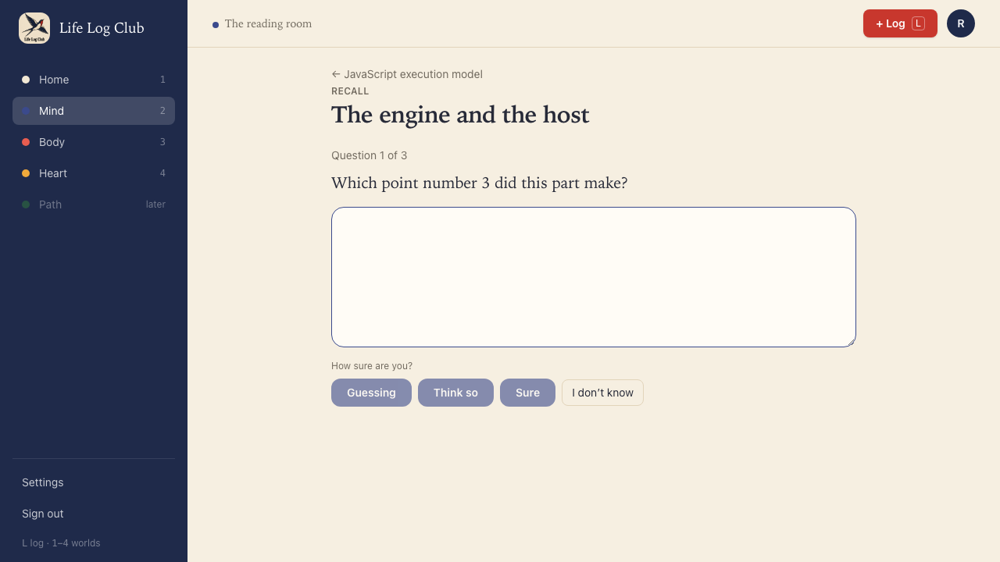
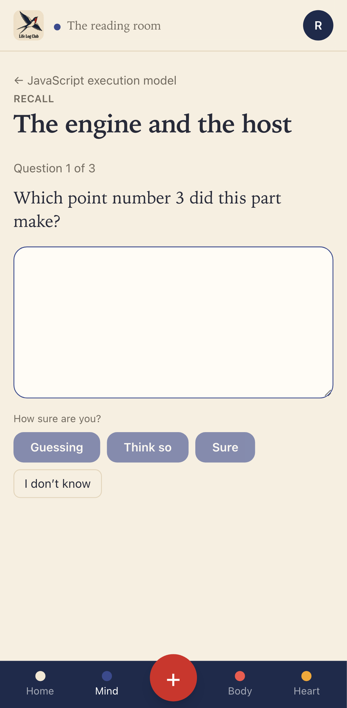
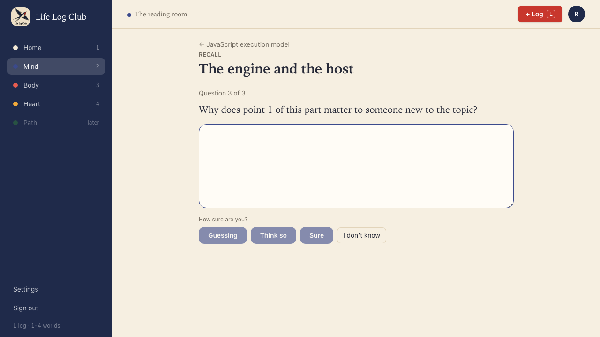
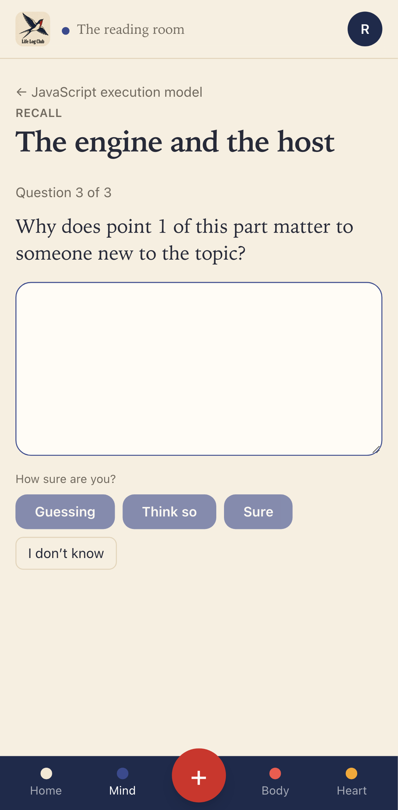
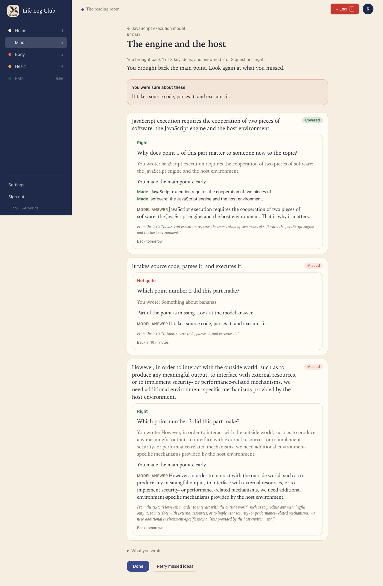
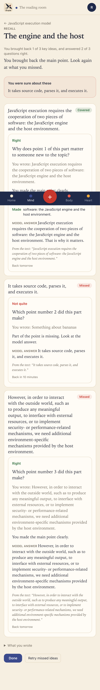
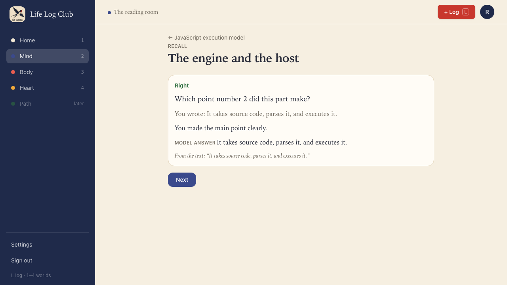
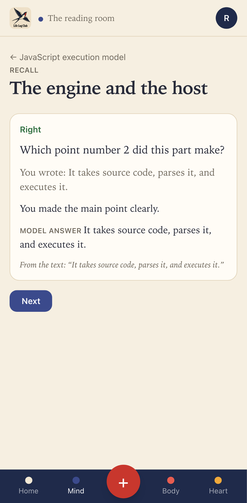
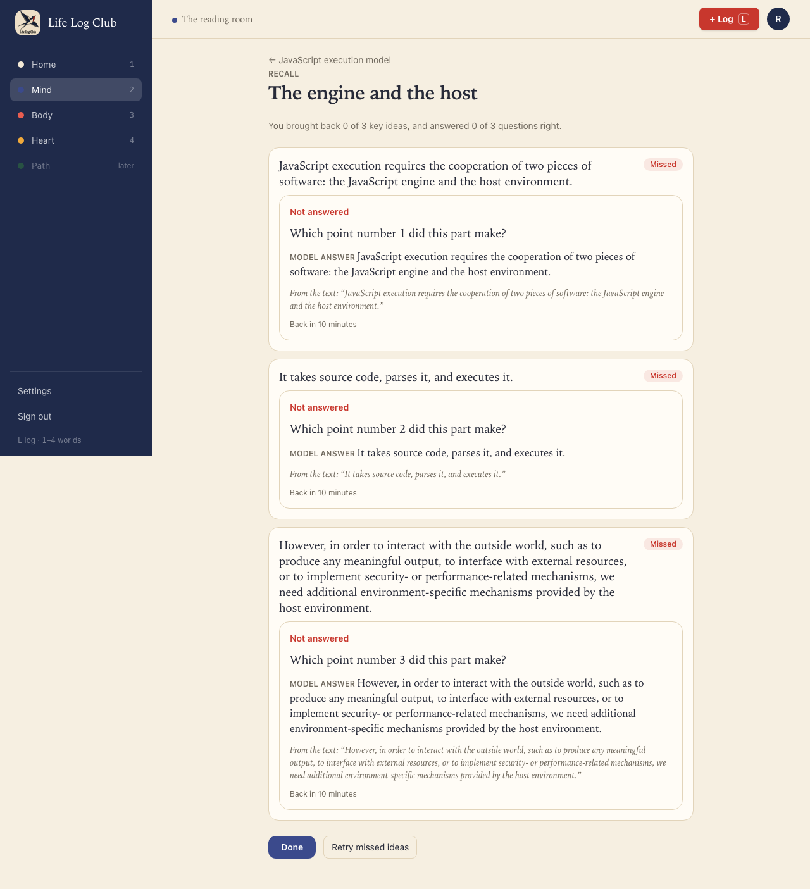
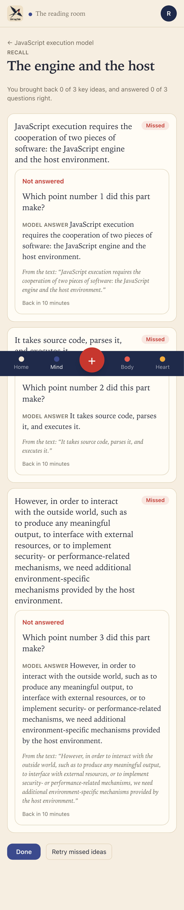

# Issue #11: Ask one question per idea after the dump

Release 1, task 6 of 31. Spec: `learning_spec.md` section 7.4 (step 3, step 4 and "Deeper questions for covered ideas"), 7.6 (written answers judged by AI) and 7.8 (confidence only; Guess first comes later).

## What was built

- **Questions after the dump.** After the dump is graded, the recall page asks one question per key idea: "Question 1 of 3", the question, one answer box (focused), and the confidence buttons **Guessing**, **Think so** and **Sure**. The confidence buttons are the submit, so saying how sure you are costs no extra click. **I don't know** is an honest miss and needs no text.
- **The question fits the dump mark** (spec table in 7.4):
  - A missed idea is asked its cue ("Which point did this part make?"), the simplest retrieval. It starts at level 0 (recall).
  - A vague idea is asked its lowest stored question. It starts at level 1 (explain).
  - A covered idea is asked its highest stored question, a "why" or "how" above recall, not a repeat of what the dump already said. It starts at that question's level.
- **Order.** Missed ideas first, then vague, then covered (`orderForTest` in `packages/domain`). Written questions come before choice questions, and ideas are shuffled within each group.
- **No result before the last answer.** The questions share one section, so one result could give away the next answer. The API holds the results back too: `recall.get` returns `ideas: null` until every question is answered.
- **Results** (extends the #10 recall map):
  - "You brought back N of M key ideas, and answered K of M questions right."
  - **You were sure about these**: ideas answered wrong with **Sure**, first, because confident errors are the ones most worth fixing.
  - For each idea: its dump mark, then the answer tile: the verdict (Right, Not quite or Not answered), what the member wrote, the judge's feedback, the must-have points made or missed, the model answer, the quote, and when the idea comes back.
  - **Retry missed ideas**: each idea answered wrong is asked again through its cue, with its result at once. This is `practice` mode: the schedule and the level stay as they are.
- **How cards start, now.** A card starts from its first answer in the session, not from the dump mark. A right answer moves the start level one up, and a miss one down (never below 0). The answer's rating sets when it comes back: right is back in 1 day, a miss in 10 minutes.
- **Confidence lowers credit, never raises it.** A right answer with **Guessing** counts as `hard`; `easy` with **Think so** counts as `good`. A wrong answer stays wrong however sure the member was.
- **One answer endpoint for every mode.** `review.answer` now takes an `Answer`: a stored question, a cue (both written, judged by the member's AI key), or a self-rating. It carries the `answerId` chosen by the client, the mode (`recall`, `review` or `practice`), the recall attempt and the confidence. It returns the verdict, the rating, the reveal and the new due time. Each answer is logged in `review_log` with its mode, confidence, reveal and attempt.
- **The AI judge.** `packages/llm/src/judge.ts` (prompt "Task: judge-answer", 20 second timeout) asks the model only to mark each must-have point covered, vague or missing, and to name a misconception. The score is computed in code (`scoreRubric`): all points covered is 4, a misconception caps it at 1. The judge call runs outside the transaction that locks the card, so a slow model holds no lock.

## Behaviour that changed

- The #10 recall flow now has a questions step between the dump and the results.
- Cards no longer start from their dump mark. The dump only sets the level each card starts at; the answer starts it.
- **I don't know** on every question, after **Nothing comes to mind**, needs no AI call at all: every card starts at level 0 and is back in 10 minutes.
- Sending the same answer twice (for example a retried request) counts once: the second call returns the first result.
- Review (`/mind/review` comes in #12) answers only cards that have started and are due. Recall and practice answer at any time.

## Bug fixed on the way

- On a cue answer the result tile showed the same sentence three times: as the one point, as the model answer and as the quote. The tile now leaves out the point list when its only point is the model answer, because the verdict line already says whether it was made.

## Decisions

- Retry asks each wrong answer again through its cue, not a stored question. The idea's stored questions stay unasked, so a later Review can ask them once its level has risen (spec 7.4).
- "Missed" in **Retry missed ideas** means answered wrong in the questions, not missed in the dump. A dump miss that the member then answered right needs no retry.
- The questions use the `QuestionForm` and `RevealTile` components in `apps/web/src/answer.tsx`, so Review (#12) shows the same form and tile.

## Proof

Tests (at desktop and phone sizes):

- **After reading, Recall asks one question per idea, missed ideas first, and shows the results only after the last answer** (`e2e/mind-read.spec.ts`). The dump covers idea 1 only.
  - Question 1 and 2 are the cues of the two missed ideas. Before the first answer no card has started; their levels are 1, 0 and 0.
  - The first missed idea is answered right with **Guessing**, and the second wrong with **Sure**. After two answers, neither the page nor `recall.get` shows any result.
  - Question 3 is the covered idea's stored "Why does point 1 … matter" question, not its cue. It is answered right with **Think so**.
  - The results say "1 of 3 key ideas, and answered 2 of 3 questions right". **You were sure about these** lists the wrong Sure answer, and not the right guess. The covered idea shows Right, the model answer and "Back tomorrow"; the wrong one shows Missed, Not quite, what the member wrote and "Back in 10 minutes".
  - In the database: the covered card is at level 2 and back in 1 day; the right guess is at level 1 and back in 1 day (rated `hard`); the wrong one is at level 0 and back in 10 minutes. `review_log` has the three answers in order, with ask, rating, correctness and confidence.
  - **Retry missed ideas** asks only the wrong one again, by its cue, marked "practice, your schedule stays as it is". Answered right, its level and due time do not change, and the log row has `mode = 'practice'`. The retry button then goes away. **Done** opens the reader at the next section.
- **Recall on a section not written yet opens the dump at once; Nothing comes to mind, then I don't know on each cue, keeps every idea due in 10 minutes.** Every question is a cue. Every tile says Not answered, there is no "You were sure about these", every card starts at level 0 and is due in 10 minutes, and no `grade-recall` or `judge-answer` call was made.
- **The same answer sent twice counts once** (`e2e/review.spec.ts`).
- `packages/domain`: `withConfidence` only lowers credit; `orderForTest` puts missed, then vague, then covered.
- `packages/llm`: `parseJudgeVerdict` scores in code, counts unreadable points missing, caps a misconception at 1, and refuses a reply with no JSON.
- Full run: `pnpm typecheck`, `pnpm test` (161 tests) and `pnpm e2e` (94 passed, 18 skipped) are green.

The fake AI judges a written answer by the long words it shares with each must-have point, so a test picks the verdict by what it types. Its feedback now matches the verdict.

| Desktop | Phone |
| --- | --- |
|  |  |
|  |  |
|  |  |
|  |  |
|  |  |

On phones, the full-page captures draw the fixed bottom bar where the first screen ends; on a real phone the page has room under its last line, so nothing is hidden.

Run again with `PROOF=issue-11 pnpm exec playwright test e2e/mind-read.spec.ts -g Recall`.
