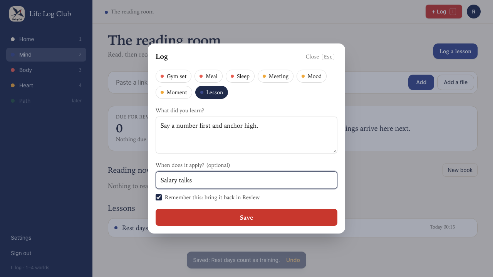
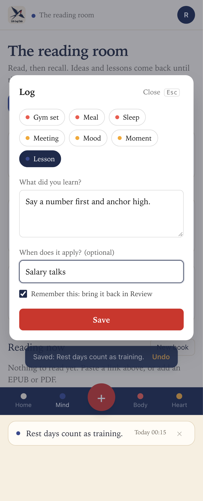
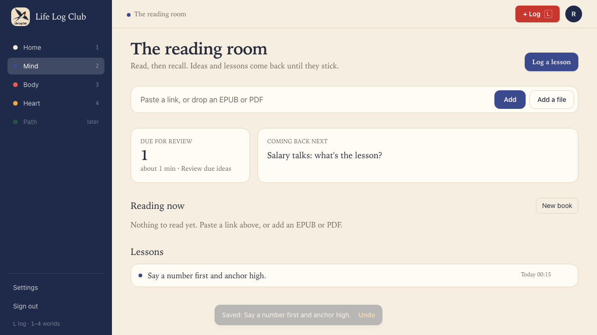
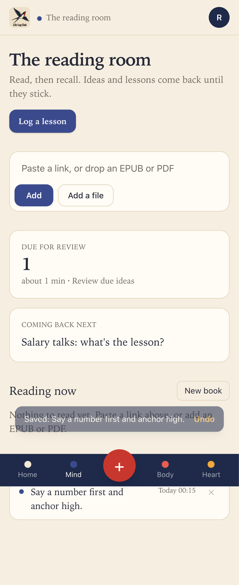
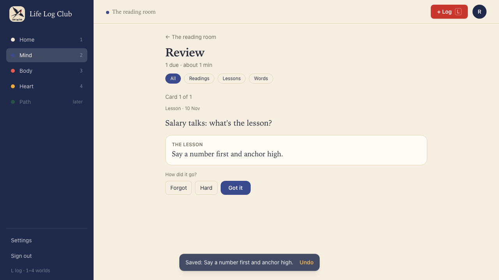
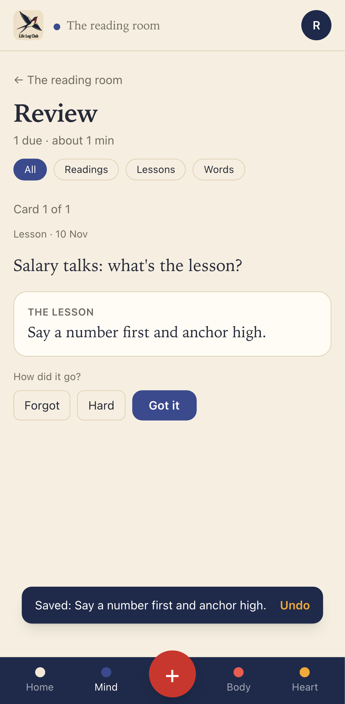

# Issue #13: Turn a logged lesson into a review card

Release 1, task 8 of 31. Spec: `learning_spec.md` section 7.10 (Life lessons in the same queue).

## What was built

- **+ Log → Lesson** has two fields and a box:
  - **What did you learn?** (required, as before).
  - **When does it apply? (optional)**, such as "Salary talks". It is saved as the entry's `details.cue`.
  - **Remember this: bring it back in Review**, ticked by default. Untick it to log a lesson with no card.
- **Save is still one click.** In the same transaction as the entry, `entries.create` makes the lesson's card:
  - `kind = 'lesson'`, `entry_id` = the entry, `answer` = the text.
  - `prompt` (the cue the card asks with): "Salary talks: what's the lesson?" when the member gave a cue, otherwise "Your lesson from 3 Nov: what was it?".
  - The card is started and due at once, like a card added with `review.add`, so the Mind due count goes up by 1 straight away.
- **An AI-written cue** for a lesson logged without one. When the member has a key, a `lesson-cue` job asks their AI for a short question about where the lesson applies (`packages/llm/src/lesson-cue.ts`). The cue must pass the same check as a key idea's cue (`lintCue`: a question, not too long, does not give the lesson away). It replaces the date cue only if the card still has it. The job is background work, so it stops at the monthly budget, and each call is in `ai_calls` with purpose `lesson-cue`.
- **Edit** (`entries.update`): a new text becomes the card's answer, and a new cue becomes its prompt. The schedule (`due_at`, `state`, `level`) stays, so an edit after reviews doesn't start the lesson over.
- **Remove and Undo** (`entries.remove` / `entries.restore`): the card is hidden and comes back with its entry (`cards.deleted_at`). The Undo in the "Saved" toast removes the entry, so it takes the due count back too.
- **Review** shows a lesson's answer under "The lesson" instead of "The idea".
- **Cleanup** now also deletes cards removed more than 30 days ago, like entries, readings and books.

## Behaviour that changed

- A lesson logged through the API now makes a card. Clients that add the card themselves with `review.add` (still supported) pass `remember: false` on `entries.create`.
- A lesson with an empty text is refused, on create and on edit: "Write what you learned, then save." The web form already required the text.
- Logging, removing or restoring any entry now refreshes the review counts in the web app, not only the entry lists.

## Decisions

- **The date in the fallback cue is the day in UTC**, as the owner chose for budgets and days.
- **A cue the member removes later** leaves the card's prompt as it is. The entry API merges details, so there is no way yet to clear a cue, and no screen edits a lesson.
- **The AI cue job runs once, with one retry.** When it fails or the cue is bad, the card keeps its date cue; nothing waits on it.
- **A retried create** (same entry id) makes no second card, because the card is only made when the entry row is new.

## Proof

UI test (in `e2e/worlds.spec.ts`, at desktop and phone sizes):

- **A lesson logged with + Log is due in Review at once with its cue, Undo takes it back, and Remember this off logs no card.** On Mind the due count is 0. **Log a lesson** with "Say a number first and anchor high." and "Salary talks": the count is 1 and "Salary talks: what's the lesson?" is listed. **Undo** in the toast: the count is 0. A lesson with **Remember this** unticked shows in the lessons list, and the count stays 0. Logged again, **Review due ideas** shows "Lesson · <today>", the cue, and after **Show answer** the lesson under "The lesson".

API tests (in `e2e/review.spec.ts`):

- **A lesson entry makes its card.** `review.due` goes from 0 to 1. A retried create makes no second card. With no cue the prompt is "Your lesson from 3 Nov: what was it?". After a review, an edit of the text and cue changes the answer to the new text and the prompt to "Skipping the gym: what's the lesson?", and `due_at` is the same. An empty text is refused on create and on edit. Once due, removing the entry takes `review.due` to 0 and the card can't be answered; restoring brings it back to 1. With `remember: false` no card is made.
- **With a key, a lesson logged without a cue gets one written by AI; a cue the member gave stays.** The fake AI's cue replaces the date cue within a few seconds, with one `lesson-cue` row in `ai_calls`. The lesson logged with "Salary talks" keeps "Salary talks: what's the lesson?".

Unit test (in `apps/server/src/jobs.test.ts`): cleanup deletes a card removed 31 days ago and keeps one removed 29 days ago and one not removed.

Full run: `pnpm typecheck`, `pnpm test` (161 tests) and `pnpm e2e` (109 passed, 23 skipped) are green.

| Desktop | Phone |
| --- | --- |
|  |  |
|  |  |
|  |  |

Run again with `PROOF=issue-13 pnpm exec playwright test e2e/worlds.spec.ts -g "lesson logged"`.
