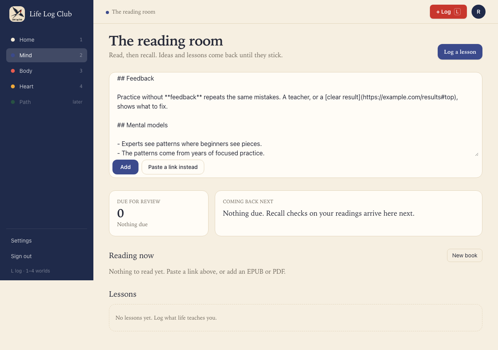
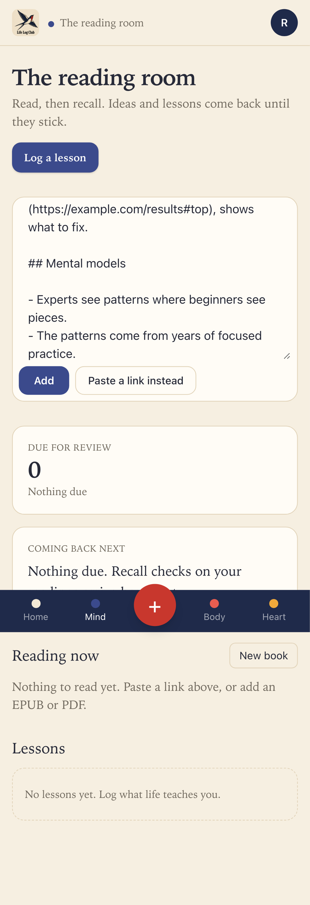
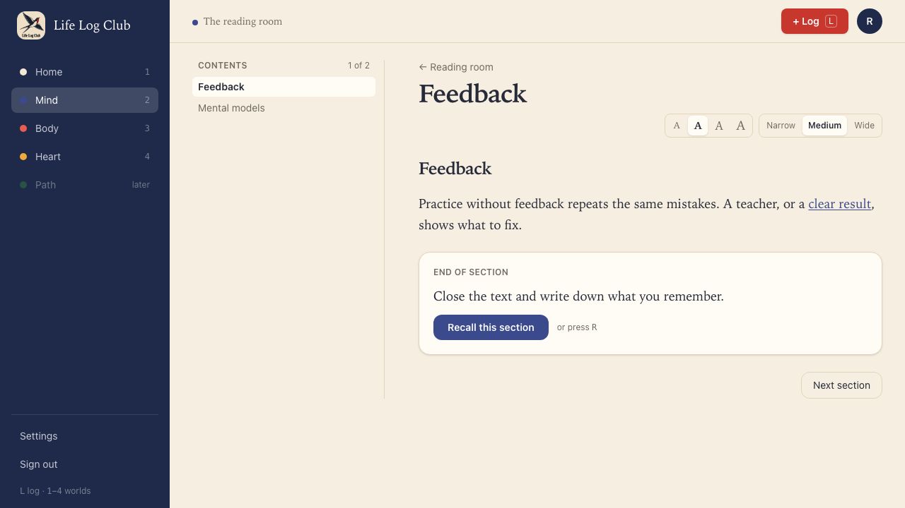
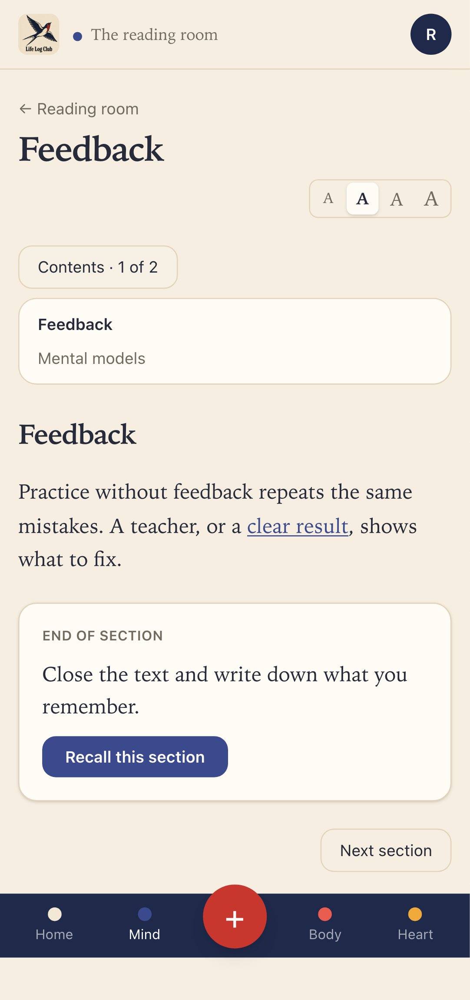
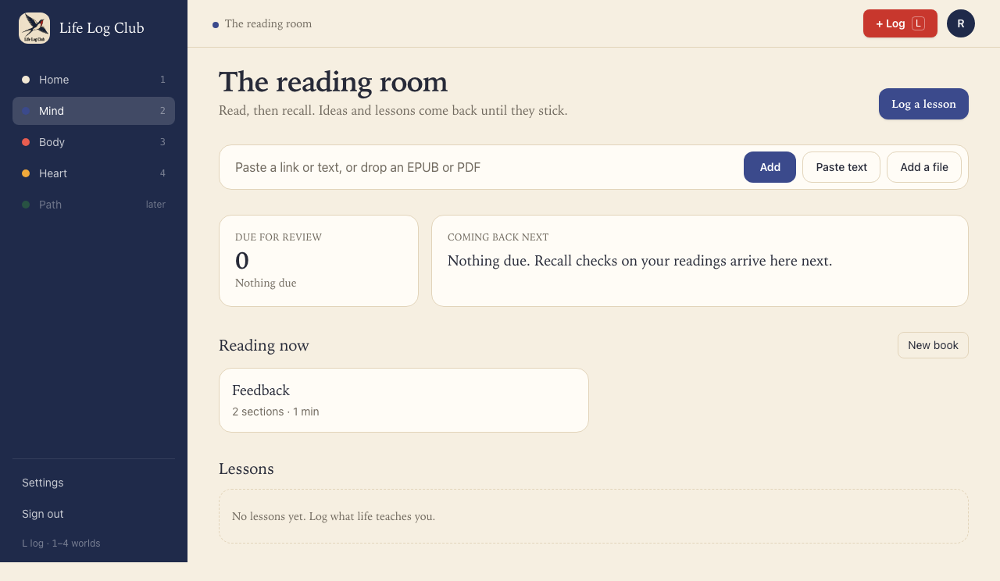
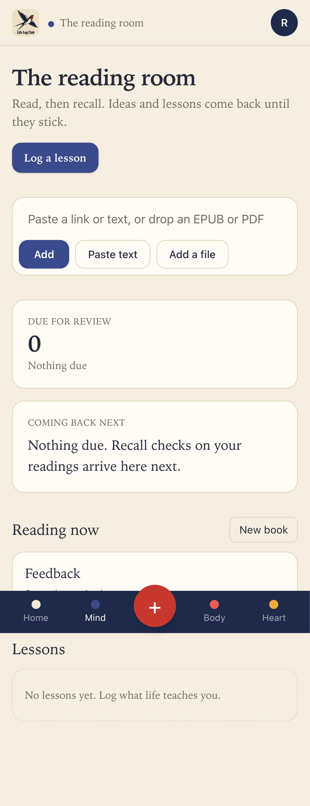

# Issue #14: Add a reading from pasted text

Release 1, task 9 of 31. Spec: `learning_spec.md` section 7.1 (Adding readings: "Add pasted text").

## What was built

- **Paste text on Mind.** The add box has a **Paste text** button next to **Add** and **Add a file**. It turns the box into a text area ("Paste text or Markdown. The first heading, or the first words, becomes the title."), with **Add** and **Paste a link instead**.
- **Smart default:** text pasted into the link box (anything with a space or line break in it) turns the box into the text area at once, with the line breaks kept. A link pasted there stays a link. So pasting an article is still one click: paste, then **Add**.
- **Ready at once.** `readings.addText({ id, text, title? })` splits the text into sections in the request and returns the reading as `ready`, so the reader opens on it straight away. There is no import job to wait for.
- **Text or Markdown** (`apps/server/src/import/paste.ts`):
  - Plain text: a paragraph at each blank line; lines inside a paragraph are joined.
  - Markdown: `#` and underlined headings, bullet and numbered lists (an indented line goes on with its item), quotes, code fences (kept exactly as typed), pipe tables, and rules.
  - Inline: links keep their words and point at their address without the `#fragment`; only http(s) links are kept. Bold, italic, strike and code marks go. A `snake_case_name` and stars inside code are kept.
  - An image keeps only its alt text, because pasted text brings no files (Release 1 has no images).
- **Sections like an article**, with the same `splitSections` as links: the headings are the boundaries, and a section past about 2,500 words is cut at a block. A text of 1,000 words or more with no headings gets AI headings when the member first opens it, the same way as a saved page.
- **Title:** the `title` given, else the first heading, else the first eight words ("Deliberate practice is not the same as playing…").
- **Limits and errors:** at most 500,000 characters ("That is too much text to paste at once. Paste one part at a time."); text with nothing to read, such as only a heading, is refused ("There is no text to read in what you pasted."); more than 2,000 sections is refused.
- Readings have a new source, `paste`. It can't be put in a member's book, which holds only web articles.

## Decisions

- **`readings.addText` is its own endpoint**, like `addFile`, rather than a `text` field on `readings.add` as the spec sketched. Pasted text is ready at once and has no link to find again, so it shares nothing with `add` but the id.
- **The same text pasted twice is two readings.** Only a retry with the same id returns the first one. A paste has no address to match, and the member may well want a fresh copy.
- **The reading's word count leaves out headings**, as for every other reading.

## Bug fixed on the way

- The first version of the link parser cut an address at its first `)`, so a link to `https://en.wikipedia.org/wiki/Flow_(psychology)` lost its end. Addresses may now hold one level of parentheses, as in Markdown. The unit test has this case.

## Proof

UI tests (in `e2e/mind-add.spec.ts`, at desktop and phone sizes):

- **Pasted text with two headings opens at once as a reading with two sections.** This is the issue's acceptance test. **Paste text**, paste Markdown with `## Feedback` and `## Mental models`, **Add**: the reader opens at once, titled "Feedback". The text shows without Markdown marks, and "clear result" is a link to `https://example.com/results`. The contents list is exactly Feedback, Mental models; the second section shows its list. Back on Mind, the reading says "2 sections".
- **Text pasted into the link box turns it into a text box, line breaks kept; Paste a link instead turns it back.** A paste event with the Markdown fills the text area exactly, and it has focus. **Paste a link instead** brings back an empty link box. A pasted link stays in the link box.

API test (in `e2e/mind-add.spec.ts`):

- **A retry returns the same reading, a title can be given, empty text is refused, and another member can't read it.** `addText` returns `source: 'paste'`, `status: 'ready'`, 2 sections. The same id again returns the first reading, and the list holds one. A given title wins. Blank text and a heading with no text are refused with `BAD_REQUEST`. Member B gets `NOT_FOUND` for A's reading and `CONFLICT` when reusing its id.

Unit tests (in `apps/server/src/import/paste.test.ts`): paragraphs from plain text; every Markdown block; links with a fragment, with parentheses, and a `javascript:` link that keeps its words but no link; titles from a heading, from the first words and from `title`; AI headings only for long text with no headings; nothing to read is refused.

Full run: `pnpm typecheck`, `pnpm test` (167 tests) and `pnpm e2e` (114 passed, 24 skipped) are green.

| Desktop | Phone |
| --- | --- |
|  |  |
|  |  |
|  |  |

On phones, the fixed bottom bar sits over the end of a long page in a full-page capture; on a real phone the page has room under its last line, so nothing is hidden.

Run again with `PROOF=issue-14 pnpm exec playwright test e2e/mind-add.spec.ts -g "pasted text"`.
