# Issue #15: Let a member without an AI key try the whole loop

Release 1, task 10 of 31. Spec: `learning_spec.md` sections 6.4 (Day 0 without a key) and 7.4 ("Without a key").

## What was built

- **The sample reading, "How to remember what you read"** (`apps/server/src/seed/sample-reading.ts`). About 1,100 words in 3 sections, on this app's own method: rereading feels like learning, write it down from memory, come back just before you forget. Each section has 3 key ideas, each with a cue, the exact sentence it rests on, and one written question (explain or apply) with its model answer, two must-have points and known misconceptions. All of it is written in the file, so nothing waits on an AI key.
- **Added on the first visit to Mind** (`readings.addSample`). The rows have ids made from the member's id, and `preferences.sample_added_at` (migration `0018_sample_reading.sql`) records that it was added, so a second visit adds nothing and a removed sample never comes back.
- **A hint on Mind without a key:** "Add your own AI key in Settings to get questions on your readings."
- **Compare with the text.** Without a key, the dump is left for the member to check (`self`). The recall page shows what they wrote beside the section's text, then each key idea with **Got it / Partly / Missed** (one click each, Missed until changed). **Go on to the questions** sends the marks (`recall.selfMark`). They feed the same rules as AI grading: missed ideas are asked their cue first, vague ones their lowest question, covered ones their highest, and the cards start from their first answer.
- **A section with no key ideas** (the member's own reading, no key) can only be compared: "There are no key ideas to mark in this section. Add your own AI key in Settings to have them written." **Done** goes on reading at the next section.
- **Self-checked written answers.** Without a key, after the member writes an answer and picks how sure they are, the app shows the model answer and a box for each must-have point ("Tick each point your answer made"). For a cue, the one point is the idea itself ("Did your answer say this?"). **Done** sends the answer with the ticks (`made`), and the grade is worked out in code from them, with the same scoring as the AI judge's points and the same confidence rules. The log row says `graded_by = 'self'`. The checklist comes from `review.checklist`. This applies to the recall questions and to Retry missed ideas.
- **Review without a key** stays as built in #12: self-rated cards with Show answer, then Forgot / Hard / Got it.

## Behaviour that changed

- The old "Your recall is saved. Add your own AI key…" line after a dump without a key is replaced by Compare with the text.
- Recall attempts now say `selfCheck` (the member has no key) and, while `self`, the ideas to mark (`toMark`).
- A written answer may carry `made`, the learner's own check of each point. With it, no AI is called.
- New reading source `sample`.

## Decisions

- **Compare with the text shows at once** after Done, instead of behind a button, to save a click.
- **The sample's ideas count as key ideas** (`origin = 'ai'`), so recall, review and the dump marks treat them exactly like ideas the AI writes, although they were written by hand.
- **The sample is checked like AI output.** A unit test makes each quote a real sentence of its section, and runs each cue and question through the same checks as AI-written ones (`lintCue`, `lintQuestion`).
- **Tests start without the sample.** The e2e helper `joinAs` marks it as added, as if the member had removed it, so every other test still starts from an empty Mind; the sample's own test asks for it with `{ sample: true }`.

## Bugs fixed on the way

- The sample's first draft had one question that copied 10 words in a row from the text, which the question check refuses. The unit test caught it; the question is reworded.
- **A flaky test:** "a device unused for 30 days must sign in again" failed now and then. After the first reload, a request of the Home page could still be running when the test aged the session to 31 days. That request met the expired session, and its answer cleared the cookie, so the next reload showed Sign in without "You have been away from this device for 30 days". The test now waits until the page has no requests in flight, as a device that is really away has none. It then passed 32 times in a row.

## Proof

UI tests (in `e2e/mind-read.spec.ts`, at desktop and phone sizes):

- **Without a key, the sample reading runs the whole loop: dump, Compare with the text, own marks, self-checked answers, results, then Review.** This is the issue's acceptance test.
  - Mind shows the sample with "3 sections" and the key hint; after a reload there is still one reading.
  - In section 1, the dump goes to Compare with the text: the dump and the section's text show, and each of the 3 ideas starts at Missed. The member marks the first Got it and the third Partly.
  - Question 1 is the missed idea's cue: one checkbox with the idea, no model answer label; ticked, it counts as right. Question 2 is the vague idea's question: the model answer and 2 boxes; with one ticked it is "Not quite". Question 3 is the covered idea's question; with both ticked it is right.
  - Results: "You brought back 1 of 3 key ideas, and answered 2 of 3 questions right." The vague idea shows "Not quite" and "Missed The effort is a desirable difficulty, not a sign of failure". In the database the attempt is `graded_by = 'self'` with covered, missing, vague, and the 3 log rows are self-graded (cue right, question wrong, question right). The covered idea is due in 1 day.
  - Once due, Review shows it as a self-rated card with the source line "How to remember what you read · Rereading feels like learning". **Got it** puts it 2 days out.
- **Without a key, a reading with no key ideas can only be compared with the text, and Done goes on reading.** A link reading: the dump leads to Compare with the text, the "no key ideas" line, the section's text and no marks. Done opens the reader at the next section.

Unit tests (in `apps/server/src/seed/sample-reading.test.ts`): the sample is 1,000 to 1,400 words in 3 sections of 3 ideas; each idea's quote is in its section; each cue and question passes the checks for AI-written ones.

Full run: `pnpm typecheck`, `pnpm test` (177 tests) and `pnpm e2e` (118 passed, 24 skipped) are green.

| Desktop | Phone |
| --- | --- |
| 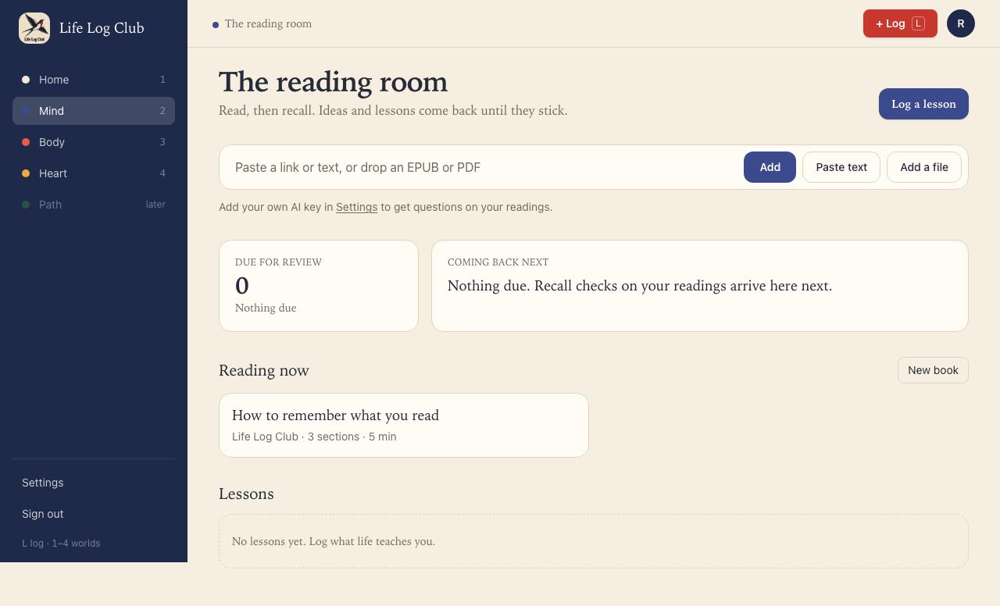 | 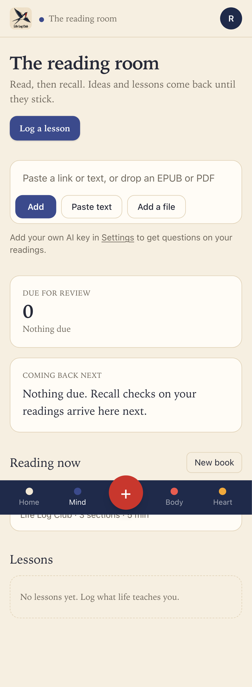 |
| 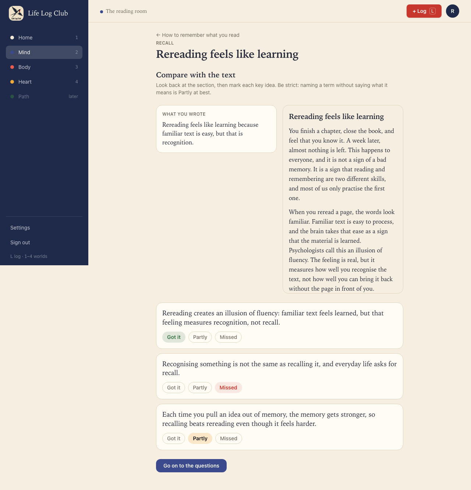 | 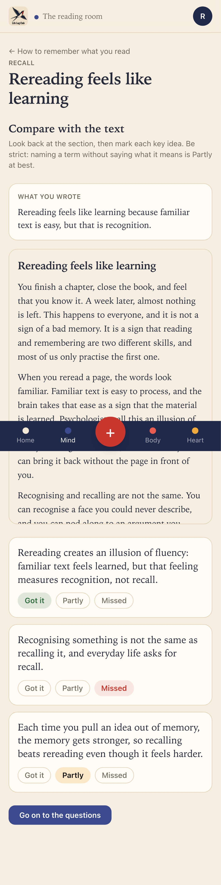 |
| 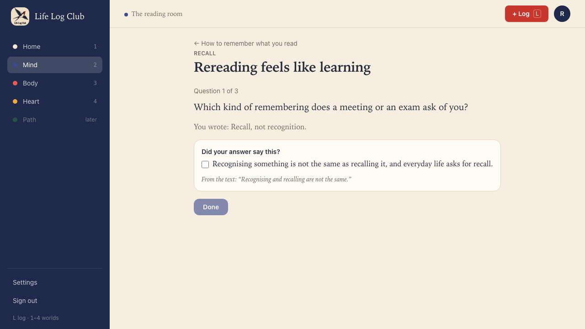 | 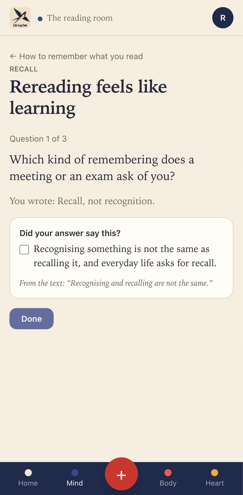 |
| 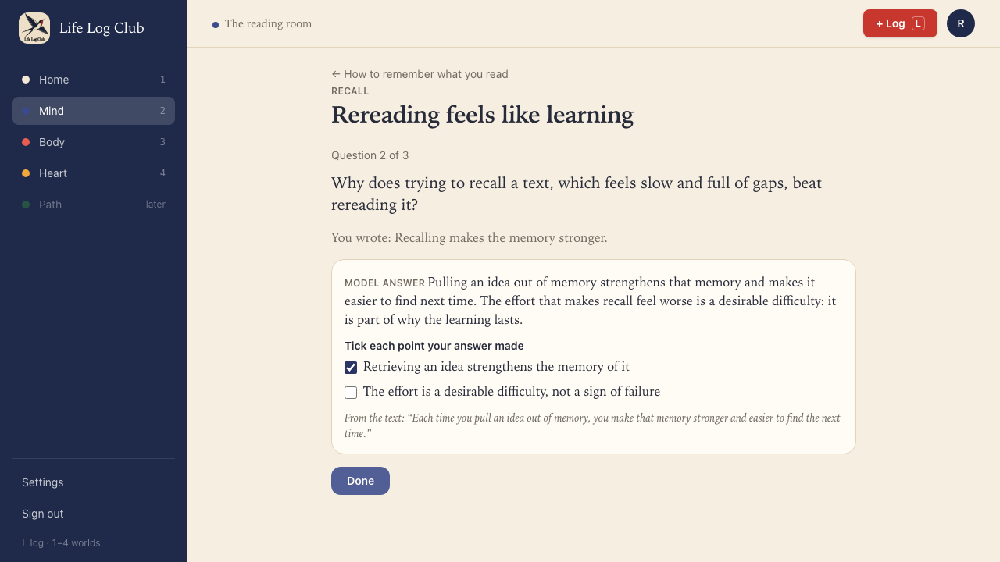 | 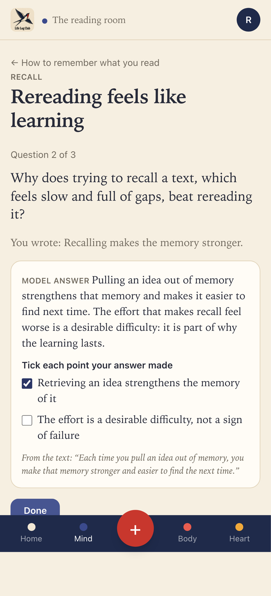 |
| 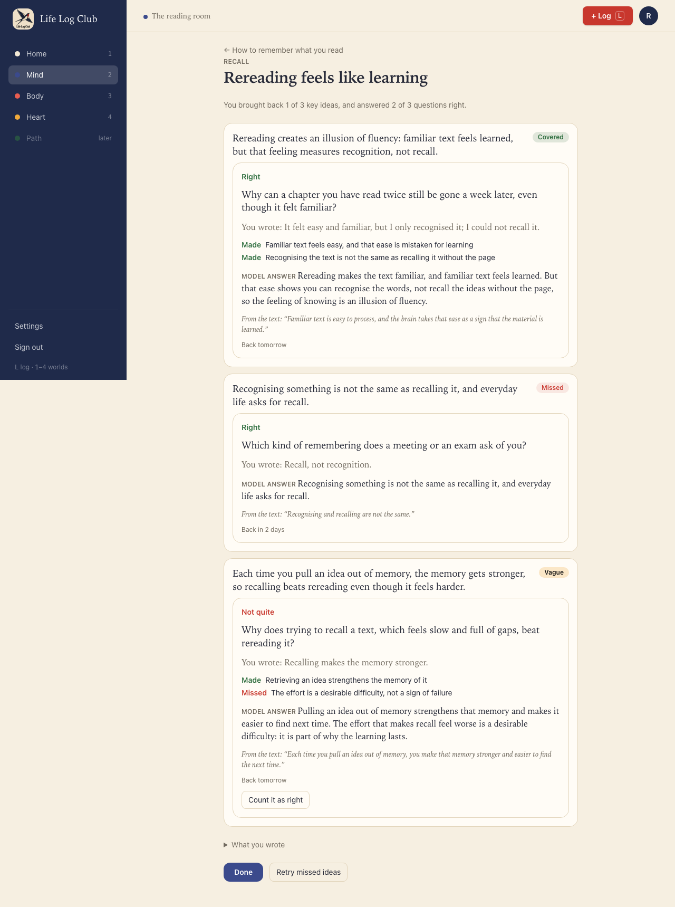 | 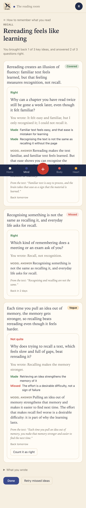 |
| 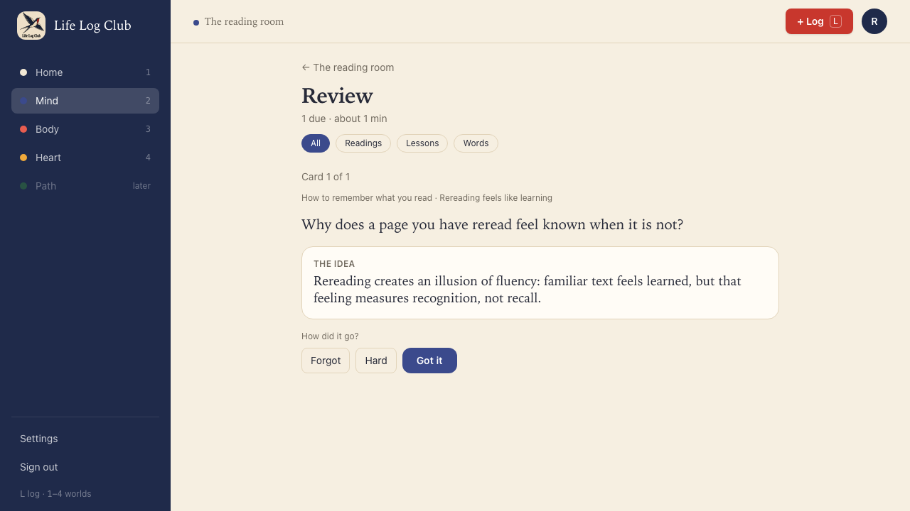 | 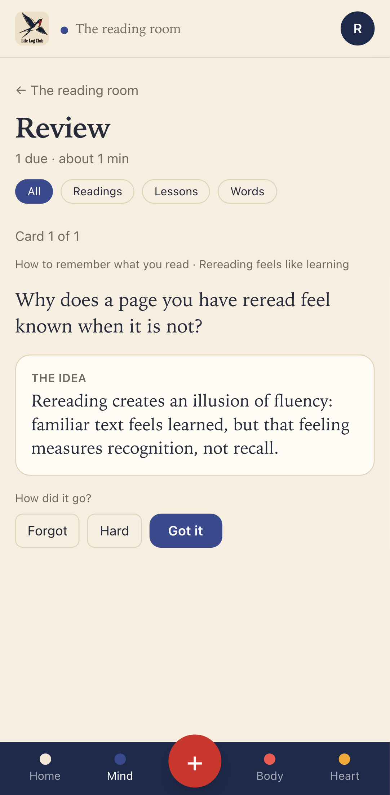 |

On phones, the fixed bottom bar sits over part of a long page in a full-page capture; on a real phone the page scrolls under it, so nothing is hidden.

Run again with `PROOF=issue-15 pnpm exec playwright test e2e/mind-read.spec.ts -g "without a key, the sample"`.
