# Issue #16: Check the Release 1 loop end to end

Release 1, task 11 of 31. Spec: `learning_spec.md` section 10 (Release 1 exit criteria).

## The exit criteria, and where each is proven

| Exit criterion | Status | Proof |
| --- | --- | --- |
| e2e: add a link → stay 30 s → Recall → dump → answer → results → a covered idea is due in 1 day → make it due → Review → answer right → due in 2 days | Passes at desktop and phone sizes | `e2e/mind-read.spec.ts`, "Release 1 loop" (below) |
| No-key e2e: the sample reading's loop, start to finish | Passes at both sizes | `e2e/mind-read.spec.ts`, "without a key, the sample reading runs the whole loop" ([#15](issue-15.md)) |
| e2e: a lesson card appears in Review | Passes at both sizes | `e2e/worlds.spec.ts`, "a lesson logged with + Log is due in Review at once" ([#13](issue-13.md)) |
| The budget stops a second section's writing in a test with a $0 budget | Passes at both sizes | `e2e/mind-read.spec.ts`, "past this month's AI budget a newly read section stays paused" ([#8](issue-08.md)) |
| RLS tests: member B can't see A's readings, cards, questions, attempts or AI calls | Passes | `apps/server/src/learning/rls.test.ts` (below), and the API tests below |
| The owner uses it on one real article for a week | For the owner | Not something a test can do. |

## What was built

- **The Release 1 loop test.** The Review test from #12 already walked most of the loop; it is now the named Release 1 test, with the step that was missing: after the results, the covered idea shows "Back tomorrow" and is due in 1 day (± 1 minute) at level 2. Then, made due, Review on Home → **Review due ideas** asks its cue; right is "Back in 2 days" at level 3; due again and wrong is "Back in 10 minutes" at level 2.
- **A row-level security check from the database itself** (`rls.test.ts`):
  - Every table in the database, except the four the sign-in code reads on purpose (`users`, `invites`, `sessions`, `audit_log`), must have row-level security on, with a policy for all commands whose read and write rule are both "the row's `user_id` is the current member". The test reads this from the Postgres catalog, so a table added later without a policy fails it.
  - Member A gets a reading, a section, a key idea, a question, an answer, a recall attempt, an AI call, preferences and a lesson. Then every table with row-level security is counted as each member: A sees 1 row in each of those tables, and B sees 0 rows in every table, A's or anyone else's.
  - Proven not to be empty: with row-level security turned off on `ai_calls` in the test database, both tests fail.
- **An API test for the calls added in this release** (`e2e/review.spec.ts`): member B gets `NOT_FOUND` for A's recall attempt, for marking it (`recall.selfMark`) and for the checklist of A's card (`review.checklist`), and an empty reading list. After B's tries, A's attempt is unchanged, and A can still mark it. `readings.addSample` adds the sample once: `{ added: true }`, then `{ added: false }`.

## What the check found

- **Nothing broken in the loop or in row-level security.** The `entries` table has the same rule as the others under an older policy name (`own_entries`); the check tests what a policy says, not its name.
- **The phone bottom bar.** Full-page captures on phones show the fixed bottom bar over the middle of long pages, and earlier proofs noted it. A normal phone capture, scrolled to the very bottom of Mind with a long list, shows the last item ending 57 pixels above the bar. So it is an effect of full-page captures only, and nothing is hidden on a real phone.
- The flaky 30-day sign-in test was found and fixed in [#15](issue-15.md).

## Proof

Full run: `pnpm typecheck`, `pnpm test` (179 tests) and `pnpm e2e` (119 passed, 25 skipped) are green.

The Release 1 loop, step by step:

| Desktop | Phone |
| --- | --- |
| 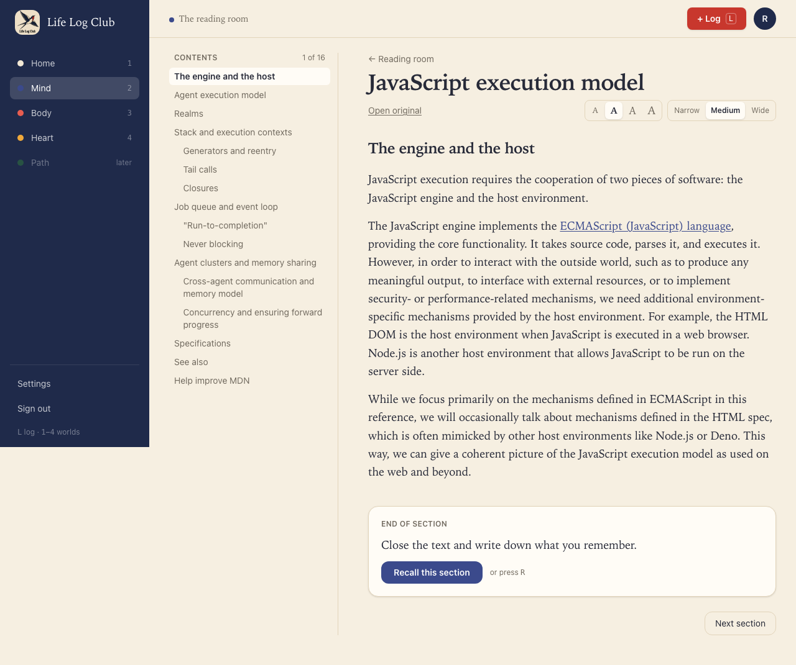 | 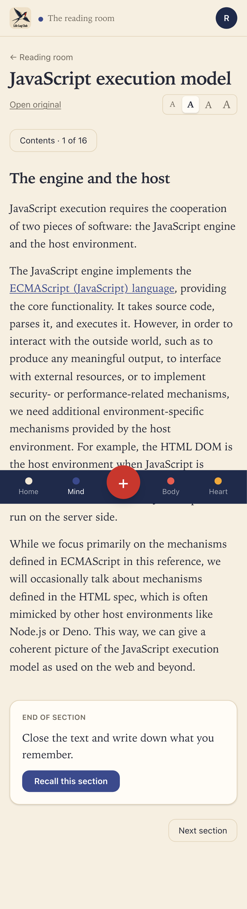 |
| 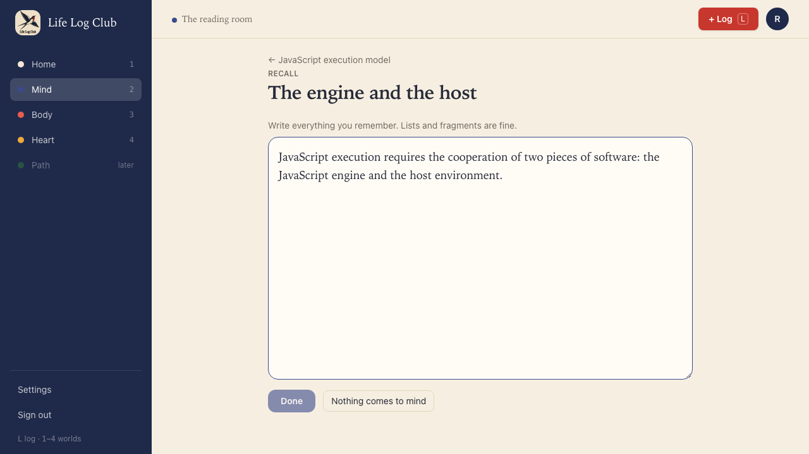 | 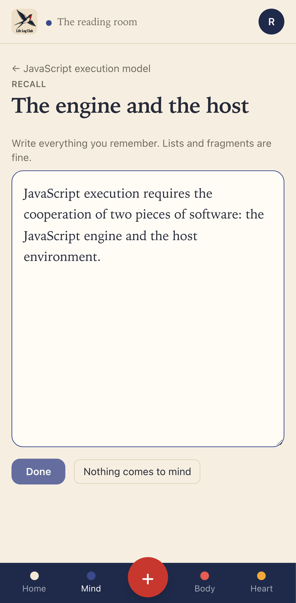 |
| 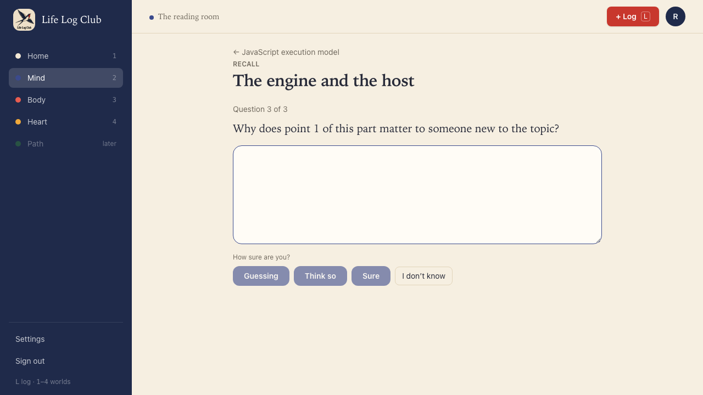 | 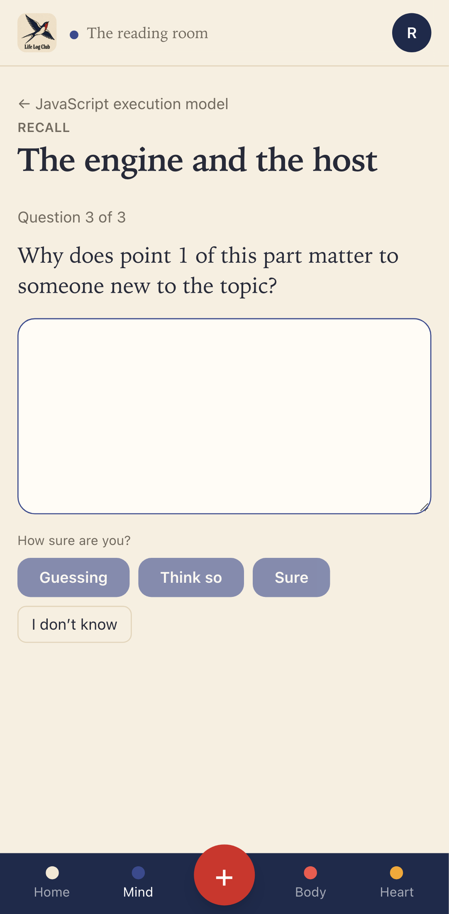 |
| 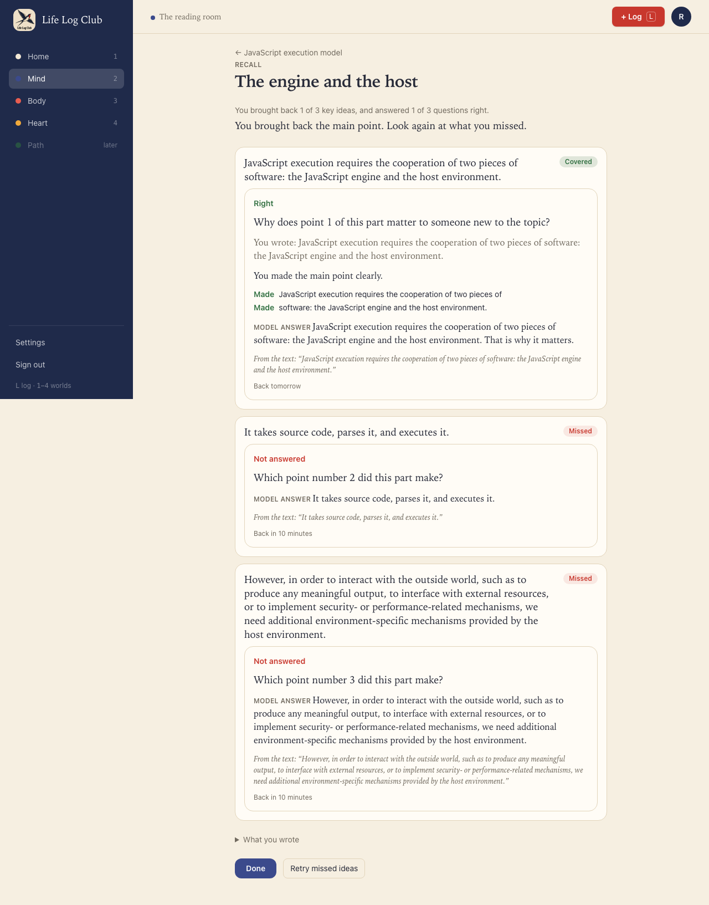 | 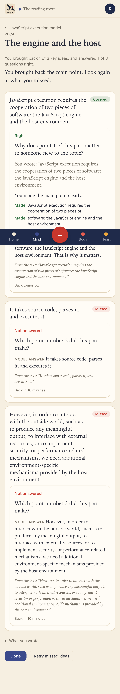 |
| 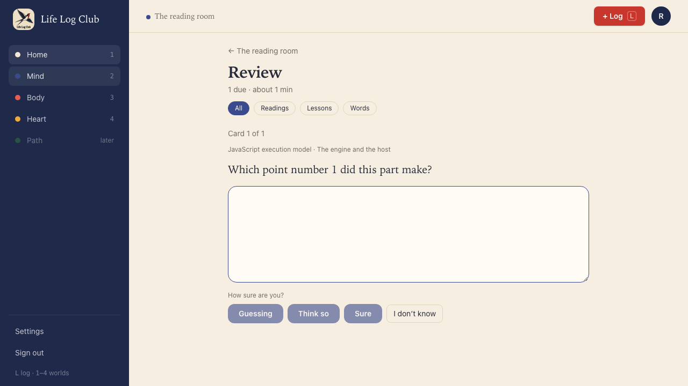 | 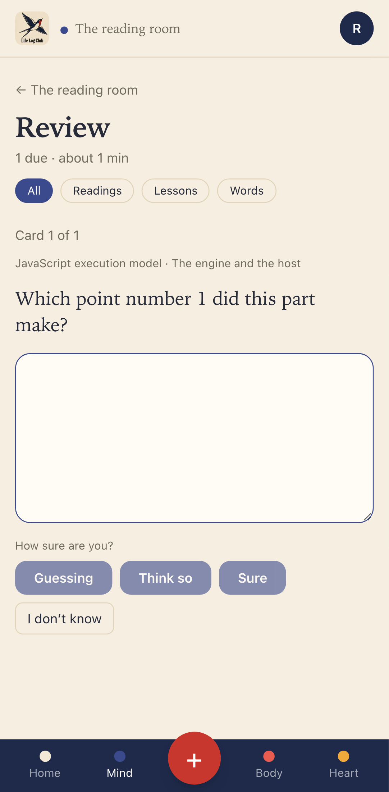 |
| 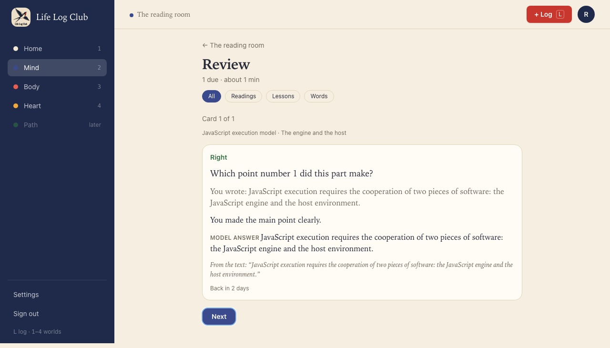 | 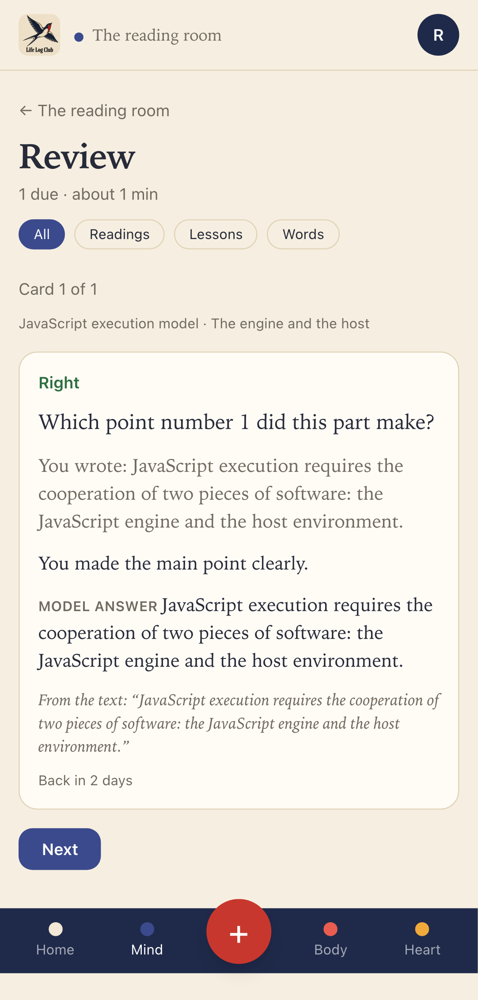 |
| 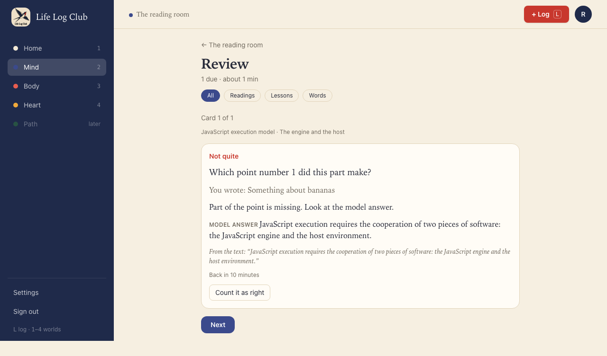 | 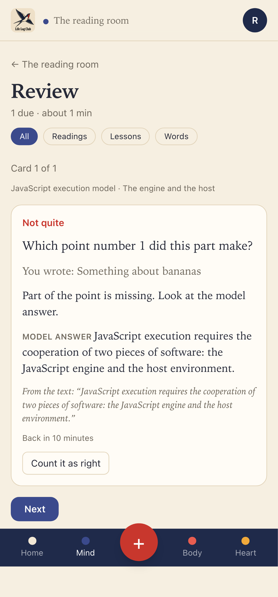 |

The bottom of a long page on a real phone screen, not a full-page capture: the last item is above the bar.

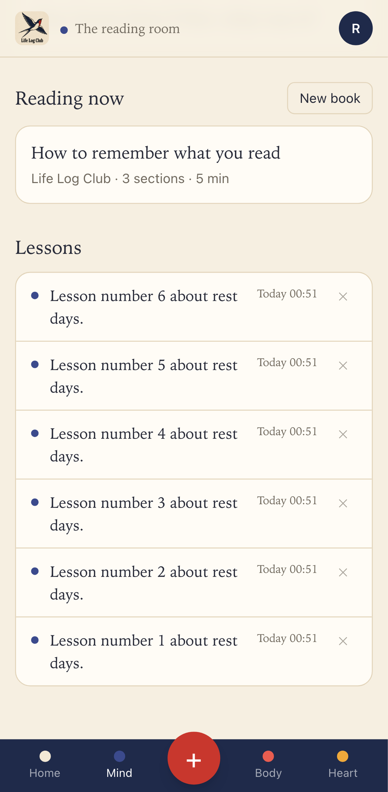

Run again with `PROOF=issue-16 pnpm exec playwright test e2e/mind-read.spec.ts -g "Release 1 loop"`.
