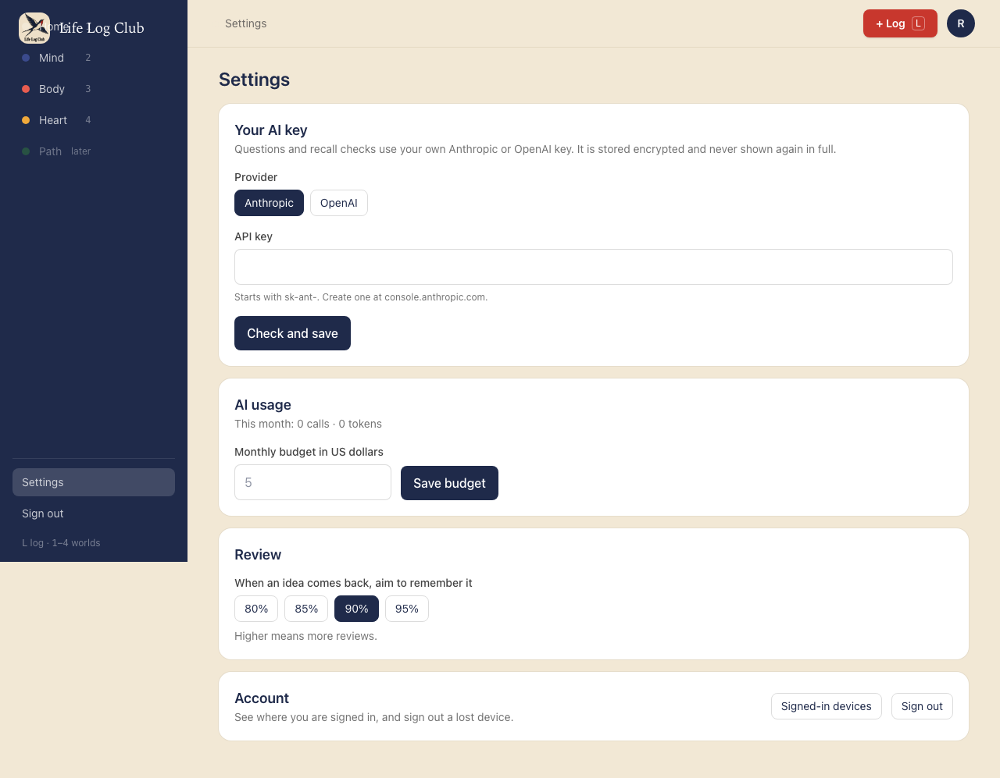
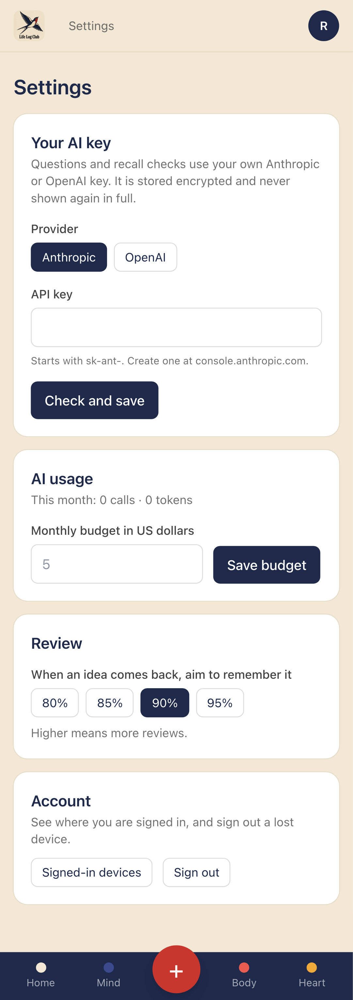
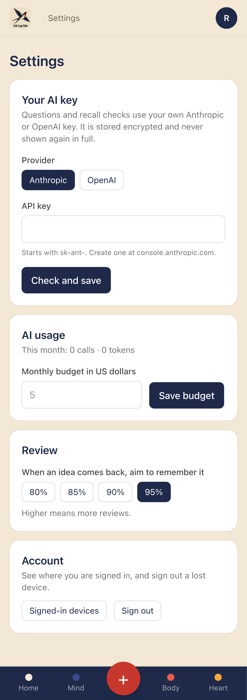
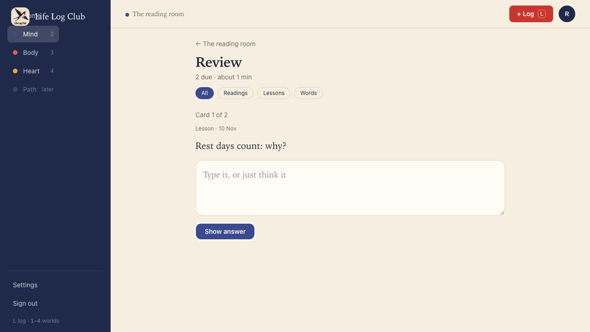
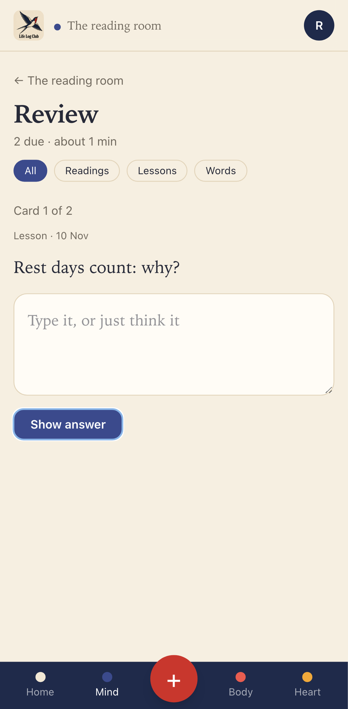

# Issue #19: Let the member choose how well to remember, and review the weakest first

Release 2, task 14 of 31. Spec: `learning_spec.md` sections 5.5 and 7.7.

## What was built

- **Settings → Review.** "When an idea comes back, aim to remember it": 80%, 85%, **90%** (the default) or 95%, with the line "Higher means more reviews." One click saves the choice; there is no Save button. It is stored in `preferences.desired_retention`, which already existed with a default of 0.9.
- **The API.** `preferences.get` and `preferences.update` now carry `desiredRetention`. The contract refuses anything outside 0.8 to 0.95 with "Choose a target of 80% or more." or "… 95% or less."
- **Every answer uses the member's own target.** `review.answer` reads the member's preferences inside the transaction that locks the card and schedules the answer with `schedulerFor(desiredRetention)`. Count it as right works the schedule out again with the same scheduler. Only the gaps after the 1, 2 and 3 day steps depend on the target; the steps and the 10-minute and 1-day lapse checks do not.
- **`schedulerFor(target)`** in `packages/domain/src/scheduler.ts` returns `stepsThenFsrs({ desiredRetention })`, one per target, kept once made. Its id is the same `steps-fsrs-v1:FSRS-6` as the default, so answers given at any target can still be changed later.
- **Review serves the idea most likely forgotten first.** `review.next` ranks every due card by its predicted recall now (the FSRS forgetting curve, from the card's memory and the time since its last answer), lowest first, then takes the batch. A card never answered has nothing to predict from, so it comes first. Between equals, the one due longest comes first. This replaces "oldest due first" from Release 1, as the spec says for Release 2. `review.due`, which only feeds the counts on Home and Mind, is unchanged.

## Decisions

- **A new target applies from the next answer.** Cards already scheduled keep their due times; each moves to the new target the next time it is answered. Moving every due date at once would surprise the member and rewrite the schedule the log explains.
- **The ranking is done in code, not SQL**, because predicted recall comes from the FSRS forgetting curve in `packages/domain`, and writing that curve again in SQL would make two copies to keep in step. A member's due cards are read as id, state and due time only (small rows), ranked, and only the batch is read in full.
- **The phone proof screenshots** now place the fixed bottom bar at the page's end. Full-page captures drew it where the viewport ends, over the page. Only the capture changes (`e2e/proof.ts`), not the app.

## Proof

### Settings → Review, at desktop and phone sizes

The default, 90%:

After one click on 95%, and a reload:

### Review opens with the weakest idea

Two lessons, both last reviewed 10 days ago. "Anchor high in salary talks" has a strong memory (about 97% predicted recall now) and has been due for 5 days; "Rest days count" has a weak one (about 76%) and has been due for 1 day. Oldest-due-first would open with the salary one; Review now opens with Rest days, and the salary one comes second.

### Tests

- `e2e/ai-key.spec.ts`, **Settings → Review sets how well to remember with one click, 90% at first, and keeps it** (desktop and phone): 90% is checked at first; one click on 95% checks it and stores 0.95; after a reload 95% is still checked.
- `e2e/mind-read.spec.ts`, **Review opens with the idea most likely forgotten, not the one due longest** (desktop and phone): the case above, through the Review page; Got it on the first card shows the second.
- `e2e/review.spec.ts`, **the member's review target sets the gap from FSRS**: two cards with the same memory, a month since their last review. Answered Got it at 90%, the gap is over 60 days (about 80); after `preferences.update({ desiredRetention: 0.95 })`, the same answer on the other card gives less than half of that (about 33). A target of 0.99 is refused with `BAD_REQUEST`.
- `e2e/review.spec.ts`, **Review serves the idea most likely forgotten first, not the one due longest**: with a batch of 2 out of 3 due cards, `review.next` returns the never-answered card and the weak one, so the ranking covers every due card, not only the oldest few; with a batch of 20, the order is never answered, weak, strong.
- `packages/domain/src/scheduler.test.ts`, **a higher target recall gives shorter gaps** (from #17): the fifth gap after five Got its is shorter at 95% than at 90%, and shorter at 90% than at 80%.
- `e2e/review.spec.ts`, the filter test now expects a new lesson, never answered, before an idea answered three times.

Full run: `pnpm typecheck`, `pnpm test` and `pnpm e2e` are green.
