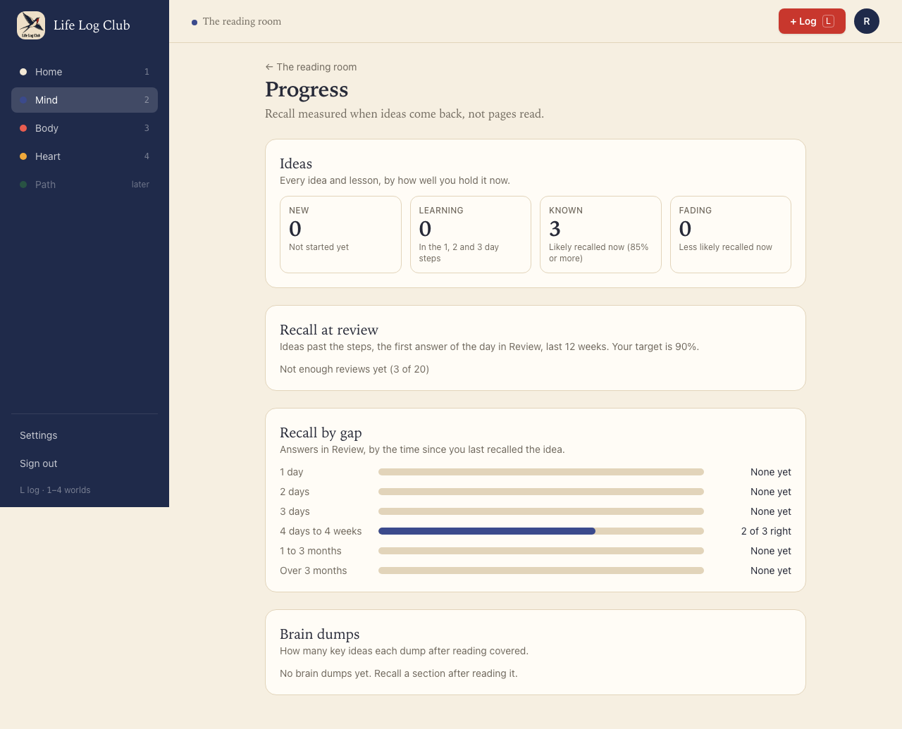
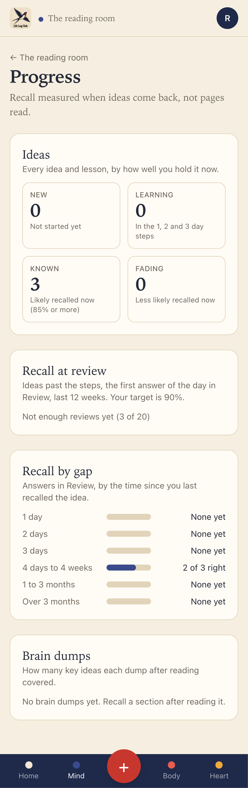
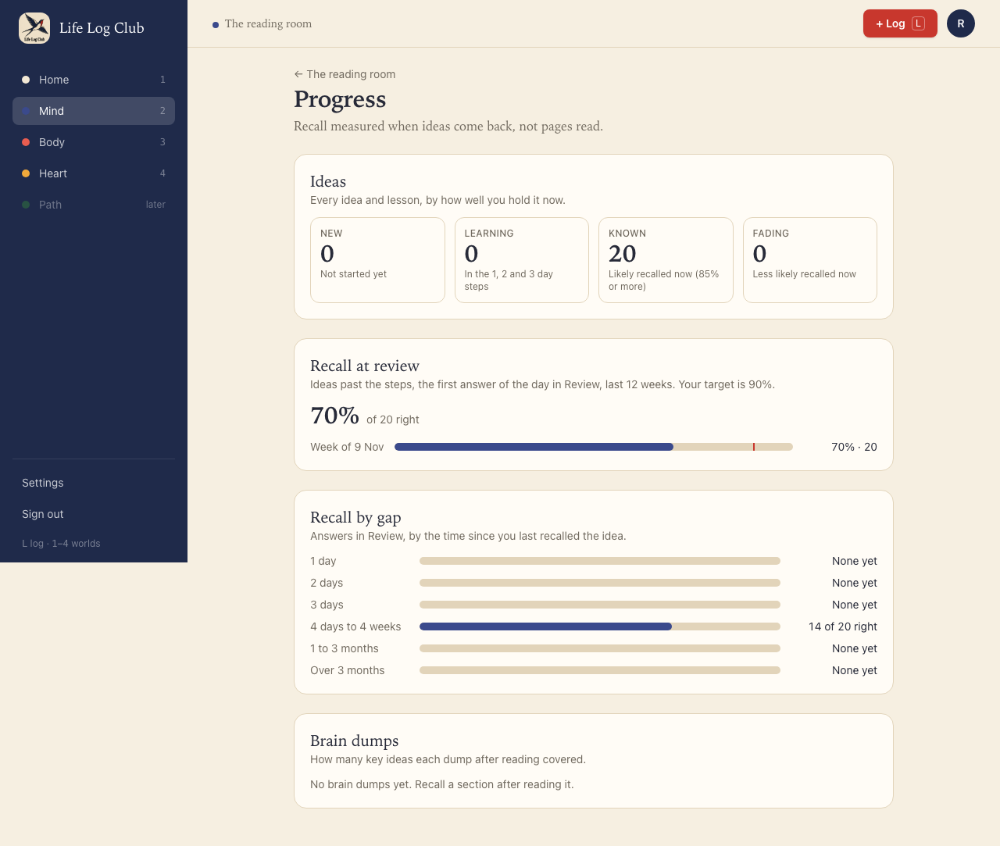
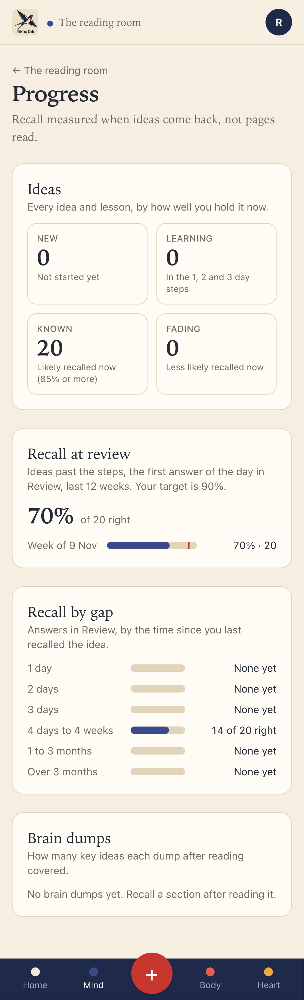
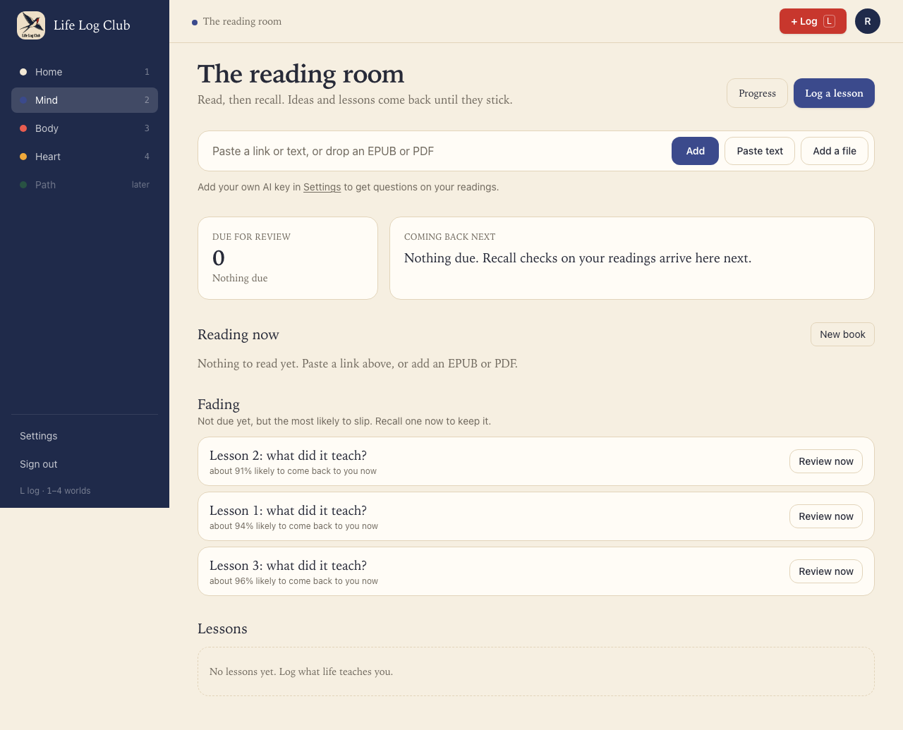
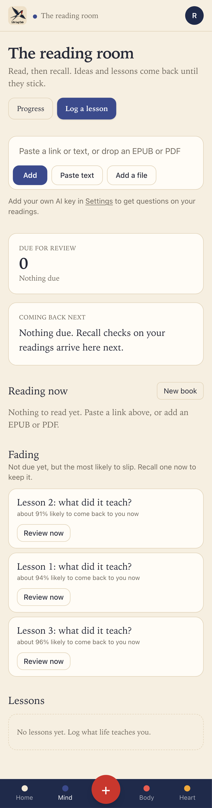
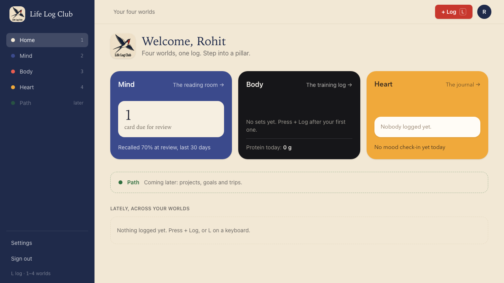
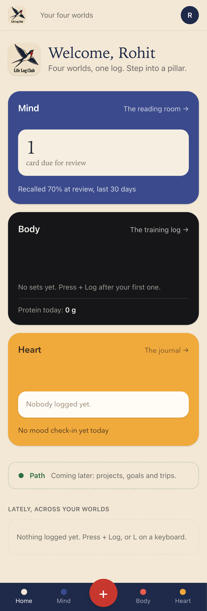

# Issue #20: Show what is fading and a first progress view

Release 2, task 15 of 31. Spec: `learning_spec.md` sections 7.15, 7.16 and 8.

## What was built

- **Fading on Mind.** Up to 3 ideas past the 1, 2 and 3 day steps that are not due yet, the lowest predicted recall first, each with "about 91% likely to come back to you now" and **Review now**. Review now is one click: it makes that card due now (`review.bringForward`) and opens Review with it as the first card (`/mind/review?first=<id>`, passed to `review.next` as `first`). A card already due keeps its due time.
- **Progress at `/mind/progress`**, linked from the top of Mind. Four blocks, over the last 12 weeks:

  | Block | What it shows | Definition |
  | --- | --- | --- |
  | Ideas | New, Learning, Known and Fading counts, in total and for each reading | New: not started. Learning: in the 1, 2 and 3 day steps. Known: past the steps and predicted recall now at least 85%. Fading: past the steps and below 85%. Removed cards are left out. |
  | Recall at review | % right, overall and by week (weeks start on Monday, UTC), with the member's target as a red mark | Answers in Review to cards already past the steps, the first answer of the day per card. Answers counted as right by the member are left out; reported answers are already practice, so they never count. |
  | Recall by gap | Right of total for 1 day, 2 days, 3 days, 4 days to 4 weeks, 1 to 3 months, over 3 months | Every first-of-the-day Review answer, the steps included, by the days since the card's previous answer (rounded to whole days). |
  | Brain dumps | Each graded dump, oldest first: how many of its key ideas it covered | `recall_attempts.results`, `covered` out of all marks. |

- **One honest number on Home.** The Mind card shows "Recalled 70% at review, last 30 days" under the due count, once there are 20 reviews in those 30 days. Before that it shows nothing.
- **Fewer than 20 reviews is not a percentage.** Recall at review shows "Not enough reviews yet (3 of 20)" until it rests on 20 answers.
- **API:** `mind.summary()` returns `{ fading, recall30d }` for Mind and Home. `progress.summary({ days })` returns the four blocks. `review.bringForward({ id })` and the `first` input on `review.next` serve Review now. All run as the member through `asUser`, so row-level security limits them to the member's own rows.
- **Shared rules in `packages/domain/src/progress.ts`:** `ideaStatus`, `KNOWN_RECALL` (0.85), `gapBucket`, `GAP_BUCKETS` and `RECALL_MIN_REVIEWS` (20). The server, the contract and the web app use this one copy.

## Decisions

- **Graduated is read from the state saved with each answer** (`review_log.prev`), so an answer counts as "at review" only when the card was past the steps when it was answered. Rows from before states were kept have no gap and are not counted as graduated.
- **Fading has no threshold.** The spec asks for the 3 lowest predicted recalls among ideas not due yet. At the default 90% target such ideas are usually above 90%, so a cut at 85% would leave the block empty almost always. The line under the heading says what the list is: "Not due yet, but the most likely to slip."
- **Predicted recall is worked out in code** from the FSRS forgetting curve in `packages/domain`, as for the Review order in #19, not copied into SQL. The answers themselves are picked in SQL (`distinct on (card, day)`).
- **`mind.summary` leaves the due count and Continue to their existing calls.** The spec's single call also lists `due`, `minutes`, `continue` and `skillsWeek`. Due and minutes already come from `review.due`, Continue already comes from the reading list, and skills come in Release 8. Moving them now would change two screens for no gain to the member.
- **Proof captures.** The style that puts the phone's fixed bottom bar at the page's end (added in #19) also moved the desktop sidebar's nav, because both have the label "Worlds". It now applies only to the fixed bar, and the #19 desktop screenshots were taken again.

## Proof

### Progress, before and after 20 reviews

Three lessons answered in Review, 2 right, each 10 days after its previous answer:

After 17 more (12 right), 14 of 20:

### Fading on Mind

The three lessons, weeks later and still not due: 91%, 94% and 96%, the weakest first.

### Home, at 20 reviews

### Tests

- `apps/server/src/learning/progress.test.ts`: one member's fixtures in `cards`, `review_log` and `recall_attempts`, checked against each definition:
  - Ideas: known (recall about 99%), fading (about 70%), learning, new, a removed card (left out), and per reading only cards from a reading.
  - Recall at review: a second answer on the same day is left out, an answer counted as right is left out, a rating with no verdict reads Forgot as wrong, practice and recall answers never count, answers older than the window are left out, and an answer in the steps counts only for recall by gap. Weeks start on Monday: answers on two Sundays fall in two different weeks.
  - Recall by gap: 1 day, 4 days to 4 weeks and 1 to 3 months, with an answer from before states were kept left out.
  - Brain dumps: an open attempt and one past the window are left out; the graded one covered 2 of 4.
  - `mindSummary`: Fading lists the 2 graduated cards not due yet, the lower recall first, and not the graduated card that is already due; the 30-day recall counts 1 of 3.
  - Another member sees none of it.
- `packages/domain/src/progress.test.ts`: `ideaStatus` changes from known to fading on the day predicted recall falls below 85%; `gapBucket` puts each step in its own group a few hours either way.
- `e2e/mind-read.spec.ts`, **Progress counts recall at review only from 20 reviews, Fading brings an idea back with Review now, and Home shows the 30-day recall** (desktop and phone): the screens above, through the app. Review now on the weakest idea opens Review at "Card 1 of 1" with that idea; Home has no recall line at 3 reviews and shows "Recalled 70% at review, last 30 days" at 20.

Full run: `pnpm typecheck`, `pnpm test` and `pnpm e2e` are green.
