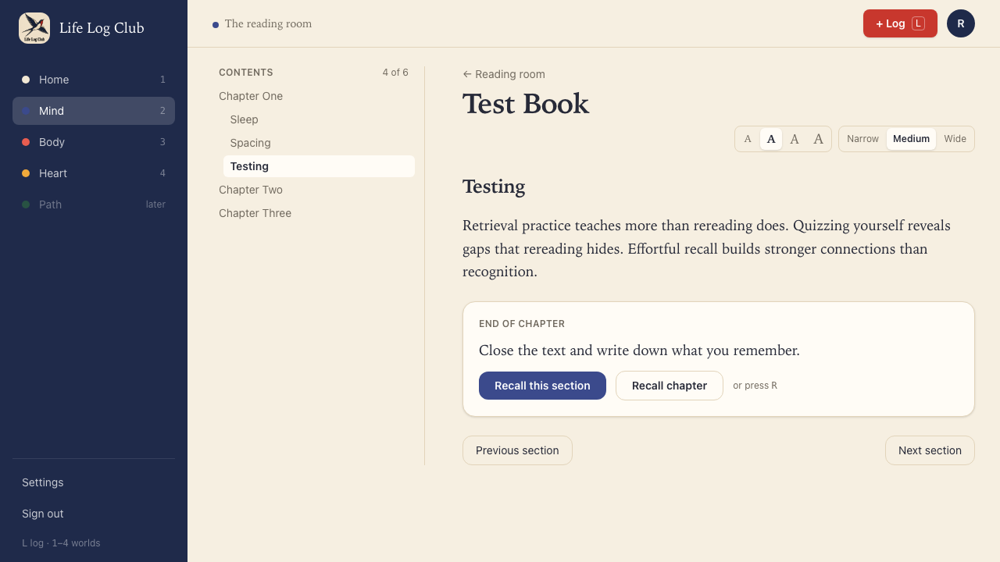
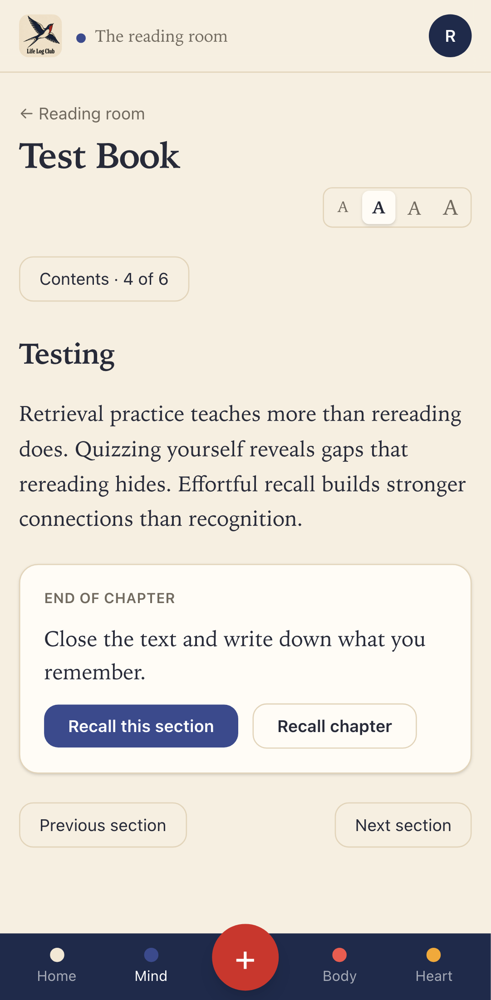
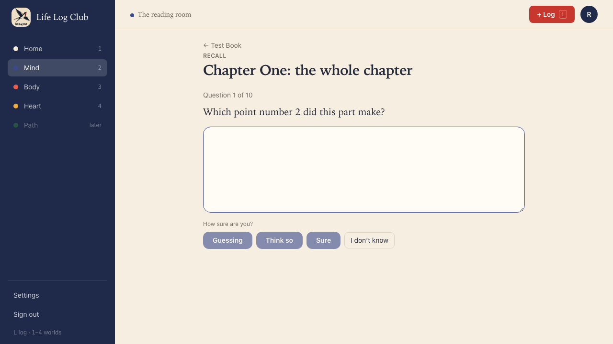
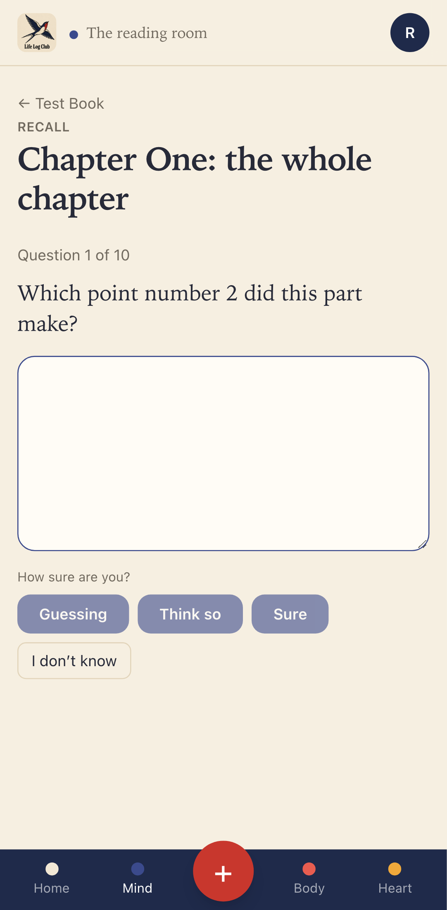
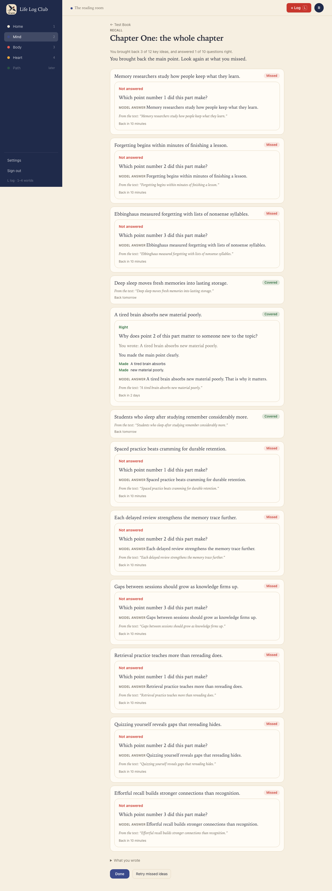

# Issue #21: Recall a whole chapter

Release 3, task 16 of 31. Spec: `learning_spec.md` sections 7.4 (step 5) and 7.3 (chapter batches).

## What was built

- **Recall chapter.** At the end of the last section of a chapter with more than one section, the card at the end of the text says "End of chapter" and offers **Recall chapter** next to **Recall this section**. One click opens the brain dump for every section of the chapter, under the heading "Chapter One: the whole chapter". Inside a chapter, and in a chapter of one section, only Recall this section shows, as before. The reader knows each section's chapter from `contents[].chapter`, which `readings.get` now returns (`sections.chapter` already existed).
- **Graded against every key idea in the chapter.** The dump goes through the same `grade-recall` job, with every key idea of every section in the attempt.
- **At most 10 questions, missed first.** A recall check over more than one section asks at most `CHAPTER_QUESTIONS` (10). Ideas are picked by their dump mark alone (missed, then vague, then covered), and the picked ones are then put in the usual test order (written before choice, missed first). Picking by mark first means a missed idea with a choice question is never left out for a covered idea with a written one. A single section still asks one question per idea.
- **No idea is left out of review.** Each idea the session does not ask about starts from its dump mark: covered as Got it (back tomorrow), vague as Hard, missed as Forgot (back in 10 minutes). Each start is logged as a `recall` answer of the attempt (`ask = 'self'`, with `prev`, the scheduler and its predicted recall), so the schedule can be worked out again from the log like any other answer.
- **The results list every idea in the chapter.** An idea with no question shows its mark, its quote and when it comes back. The summary line counts only the questions asked: "You brought back 3 of 12 key ideas, and answered 1 of 10 questions right."
- **A chapter is written in batches.** When Recall chapter starts and some sections have no ideas yet, `recall.start` splits them into batches of up to `CHAPTER_BATCH_WORDS` (4,000) words, in reading order, and queues one `write-section` job per batch (`with: [...]` names the other sections). Each batch is one AI call. A section longer than 4,000 words is a batch of its own. Sections in a batch that already have ideas are marked ready and left out.
- **The 20-idea limit is per section.** `writeSection` in `packages/llm` used to keep the 20 most important ideas of the whole call. A chapter written in one call would then have lost ideas that section by section it would keep. It now keeps up to 20 in each section, and the rest of each section go to its spare ideas, as before.

## Decisions

- **A batch has its own job key** (`batch:<first section id>`). The `write-section` queue is stately with the section id as the key, so a batch queued while a job for its first section waits would be dropped, and the other sections would never be written. If both run, the section lock lets only one store ideas, as for any two jobs on one section.
- **Without a key, the whole batch becomes `needs_key`**, so the recall check moves on to self-marking for the whole chapter and does not wait on sections nobody will write. A single section still only marks itself.
- **Past the budget, only the first section is marked `paused`.** That is the existing rule, and Recall always bypasses the budget anyway (`recall: true`).

## Two flaky tests found and fixed

- `apps/server/src/learning/write-section.test.ts` (from #9) expected two cards in a fixed order. Both cards had position 0 in their own sections, so Postgres could return them in either order, and the test failed about one run in four of the full `pnpm test`. It now checks the two cards in any order.
- `e2e/mind-read.spec.ts`, "Review without a key…" (from #12) read the review log of the newest member with a card named "Lesson 1: what did it teach?". The Progress test from #20 makes cards with the same name, so when both ran at once the query could read the other member's log. It now finds its own member by email.

## Proof

### The end of a chapter, at desktop and phone sizes

### The first of 10 questions

### The results: all 12 ideas of the chapter

The dump brought back the three ideas of the Sleep part. The nine missed ideas were asked through their cues, and one covered idea was asked a stored question. The two covered ideas not asked show their mark and "Back tomorrow".

### Tests

- `e2e/mind-read.spec.ts`, **Recall chapter at the end of an EPUB chapter is graded against every key idea in it, asks at most 10 questions, missed first, and starts every idea** (desktop and phone). An EPUB whose chapter one has four sections with three key ideas each is added as a file, with the fake LLM:
  - Inside the chapter (Sleep), only Recall this section shows; at its last section (Testing), Recall chapter shows too.
  - The four sections are written in one `write-section` call (one `ai_calls` row), and give 12 key ideas.
  - The dump covers the three Sleep ideas. Questions 1 to 9 are cues of missed ideas; question 10 is a stored question on a covered idea.
  - The results list all 12 ideas, and the line reads "You brought back 3 of 12 key ideas, and answered 1 of 10 questions right."
  - Every card has started. The two covered ideas not asked are due in 1 day (± a minute), and each has a `recall` log row rated `good` with `ask = 'self'`; the attempt has 12 log rows.
- `packages/llm/src/write-section.test.ts`: two sections written in one call, 21 ideas in the first and 2 in the second, keep 20 and 2, and the 21st is spare.
- `apps/server/src/learning/write-section.test.ts`: `chapterBatches` fills a batch to exactly 4,000 words and starts a new one past it, puts a 5,000-word section on its own, and keeps reading order.

Full run: `pnpm typecheck`, `pnpm test` and `pnpm e2e` (129 passed, 27 skipped) are green.
