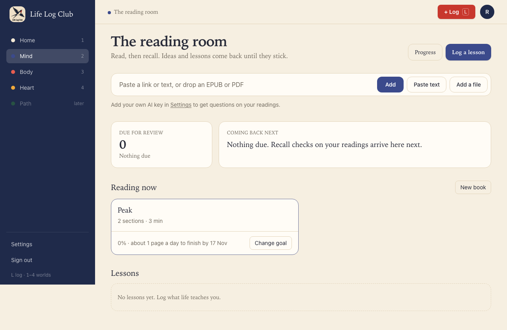
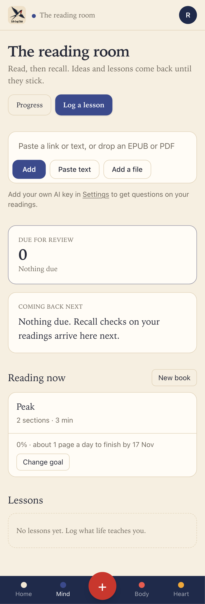
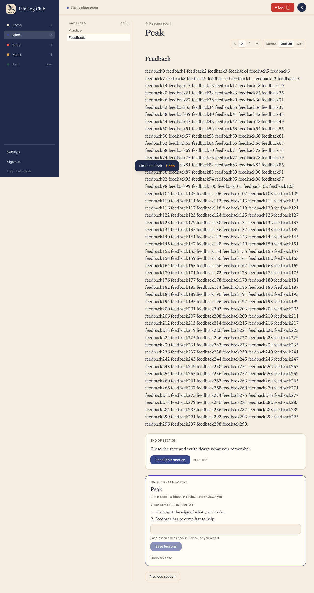
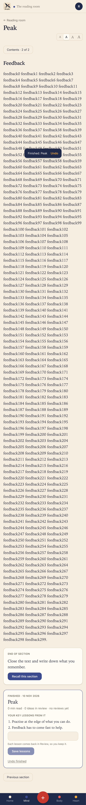
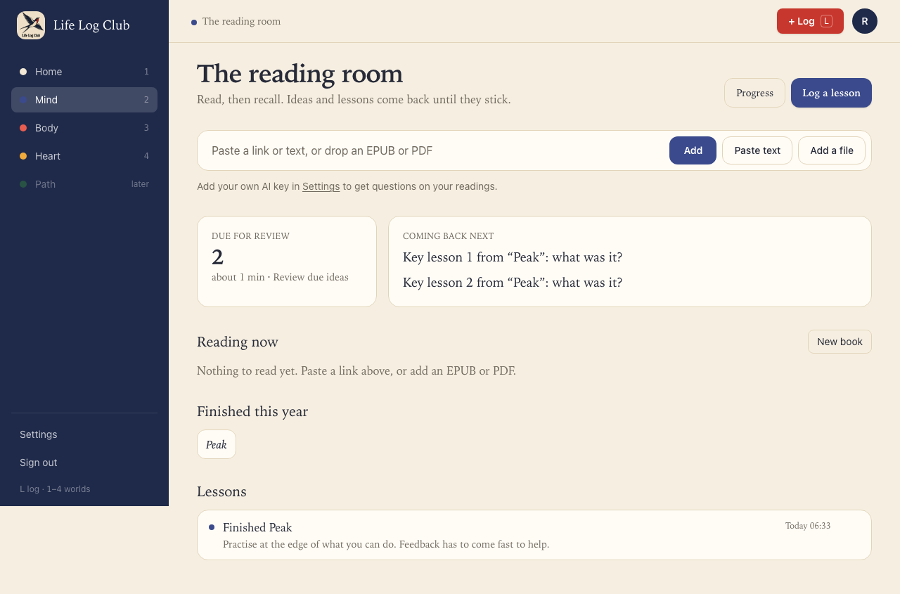
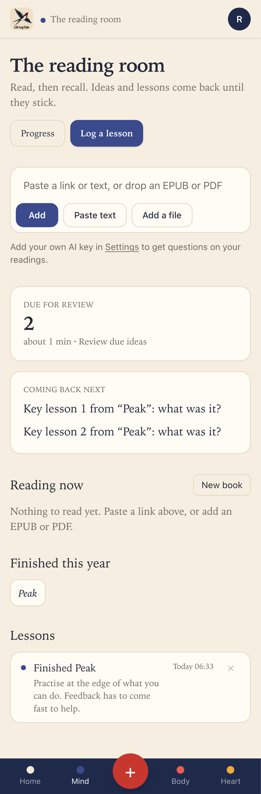

# Issue #22: Set a goal to finish a book, and mark it finished

Release 3, task 17 of 31. Spec: `learning_spec.md` section 7.13.

## What was built

- **Finish by.** Each reading's tile has **Finish by**; picking a date saves it (2 clicks). The tile then shows "0% · about 1 page a day to finish by 17 Nov": the share of words in sections read to their end, and the words left divided over the days to the goal, today included, in pages of 300 words, rounded up. After the goal day it shows "Goal date passed", and nothing else. **Change goal** picks another date, and **No goal** clears it. Stored in `readings.goal_by` (a date, UTC days), through `readings.update({ id, goalBy })`.
- **Finished.** One click, from the reader's header in any section, or from the card at the end of the last section. It sets `readings.finished_at`, logs a `reading.finished` entry (`readings.finished_entry_id`), shows "Finished: Peak" with **Undo**, and opens the last section. Finishing without reading every section is allowed.
- **The milestone card**, at the end of the last section of a finished reading: the date, time read (from the `reading_time` heartbeats, already recorded quietly since the reader was built), ideas in review, and how many were right at their last review. Under it, **Your key lessons from it**: up to 3 lines, empty at first. **Save lessons** makes each line a lesson card linked to the entry, started and due at once, and the entry's text holds them all, one a line. **Undo finished** takes it all back.
- **Undo.** `readings.unfinish` removes the entry, hides its lesson cards and clears `finished_at`. Removing the entry from the entry list (×) does the same, and its Undo (`entries.restore`) finishes the reading again with its lessons.
- **On Mind.** The entry shows in the Lessons list as "Finished Peak" with its lessons. A finished reading leaves Reading now and shows under **Finished this year**, which opens it at its milestone. Readings finished in earlier years show under **Finished before**.
- **The `reading.finished` entry type** in `packages/domain/src/entries.ts`: Mind, relive and track, details `{ readingId, title, author? }`. It is not in the + Log picker, and `entries.create` refuses it ("Mark a reading finished from the reading itself."), so only Finished makes one.
- **API:** `readings.update`, `readings.finish({ id, entryId, lessons })` → `{ reading, entry, milestone }`, `readings.unfinish({ id })`, `readings.milestone({ id })`. `Reading` now carries `wordsRead`, `goalBy` and `finishedAt`. Migration `0019_reading_goals`.

## Decisions

- **Finished is one click, and the lessons come after it.** The spec's `finish({ id, lessons })` takes the lessons with the finish, but the spec also asks for Finished in 1 click. So `finish` is idempotent: on a finished reading it only adds lessons, to the entry it already has. The client picks the entry id and each lesson's card id, so a retried save adds nothing twice.
- **Lesson cards get a plain cue**, "Key lesson 1 from “Peak”: what was it?", and no AI-written cue. The lesson-cue job finds a card by its entry, and a finished reading has up to 3 cards on one entry. The card also points at its reading, so Review shows the reading as its source.
- **Words added** is not on the milestone yet: words come in Release 6.
- **Member-made books** (articles put together as a book) have no Finished yet; this issue covers readings, which is what an EPUB or PDF book is.

## A bug from #21, found and fixed

An article stores chapter 0 on every section, so the last section of any article with more than one section looked like the end of a chapter and offered **Recall chapter** (seen on the milestone screenshot of this issue's first run). Recall chapter now shows only on readings that have more than one chapter. The #22 e2e test checks that the article's last section has no Recall chapter.

## Proof

### The goal on the tile

### The milestone, after Finished and two key lessons

### Mind: the entry, Finished this year, and the 2 lessons due

### Tests

- `e2e/mind-read.spec.ts`, **Finish by sets a pace on the tile; Finished logs the reading as a milestone whose key lessons become cards, and Undo takes both back** (desktop and phone). A pasted reading of 600 words in two sections:
  - Finish by a week from today shows "0% · about 1 page a day to finish by …"; a goal day already over shows "0% · Goal date passed".
  - Finished from the first section shows the toast and opens the last section, which has no Recall chapter and shows the milestone.
  - Two lessons saved: one `reading.finished` entry whose text is both lessons, and two lesson cards linked to it.
  - Mind shows "Finished Peak" in the entry list, Peak under Finished this year and not in Reading now, and 2 due.
  - Undo finished: the entry is removed, both cards hidden, Peak is back in Reading now, and 0 are due.
- `e2e/review.spec.ts`, **a finished reading follows its entry**: a retried save and a second Finished add nothing; a 4th lesson is refused; removing the entry unfinishes the reading and hides its cards; restoring it finishes it again; `entries.create` refuses a `reading.finished` entry.
- `packages/domain/src/progress.test.ts`, **goalPace**: words left over the days to the goal with today included; part pages round up; the goal day itself still counts and the day after has passed.

Full run: `pnpm typecheck`, `pnpm test` and `pnpm e2e` are green.
