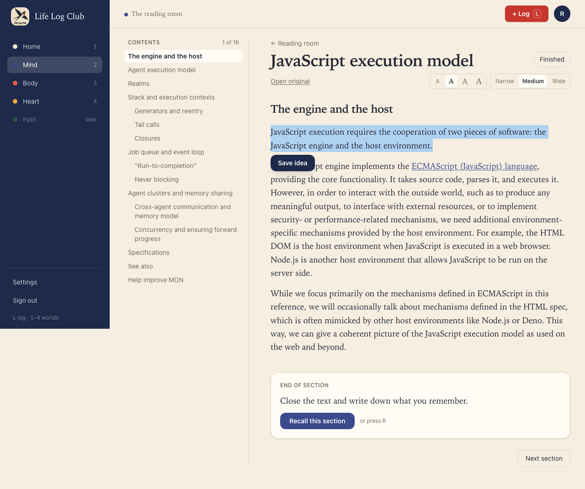
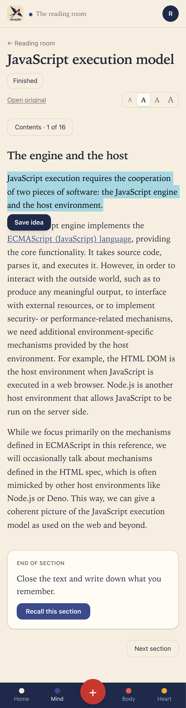
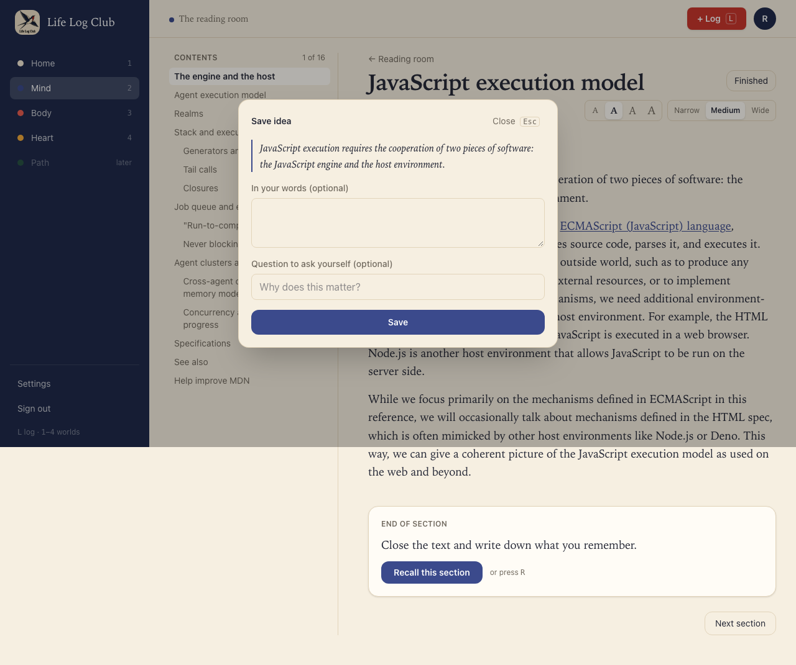
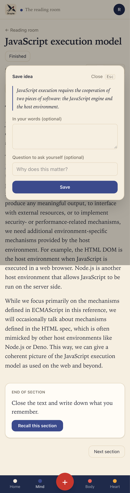
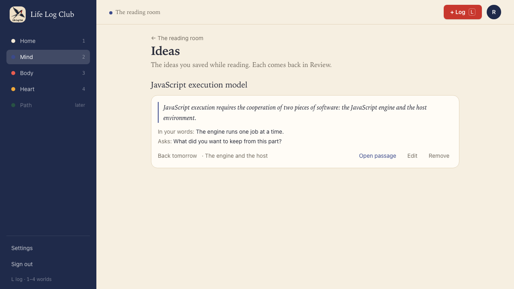
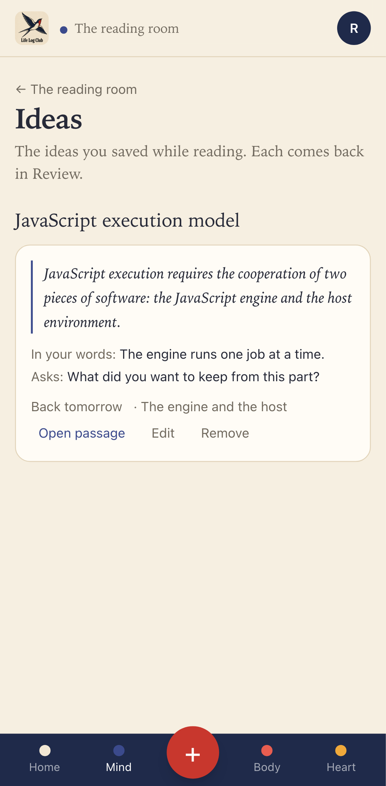

# Issue #23: Save an idea from selected text

Release 4, task 18 of 31. Spec: `learning_spec.md` section 7.9.

## What was built

- **Save idea.** Selecting text in the reader shows **Save idea** under the selection. It opens a small card with the quote and two optional fields, **In your words** and **Question to ask yourself**. **Save**, or Enter in either field, saves it (2 clicks). Shift+Enter starts a new line in the words. A toast says "Idea saved. It comes back tomorrow." with **Undo**.
- **The card.** `kind = 'idea'`, `origin = 'member'`, with `reading_id`, `section_id` and `quote`. The answer is the member's words, else the quote. The cue is their question, else "From *Title*, *Section*: what did you save here?" (an article whose one section has the reading's title gives "From *Title*: …"). Saving counts as a study event, so the card starts at step 1 and is first due in 1 day.
- **The `write-cue` job.** When the member has a key and gave no question, the job asks their AI for a cue (`packages/llm/src/idea-cue.ts`, "Task: write-cue"). The cue must pass `lintCue` against the quote and the member's words: a question, under the length limit, and not giving the idea away. The fallback cue is replaced only if it is still the card's cue, so a question the member writes meanwhile wins. It stops at the AI budget, like other background work.
- **Ideas page** (`/mind/ideas`, **Ideas** on Mind, next to Progress). Every saved idea, grouped by reading, newest first: the quote, the member's words, the cue ("Asks: …"), when it comes back, and its section. **Open passage** opens the reader at the section and block where the quote starts. **Edit** changes the words and the question. **Remove** has **Undo**.
- **API:** `review.add` takes `{ readingId?, sectionId?, block?, quote? }`, and `prompt` and `answer` are now optional when there is a quote. New: `review.update({ id, prompt?, answer? })`, `review.remove({ id })`, `review.restore({ id })` and `review.list({ readingId?, origin?, kind? })`. `Card` now carries `readingId`, `sectionId` and `quote`.

## Edge cases

- **A selection across sections** belongs to the section where it starts. The reader shows one section at a time, so this mostly means a selection that starts in the section title.
- **Over 1,000 characters:** the reader shows "Pick one idea, not a page." in place of **Save idea**, and the API refuses it with the same message.
- **The same quote twice** (the same reading, with spacing ignored): **Save idea** opens the first card ("You saved this idea already") with its words and cue, to edit. The API also returns the first card, so the id that comes back can differ from the one sent.
- **A section still waiting for AI headings** offers no **Save idea**, because it is split again when the headings arrive.
- Note markers inside the selection are left out of the quote, and blocks are joined with a space.

## Decisions

- **`block` was added to `review.add`.** The spec's fields cannot link back to the passage itself, only to its section. The block index where the quote starts is kept in `cards.details`, and **Open passage** opens the reader there (`/mind/read/<id>?section=…&block=…`).
- **Only saved ideas can be edited or removed through `review.update` and `review.remove`.** A key idea's questions are written from its answer, and a lesson card follows its entry. Other cards answer "That idea does not exist."
- **The reading and the section are checked** to belong to the member and to each other before the card is made, because foreign keys skip row-level security.
- `parseLessonCue` is now `parseCue`, shared by the lesson and idea cue jobs.

## Proof

### Text selected in the reader: Save idea under it

### The Save idea card

### Ideas: the saved idea under its reading, with the cue the AI wrote and the member's words

### Tests

- `e2e/mind-read.spec.ts`, **Save idea turns a selected passage into a card due in 1 day, listed on Ideas under its reading; with a key, AI writes its cue** (desktop and phone):
  - Selecting the whole section shows "Pick one idea, not a page." and no **Save idea**.
  - A triple-click selects a paragraph; **Save idea**, then Enter, saves it. The card has the quote as its answer, the first section, step 1, a start time, and a due time 1 day away.
  - The fake LLM's cue replaces the fallback, and shares no word of 4 letters or more with the quote.
  - Selecting the same paragraph again opens "You saved this idea already" with the AI's cue. The words saved there update the same card, and there is still one card.
  - Ideas shows the idea under the reading's title, with the member's words and "Back tomorrow". **Open passage** opens the reader at its section. **Remove** takes it off, and **Undo** brings it back.
- `e2e/review.spec.ts`, **a saved idea uses the member's words and question, else the quote and a fallback cue, and is due in 1 day**: the fallback cue names the reading and section; the member's words and question are kept; the same quote with other spacing returns the first card; no AI call without a key; a 1,001-character quote, a quote with no reading, a lesson with a quote, and a question with no answer are refused; `review.list` is newest first with titles, and is empty once the reading is removed.
- `e2e/review.spec.ts`, **a saved idea can be edited, removed and restored, and only by its member**: an edit keeps the due time; a removed idea can't be edited and comes back on restore; another member can't save into the reading, edit, remove or list it; a section of another reading is refused; a lesson card can't be edited or removed here.

Full run: `pnpm typecheck`, `pnpm test` and `pnpm e2e` (136 passed, 30 skipped) are green.
