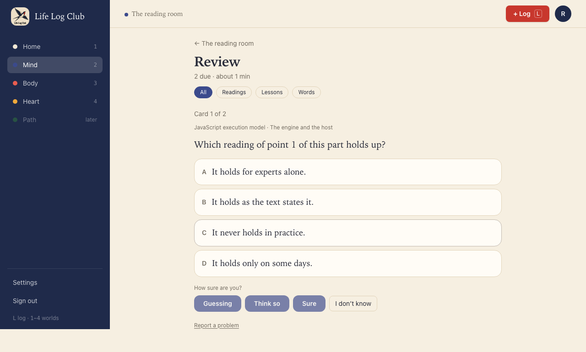
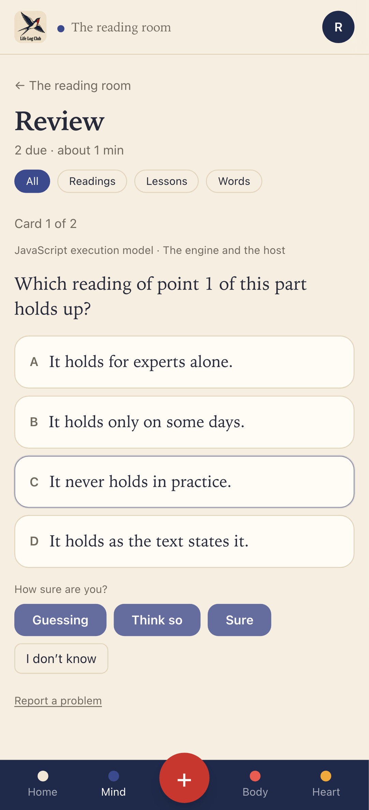
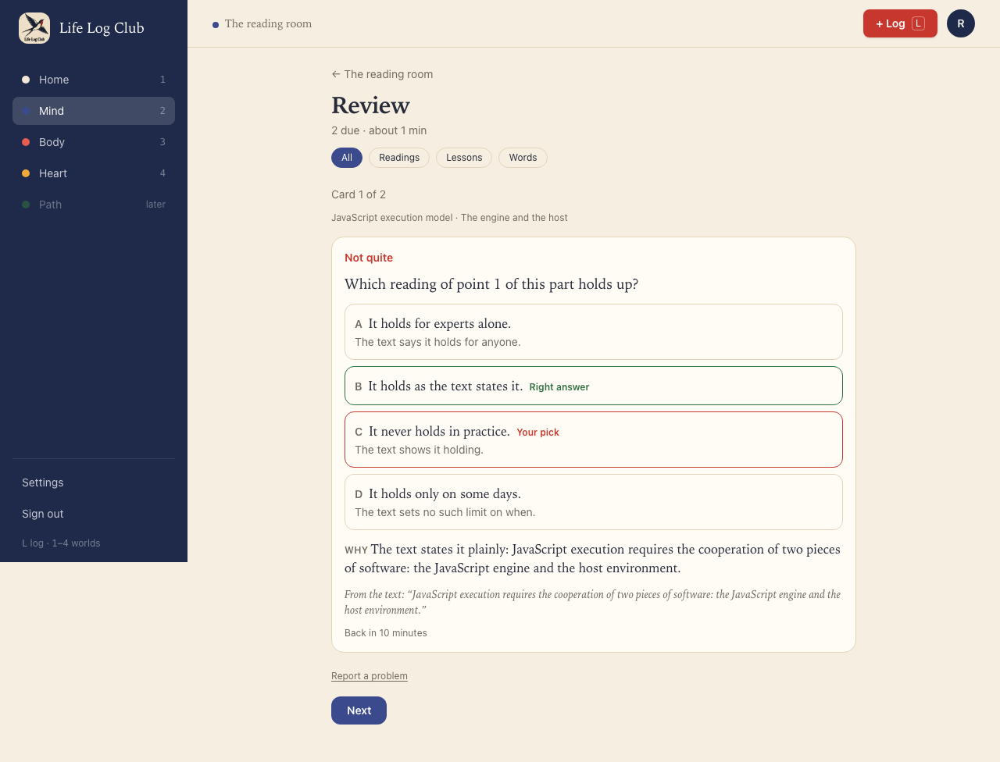
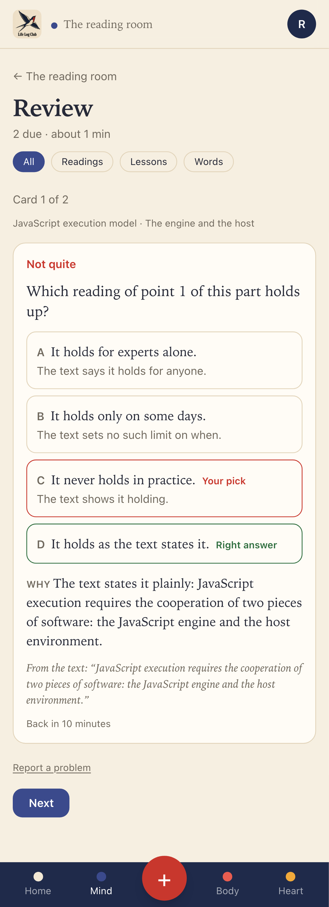

# Issue #24: Add multiple-choice questions

Release 4, task 19 of 31. Spec: `learning_spec.md` sections 7.5 and 7.6.

## What was built

- **The `mcq` question type** in `packages/domain/src/questions.ts`, ported from the previous app: a prompt, 2 to 6 options (the write-time checks ask for exactly 4), `answerIndex`, `explanation`, and `whyWrong` with one reason per option ("" for the right one). Only the prompt, code and options reach the client. It is graded in code: the right option is `good`, any other or **I don't know** is `again`, with no AI call. Confidence lowers credit as for written answers, so a right pick called a guess is spaced like `hard`.
- **Shuffled in code.** Models tend to put the right option first. `shuffleMcq` reorders the options and moves `answerIndex` and `whyWrong` with them. Each question is shuffled once, when it is written, and stored that way, so a question shows the same order every time.
- **Writing.** `write-section` takes the member's `preferences.question_style`: `mixed` (the default) asks for mostly short answers and "about a quarter mcq, used only where the wrong options are genuinely tempting"; `written` asks for short answers only; `choice` for mcq only. A question of a type the style does not allow is sent back like any other that breaks the rules. The checks in code (exactly 4 options, no "all/none of the above", the right option not clearly the longest, a reason for each wrong option) were already in `lintQuestion`; the AI quality check now also rejects a key that is not the one right answer. Prompt version `questions-v10`.
- **Answering.** Review and the recall check show the options as A to D. Picking one turns on the confidence buttons, which submit it, as for written answers. With the answer keys on, A to D pick an option and 1 to 3 pick the confidence.
- **The result** lists every option: the right one marked **Right answer**, a wrong pick marked **Your pick**, and under each wrong option why it is wrong. Then **Why** (the explanation) and the quote. A choice has no **Count it as right**, because it is checked against its key; a wrong key is reported with **Report a problem**.
- **API:** a question in `review.next` and in a recall check now carries `options` (null for a written question). `Reveal` has an optional `choice`: the options, the right one, the pick and the reasons, so the result shows on the recall results page too. `review.answer` takes `{ choice }` or `{ skipped: true }` for an mcq. `review.override` and `review.checklist` refuse an mcq.

## Decisions

- **About a quarter is guidance to the model, not a quota.** The spec keeps the old `MIX.mixed` wording: choice types only where the wrong options are genuinely tempting. A quota in code would force options onto ideas with no good misconceptions.
- **The Kinds setting has no screen yet.** Settings → Questions is issue #26. The style is read from `preferences.question_style`, which already exists with the default `mixed`.
- **Review without a key still self-rates every card**, as before, even though an mcq needs no key to grade. Questions are only written with a key, so a member without one has none.

## Proof

### Review: a multiple-choice question, one option picked

### The result of a wrong pick

### Tests

- `e2e/mind-read.spec.ts`, **Multiple choice in Review: options stored shuffled, the pick graded against the key, and why each wrong option is wrong** (desktop and phone). A member with choice-only questions reads a section for 30 seconds; the fake AI writes each question with the right option first.
  - The stored questions are `mcq`; the key points at the right option, and each reason moved with its option.
  - In Review the question shows 4 options, and Sure stays off until one is picked. A wrong pick shows "Not quite", **Your pick** on it, **Right answer** on the right one, each wrong option's reason, "Back in 10 minutes", and no **Count it as right**. The log row is graded by `code`, with the pick's index as the response.
  - The second card is answered by keys: the right option's letter, then 3. It is right, back tomorrow, graded by `code`, with confidence `sure`.
- `e2e/review.spec.ts`, **a multiple-choice answer is graded in code against its key, with no AI key needed, and cannot be counted as right**: a wrong pick, a right pick, and I don't know; a written answer to an mcq is refused; every row is graded by `code`; override and checklist are refused.
- `e2e/review.spec.ts`, the existing Review test now expects `options: null` on a written question.
- `packages/domain/src/questions.test.ts`, ported from the previous app's `core.test.ts`: **hides the MCQ answer key and grades it without the judge**, **spaces a right answer called a guess like a hard one**, **shuffleMcq moves the right answer and its reasons along with the options**, plus **spreads the right answer over every position** and **puts written questions before multiple choice**.
- `packages/domain/src/quality.test.ts`, ported: **rejects multiple choice with a giveaway option or missing reasons**, plus a check for exactly 4 options.
- `packages/llm/src/write-section.test.ts`, **writes multiple choice in Mixed, stored shuffled with its reasons in step, and only written questions in Written**.

Full run: `pnpm typecheck`, `pnpm test` and `pnpm e2e` (139 passed, 31 skipped) are green.
