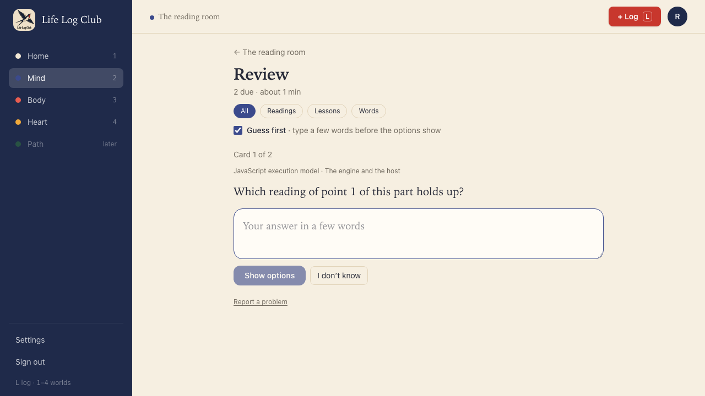
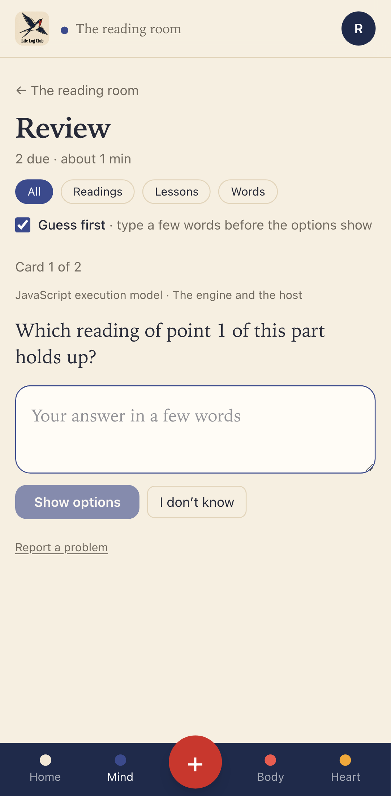
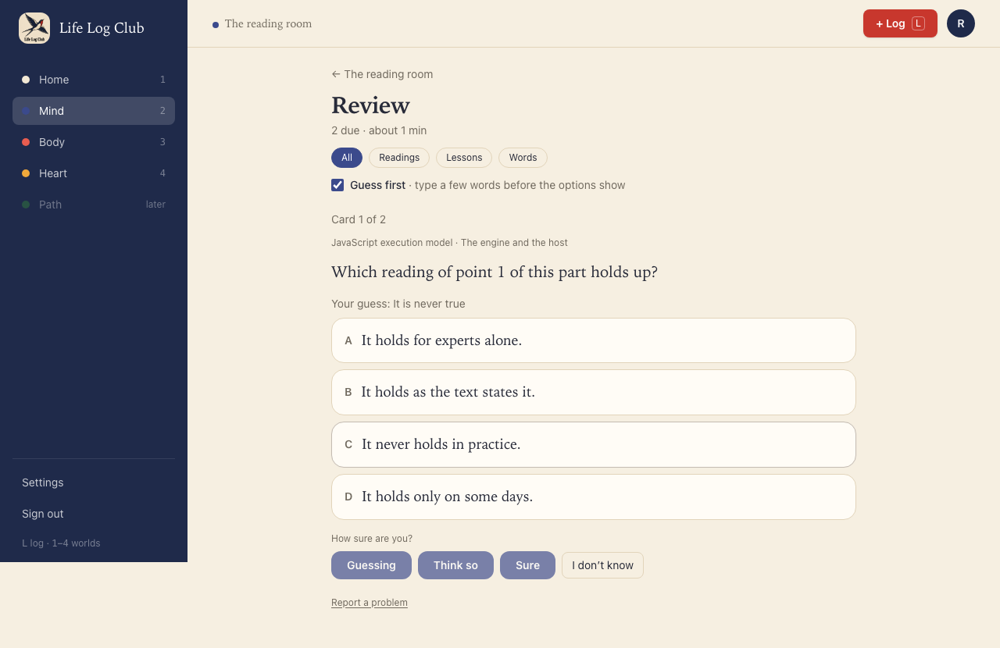
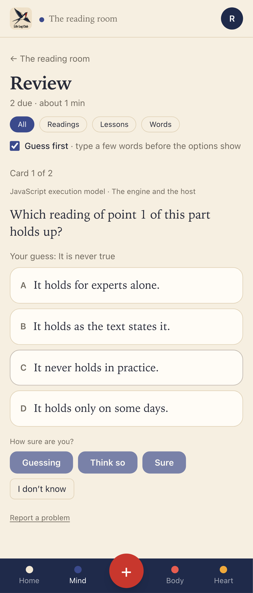
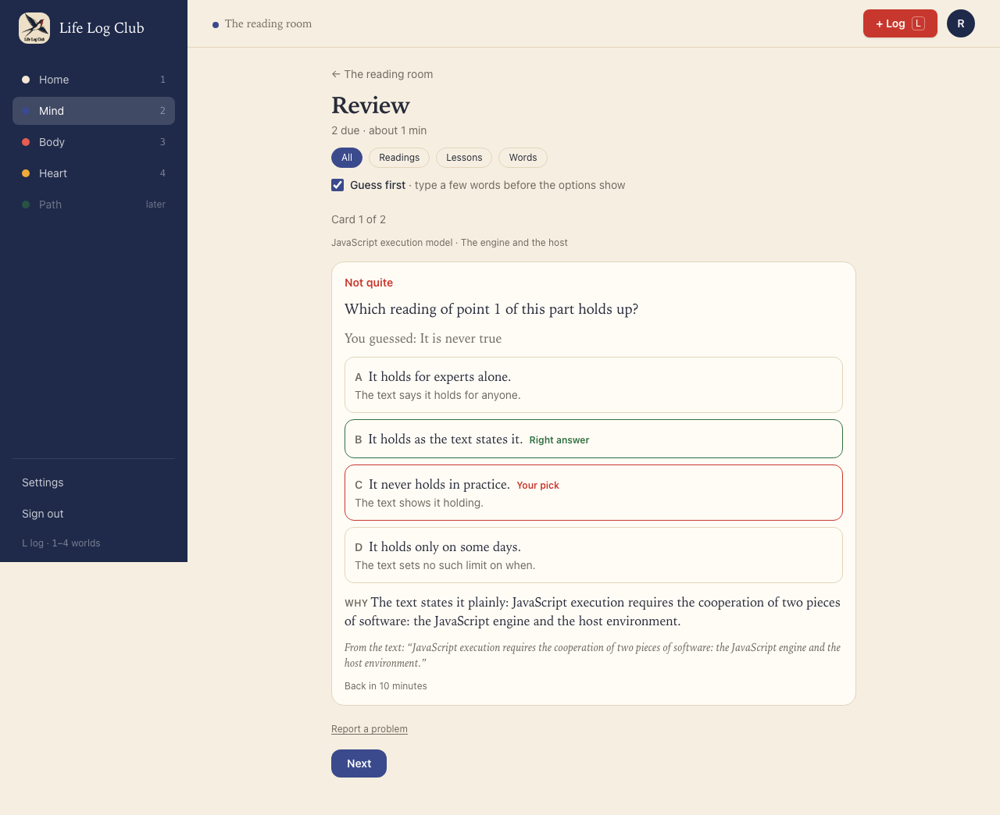
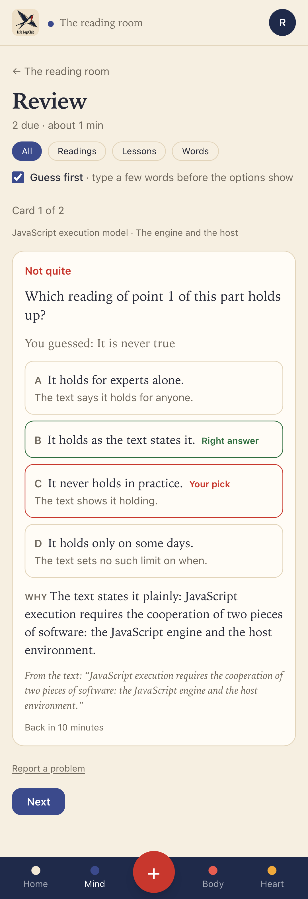
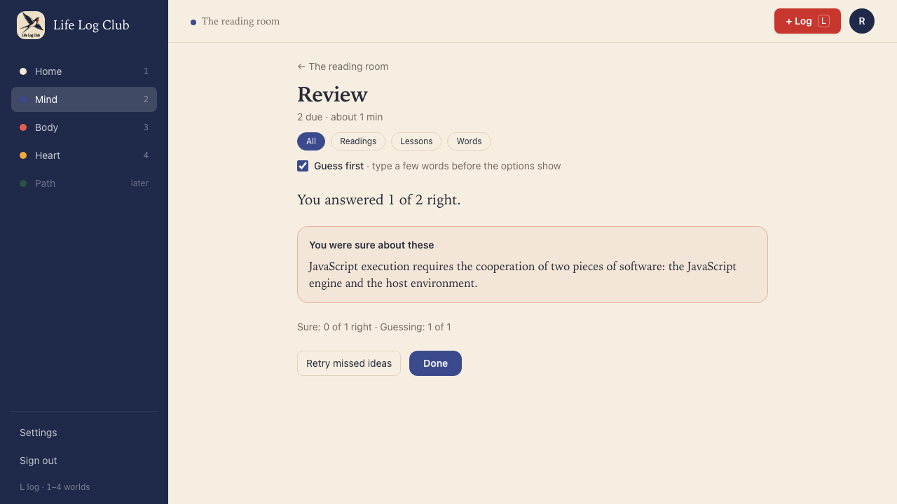
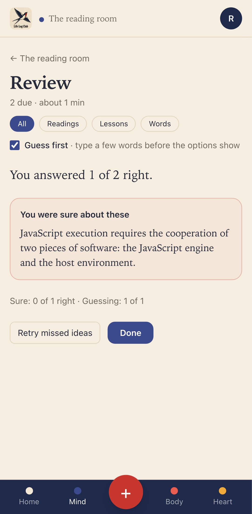
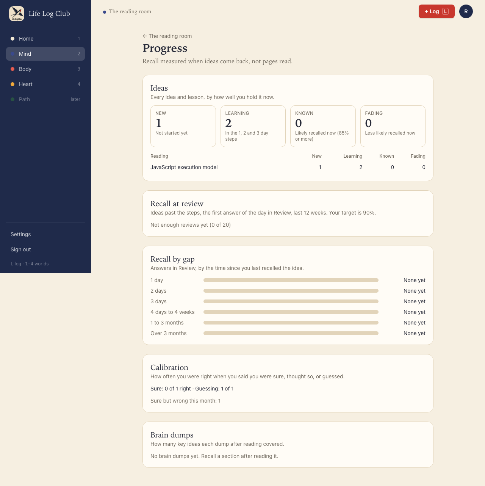
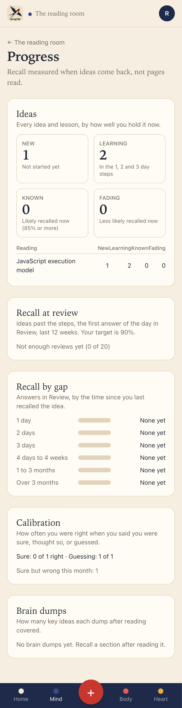

# Issue #25: Guess first, and show how well confidence matches results

Release 4, task 20 of 31. Spec: `learning_spec.md` section 7.8.

## What was built

- **Guess first**, on by default (`preferences.guess_first`). A multiple-choice question first shows "Your answer in a few words" and **Show options**, which stays off until something is typed. **I don't know** is there too. Once the options show, "Your guess: …" sits above them, and the result shows "You guessed: …". The guess is kept in `review_log.response` with the pick (`{ choice, guess }`), and is not graded.
- **One switch in three places**, all the same value: the Review start screen (under the filters), the recall start screen (under the brain dump), and the new **Questions** card in Settings. `preferences.get` and `preferences.update` now carry `guessFirst`.
- **Confidence** buttons were already the submit on every graded question, and `withConfidence` already lowered credit. This issue adds the tests the spec asks for: a right multiple-choice pick called **Guessing** logs `hard`.
- **The calibration line** on the results of a Review batch and of a recall check: "Sure: 0 of 1 right · Guessing: 1 of 1", after **You were sure about these**. Only answers given with a confidence count, so self-rated cards and I don't know are left out. Levels with no answers are left out.
- **Progress → Calibration**: the same line over the last 12 weeks, from recall and review answers. A level with 20 answers or more shows a percentage ("Sure: 91% right"). Under it: "Sure but wrong this month: N", for the calendar month in UTC. `progress.summary` returns `calibration: { sure, think_so, guessing, sureWrongThisMonth }`.
- `calibration` and `calibrationLine` are in `packages/domain/src/progress.ts`, so the results and Progress count the same way.

## Decisions

- **Practice answers are left out of Progress.** A retry right after seeing the answer says little about how well the member judges what they know. The results line of a Review batch counts the batch, not its retry round.
- **The other Settings → Questions controls** (how many, kinds, check twice) are issue #26. The Questions card holds only Guess first for now.
- **Show options is a button, not Enter.** A guess is a few words, and a click on **Show options** is the single step the spec describes.

## Proof

### Guess first: the options wait for a typed guess

### The options, with the guess above them

### The result shows the guess

### The end of the batch: the confident error, then the calibration line

### Progress → Calibration

### Tests

- `e2e/mind-read.spec.ts`, **Multiple choice in Review: options stored shuffled, shown after a typed guess (Guess first), graded against the key, then confident errors and the calibration line** (desktop and phone). This extends the #24 test:
  - The Guess first switch on Review is on. No options show, and **Show options** is off until a guess is typed. After it, "Your guess: …" shows.
  - A wrong pick with Sure: the result shows "You guessed: …", and the log keeps `{ choice, guess }`.
  - The second card: a guess, then the right option's letter and 1 (Guessing). It is right, and logged `hard` with confidence `guessing`.
  - The batch ends with "You answered 1 of 2 right.", the sure-but-wrong idea under **You were sure about these**, then "Sure: 0 of 1 right · Guessing: 1 of 1".
  - Turning the switch off on Review sets `guess_first` to false, and Settings shows it off.
  - Progress shows the same line and "Sure but wrong this month: 1".
- `e2e/mind-read.spec.ts`, the recall test now checks the Guess first switch on the brain dump screen.
- `packages/domain/src/progress.test.ts`, **calibration**: only answers with a confidence count; levels with none are left out; a level with 20 or more shows a percentage.
- `packages/domain/src/questions.test.ts`: **withConfidence** (a right guess is `hard`, `easy` needs Sure or no confidence, a wrong answer stays `again`) and **accepts a typed guess with an MCQ pick, and spaces a right answer called a guess like a hard one**.
- `apps/server/src/learning/progress.test.ts`, **calibration counts recall and review answers given with a confidence, and Sure but wrong in this month**: practice, no confidence, and answers older than the window are left out; a wrong answer from last month counts in the line but not in this month's count.

Full run: `pnpm typecheck`, `pnpm test` and `pnpm e2e` (139 passed, 31 skipped) are green.
