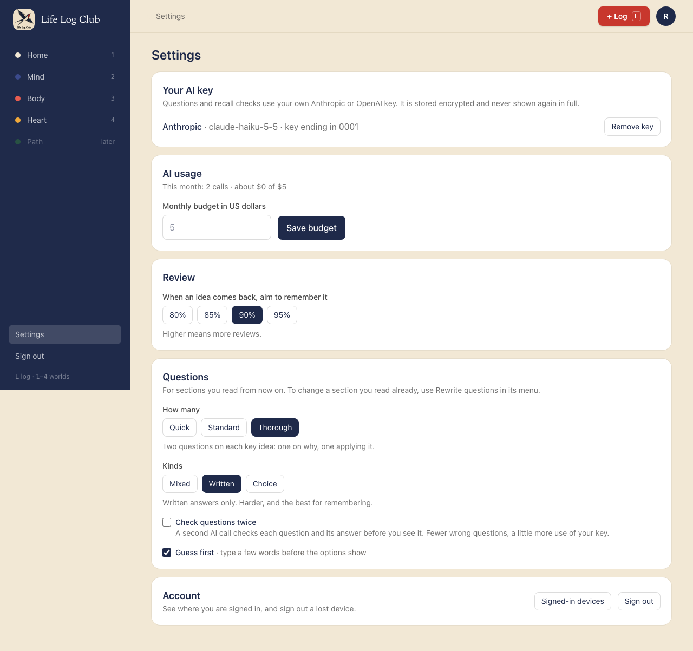
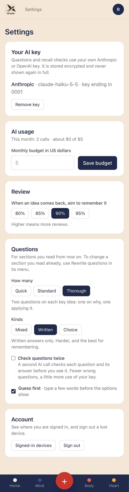
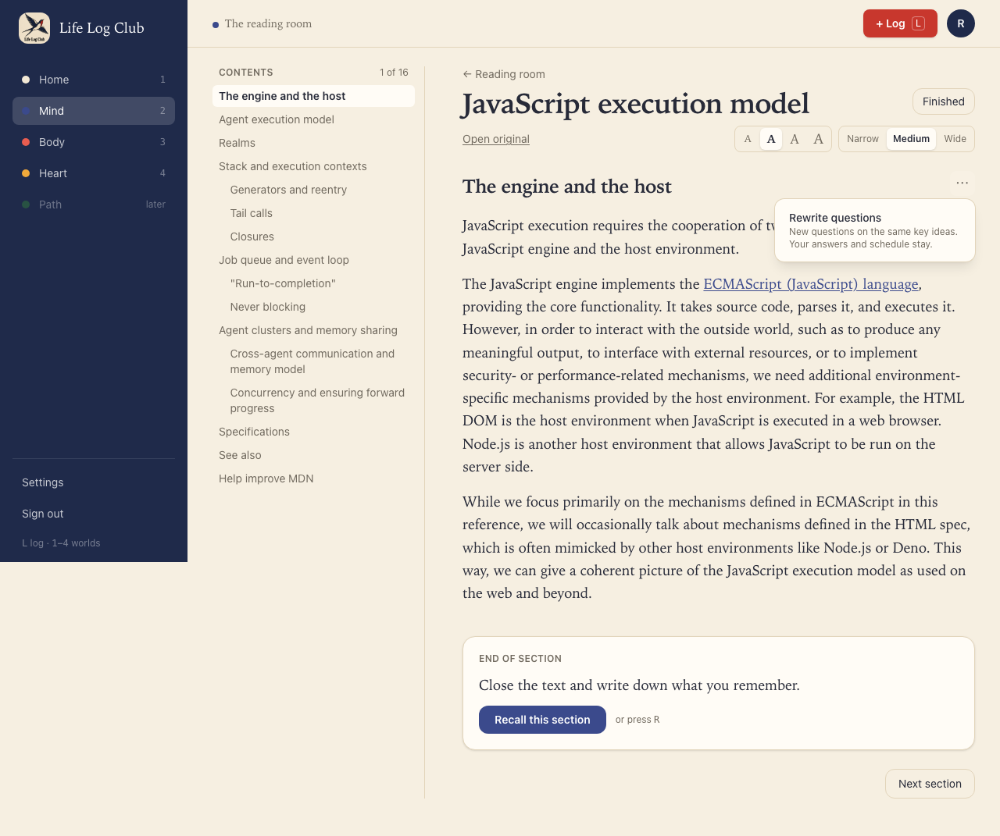
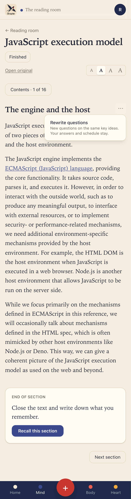

# Issue #26: Question settings and Rewrite questions

Release 5, task 21 of 31. Spec: `learning_spec.md` section 7.3 (Rewrite questions, Settings → Questions).

## What was built

- **Settings → Questions**, for sections read from now on. Each choice saves on its own click, and the hint under it says what it means for learning:
  - **How many**: Quick (no written questions, each key idea comes back through its cue), **Standard** (one per idea), Thorough (two per idea: one on why, one applying it).
  - **Kinds**: **Mixed** (mostly written, multiple choice where the wrong options are tempting), Written, Choice.
  - **Check questions twice** (on): a second AI call checks each question and its answer key.
  - **Guess first**, the same switch as on Review and the recall screen.
  - The preferences API now carries `questionAmount`, `questionStyle` and `qualityCheck`.
- **The section menu** (⋯ beside the section title in the reader), on sections that have key ideas. Esc or a click outside closes it.
  - **Rewrite questions**: new questions on the same key ideas, at the member's amount and kinds. The old questions are retired (`retired_at`), never deleted, so every answer keeps pointing at the question it answered. Cards, their schedules and `started_at` stay as they are. New questions must not repeat a question asked before on that idea.
  - **Rewrite key ideas**: shown only while none of the section's key ideas has started or has an answer (`Section.ideasInUse`). The AI's key ideas are written again from the text. Saved ideas are not touched.
  - While a rewrite runs, the line under the title says "Rewriting questions for this section…". When it is done, a toast says "New questions are ready. Your answers so far are kept." If it fails, the line says so and the menu can try again.
- **API:** `questions.rewrite({ sectionId, ideas? })`. It runs in the `write-section` queue with a key of its own (`rewrite:<section>`), at the same priority as Recall, because the member asked for it and is waiting. Like Recall, it does not stop at the monthly AI budget.
- **LLM:** `writeQuestions` writes fresh questions for ideas that already have cards. It shares the checks, the quality check and the one rewrite round with `writeSection` (moved into `fillQuestions`). `QUESTION_AMOUNTS` and `QUESTION_STYLES` moved to `packages/domain`, so the contract can use them.

## Decisions for the learner

- **Rewrite never touches what the member has learned.** No card, answer or schedule changes. Only questions are retired. This is the spec's "no surprise loss of review history".
- **Rewrite key ideas only before any idea is in use.** Once an idea has an answer, replacing it would cut its history, so only its questions can change. The menu does not offer it then, and the API refuses it with a reason.
- **On Quick, Rewrite questions is refused** with "Your questions are set to Quick, so key ideas are asked through their cues only. Choose Standard or Thorough in Settings → Questions first." Retiring questions without writing new ones would only lose variety.
- **Without a key** the API says "Add your own AI key in Settings to rewrite questions."
- **Settings show the change at once.** A quick second click no longer flickers back while the first save is still on its way. The Guess first switch works the same way.

## Proof

### Settings → Questions

### The section menu, with one idea already in review

### Tests

- `e2e/mind-read.spec.ts`, **Settings → Questions sets how many and which kinds; Rewrite questions writes new ones for the same ideas and keeps every answer and schedule** (desktop and phone):
  - Standard, Mixed and the check are the defaults. Thorough, Written and no check are saved.
  - One idea is answered in Review. The menu offers only Rewrite questions, and Esc closes it.
  - After the rewrite, every old question is retired, each idea has 2 new written questions, the `review_log` rows are the same, and every card's `started_at`, due time and level are the same.
  - When the answered idea comes back in Review, it asks one of the new questions.
- `e2e/review.spec.ts`, **Rewrite key ideas replaces ideas none of which is in use; once one is answered only questions can be rewritten, and never on Quick or without a key**: new cards with new ids replace unused ideas; after an answer, Rewrite key ideas is refused (`CONFLICT`), and Rewrite questions keeps the cards and the log row; Quick and no key are refused (`BAD_REQUEST`); another member gets `NOT_FOUND`.
- `packages/llm/src/write-section.test.ts`, **writes fresh questions on existing ideas for Rewrite, at the amount, and drops one like a question asked before**.

Full run: `pnpm typecheck`, `pnpm test` and `pnpm e2e` (142 passed, 32 skipped) are green. The menu's Esc and outside-click close came after the full run; the #26 e2e test, which presses Esc, passed again at both sizes.
