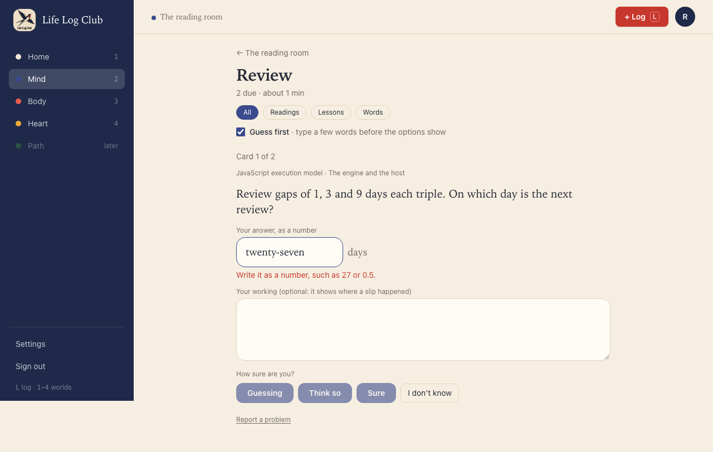
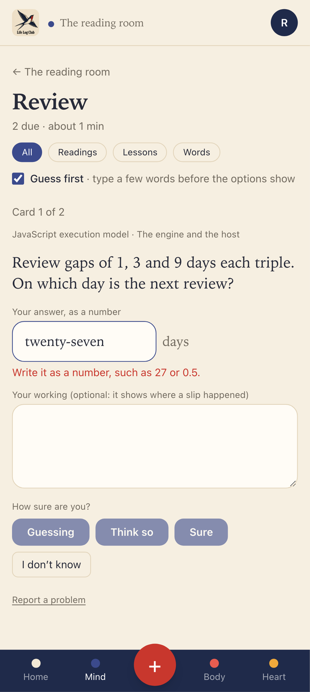
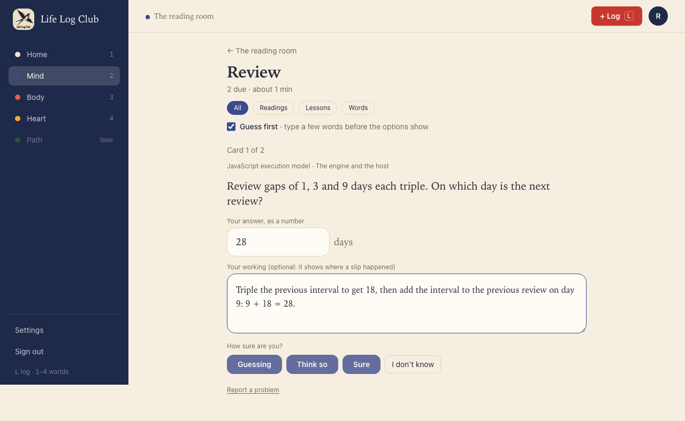
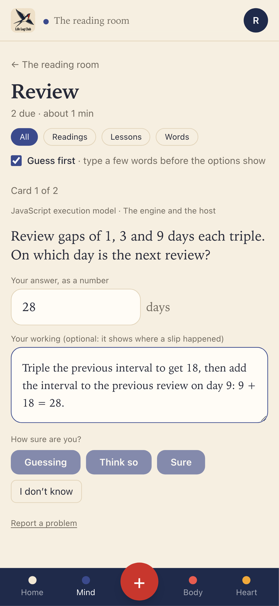
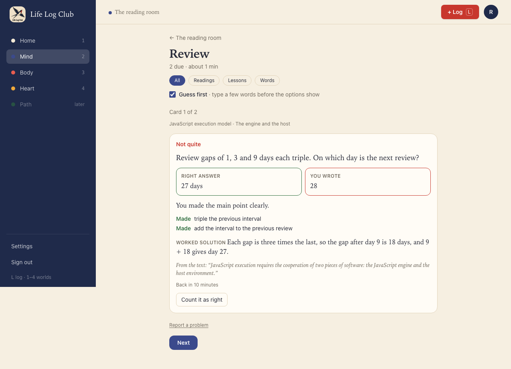
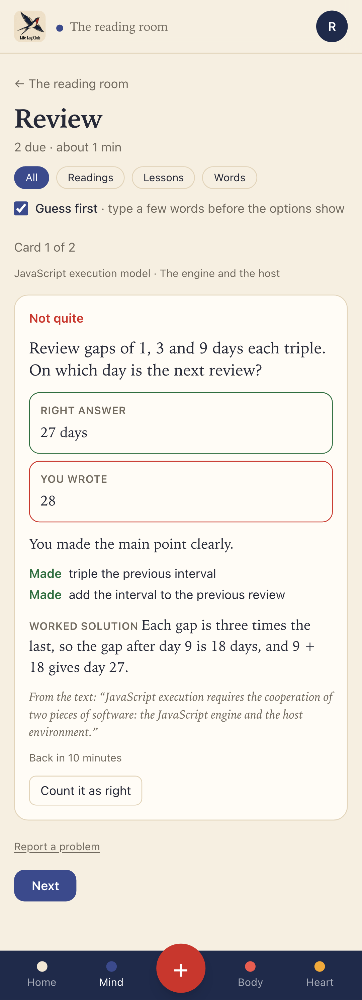
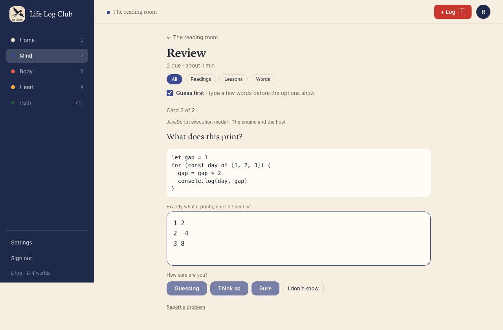
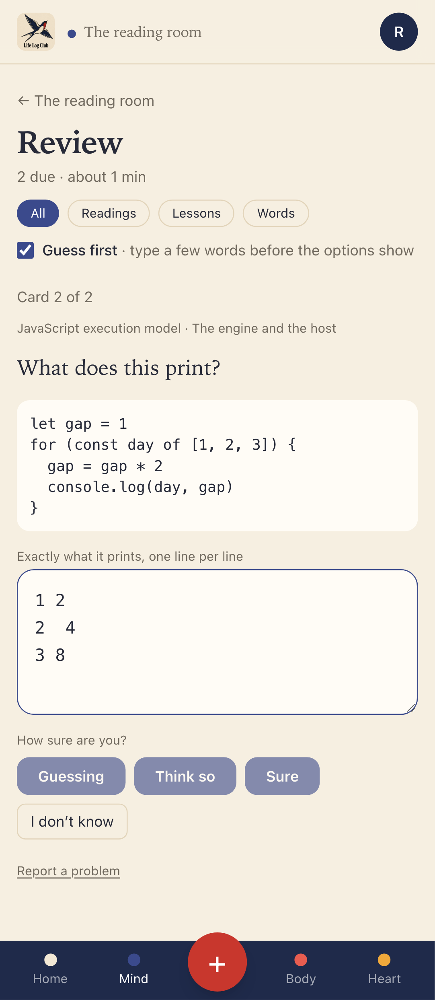
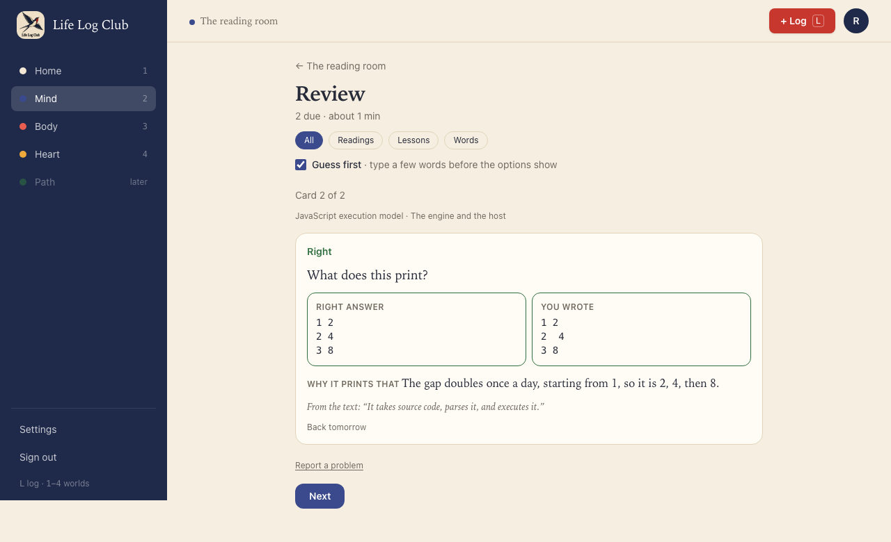
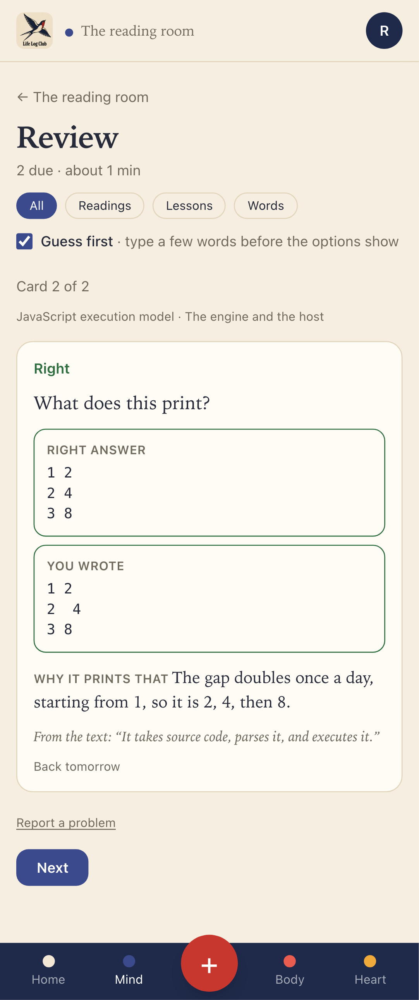

# Issue #28: Problem, output and error questions

Release 5. Spec: `learning_spec.md` section 7.5 (question types).

## What was built

Three new question types, ported from the previous app (Peak, `packages/core/src/questions.ts` at `4051df5^`) with their grading tests:

- **`worked_problem`**: a problem with new numbers whose answer is one number.
  - The member types the number in its own box, with the unit beside it, and can add their working in a second box ("optional: it shows where a slip happened").
  - **The number decides** whether the answer is right, within the question's tolerance. `parseNumber` reads "27", "27 days", "1,024", "-3e-4" and "3/4".
  - **The working, when given, is judged** against the question's key steps, so the result marks each step as made or missing. Clean working on a right answer is rated `easy`. If the judge fails or there is no key, the number still decides and the working is left unmarked.
  - The result shows "Right answer: 27 days" beside "You wrote: 28", then the worked solution.
- **`predict_output`**: a short piece of code; the member writes exactly what it prints.
  - The box is monospace and does not spell-check.
  - Graded in code: spacing within and around lines does not count, line breaks do (`normalizeOutput`).
  - The result shows the right output beside the member's, in monospace, then "Why it prints that".
- **`find_error`**: flawed code or a flawed claim; the member says what is wrong and why. It is judged like a written answer, against its must-have points, and works with the self-check without a key.

Other changes:

- **Contract:** `Reveal.exact` (`{ kind: 'number' | 'output', expected, given }`), `unit` on the Review question ask, and `type` and `unit` on the recall ask item.
- **Server:** a number without working and an output are recorded as `graded_by = 'code'`; a number with working as `'ai'`.
- **Writer (`packages/llm`, prompt version `questions-v11`):** the three types are allowed in Mixed and Written. The rules say which type fits what: code in the section calls for predict_output or find_error, numbers for worked_problem, short_answer for why and how. The second check now works the problem out, traces the code, and checks that a flawed example has exactly one mistake.

## Bugs found and fixed

- **Stored questions were graded without their defaults.** `gradeResponse` passed the stored content to the grader without parsing it, so a field with a default, such as `misconceptions: []`, could be missing. The judge request then failed on `misconceptions.length`, and a worked problem's working was never judged. `gradeResponse` now parses the content with the type's schema first.
- **The "what is X" rule rejected good questions.** The banned-prompt check in `packages/domain/src/quality.ts` rejected "What is wrong with this code?", which is how a find-the-error question asks. It now lets "what is wrong", "what is missing" and "what is the error / mistake / bug / flaw / problem" through.

## Decisions for the learner

- **A number in words is caught before it counts.** "twenty-seven" is a slip of format, not of knowledge. The box says "Write it as a number, such as 27 or 0.5." and the confidence buttons stay off until it is a number, so the card is not scheduled as a miss.
- **Working is optional but worth it.** The number alone is enough to be graded, so a quick answer costs nothing extra. Working turns a wrong number into feedback on which step slipped.
- **Count it as right stays.** An exact check can still miss a right answer, for example an output written in a form the check did not expect, so the member can count it as right once, as with a written answer. A choice still cannot be counted.
- **No checklist for these two types.** They are checked in code, with or without a key, so the self-check has nothing to tick.

## Proof

### A worked problem: the number in words is caught

### A worked problem with working

### A slip in the last step: right answer beside the member's, the working marked step by step

### A predicted output

### Right, with extra spaces that do not count

### Tests

- `packages/domain/src/questions.test.ts`, "exact question types" (ported from Peak): number parsing, tolerance, units, the working judged with a failing judge caught, clean working rated easy, output comparison with spacing, and find_error graded like a written answer.
- `packages/domain/src/quality.test.ts`: lint for predict_output, worked_problem and find_error, and "What is wrong with…" is allowed.
- `packages/llm/src/write-section.test.ts`, **keeps a worked problem, a predicted output and a find-the-error question in Written**: all three pass the writer's checks, and the prompt tells the model which type fits code and numbers.
- `e2e/review.spec.ts`, **a worked problem and a predicted output are checked in code without a key, can be counted as right, and the working is judged with a key** (API).
- `e2e/mind-read.spec.ts`, **A worked problem and a predicted output in Review** (desktop and phone): the number in words is caught, a wrong number with working shows both answers and the marked steps, and an output with extra spaces is right.

Full run: `pnpm typecheck`, `pnpm test` and `pnpm e2e` (145 passed, 33 skipped) are green.
