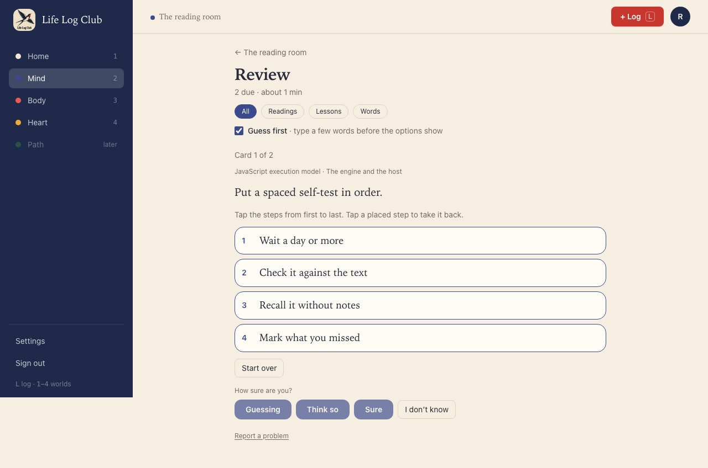
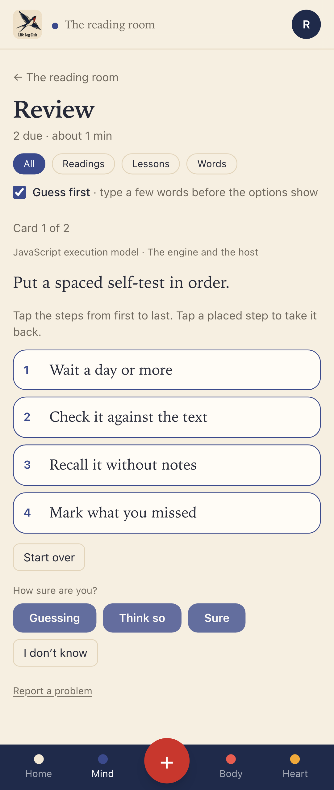
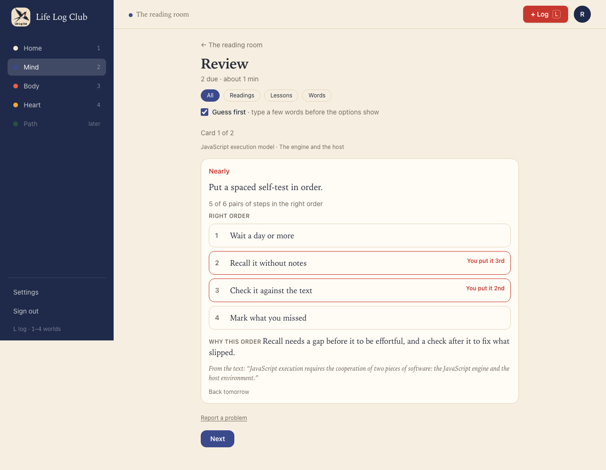
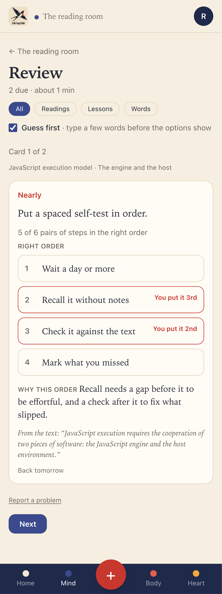
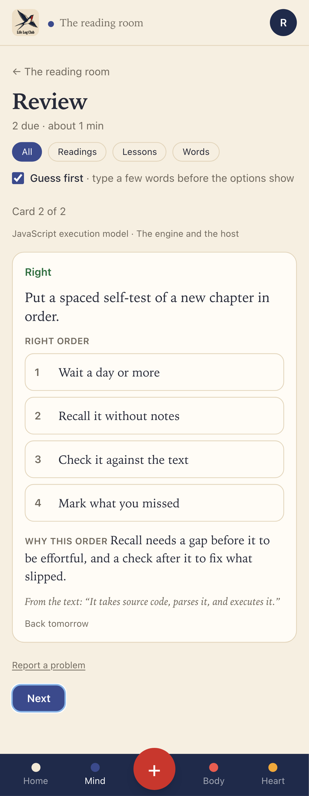

# Issue #29: Order-the-steps questions

Release 5. Spec: `learning_spec.md` section 7.5 (question types).

## What was built

- **`order_steps`**, ported from the previous app (Peak, `packages/core/src/questions.ts` at `4051df5^`) with its tests:
  - The content holds 4 to 7 steps in the right order and `shown`, the order they are shown in.
  - **Shuffled at write time, never already in order.** `shuffleSteps` shuffles the steps and, if the shuffle leaves them in order, moves them on by one. A question stored without `shown` is shown reversed.
  - **Partial credit by pairs.** `pairsInOrder` counts the pairs of steps the member put in the right relative order. All pairs right is `good`; at least 80% is `hard` ("Nearly"), so a close order comes back sooner than a right one but is not a full miss; less is `again`.
  - Every step must be placed once; anything else is refused. I don't know is allowed.
- **API:** the steps go to the client in `options`, in the shown order, with `type: 'order_steps'`. The result carries `Reveal.order` (`{ steps, given, pairs }`): the right order, the member's order as indexes into it, and the share of pairs in order. An order is graded in code (`graded_by = 'code'`), with or without a key. Like a choice, it cannot be counted as right: the key decides, and a wrong key is reported instead.
- **Recall** now builds what a question shows from the domain's `toPrompt`, the same as Review, so an order question in Recall shows its steps shuffled.
- **Writer (`questions-v12`):** order_steps is allowed in Mixed and Choice, for "a process whose order matters". The model writes the steps in order, without numbers or "first / then / finally" (the lint rejects those), and the code shuffles them before they are stored. The second check rejects an order that is not the only right one.

## Decisions for the learner

- **Tap to order, not drag.** Dragging is hard on a phone and for keyboard users. The member taps the steps from first to last; each placed step shows its number and taps back. Start over clears the order. On desktop, each step's letter places it, then 1 to 3 picks how sure.
- **The answer needs every step.** The confidence buttons wait until every step is placed, so a half-made order is never graded.
- **No Guess first here.** Guess first hides multiple-choice options behind a typed guess. The steps are the question itself, so there is nothing to hide.
- **The result teaches the order.** It lists the right order and marks each step the member put elsewhere ("You put it 3rd"), says how many pairs were in order ("5 of 6 pairs of steps in the right order"), then why this order matters.

## Proof

### Placing the steps (one pair swapped)

### Nearly: the right order, and where each step went

### Right, placed by keys

### Tests

- `packages/domain/src/questions.test.ts`, "order_steps" (ported from Peak): the steps show in the stored order; the right order is good, one swapped pair of six is hard, a far order is again; I don't know; repeated or missing steps are refused; a shuffle is never already in order, even when the random source leaves every step in place; an old question without an order is shown reversed.
- `packages/domain/src/quality.test.ts`: steps that give away their place, repeat, or are too few are rejected.
- `packages/llm/src/write-section.test.ts`, **keeps an order question in Choice, stored with a shuffled order that is never already right, and drops one whose steps give their place away**.
- `e2e/review.spec.ts`, **an order question is shown shuffled, graded in code with partial credit by pairs, and cannot be counted as right** (API).
- `e2e/mind-read.spec.ts`, **Order the steps in Review** (desktop and phone): tap, take back, start over, Nearly with the marked steps, then a right order by keys.

Full run: `pnpm typecheck`, `pnpm test` and `pnpm e2e` (148 passed, 34 skipped) are green.
