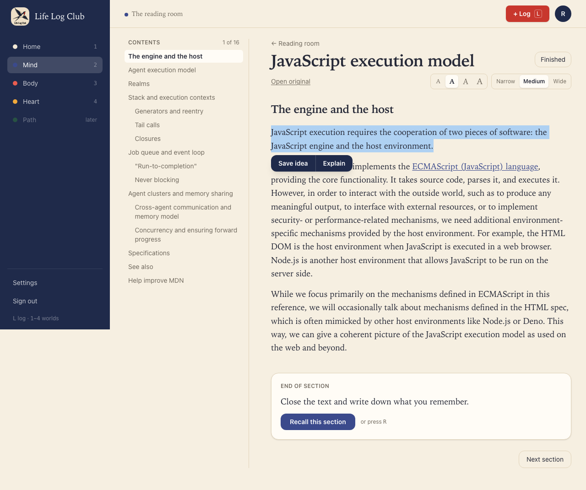
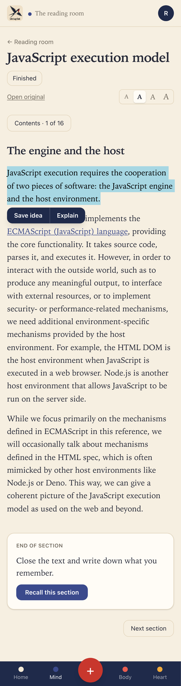
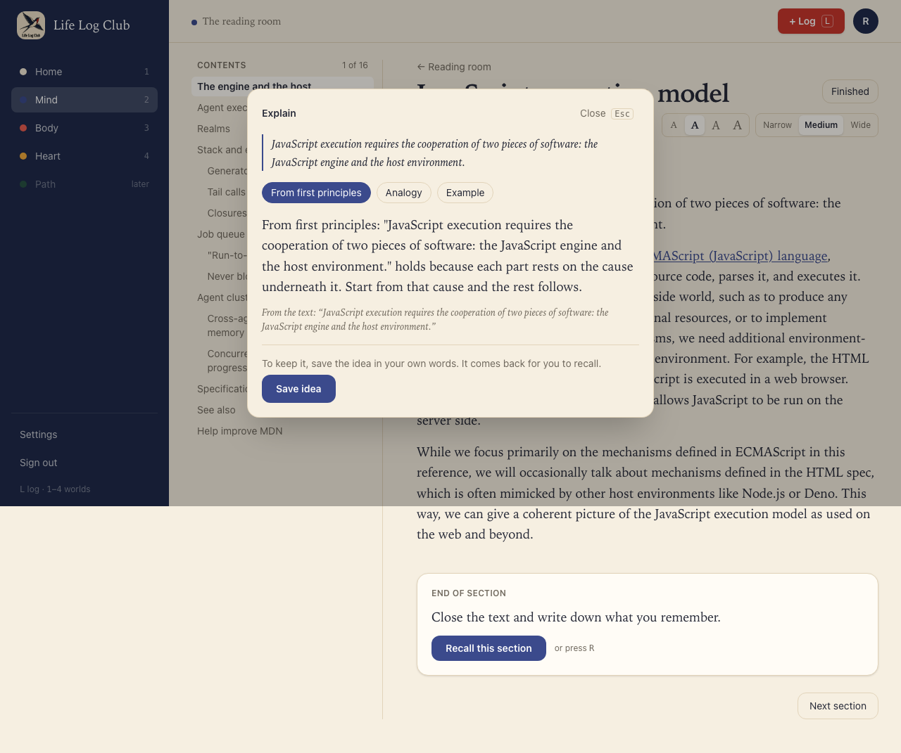
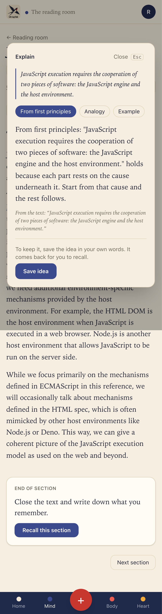
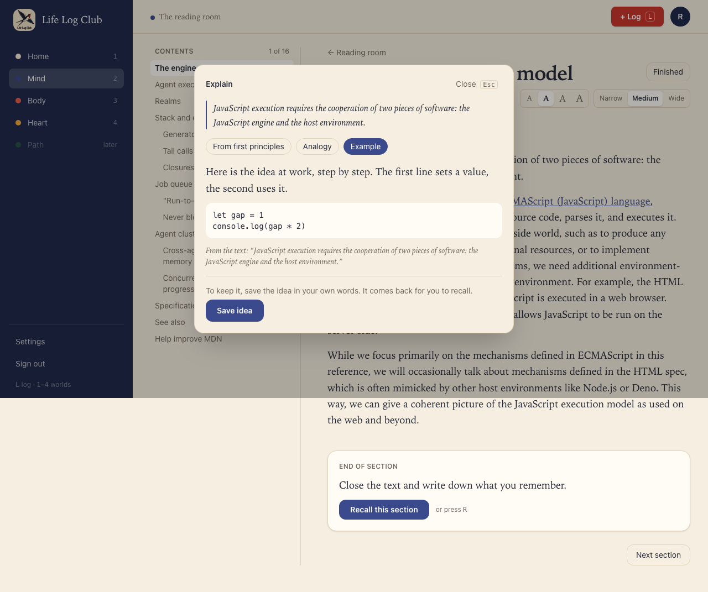
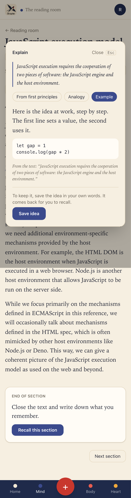

# Issue #30: Explain a passage

Release 5. Spec: `learning_spec.md` section 7.2 (the bar under a selection: Save idea, Explain).

## What was built

- **The bar under a selection** now offers **Save idea** and **Explain**. A selection too long for one idea (over 1,000 characters) still says "Pick one idea, not a page.", with Explain beside it up to 4,000 characters, a few paragraphs.
- **Explain** opens a panel over the reader, so the place in the reading stays where it was:
  - It starts at once, **from first principles**: the cause or mechanism underneath, the terms the passage relies on, then step by step to what the passage says, not a restatement.
  - **Analogy** and **Example** are one click away: an everyday analogy mapped part for part, with where it breaks down, or a worked example with new numbers or code.
  - Each kind is asked for once. Going back to one already shown costs no new AI call.
  - "From the text: …" shows the sentence of the section the explanation relies on, only when that sentence really is in the section.
  - **Save idea** in the panel opens the idea form for the same passage.
  - Esc or Close shuts it.
- **API:** `readings.explain({ sectionId, passage, kind })` → `{ text, code, quote }`. It uses the member's own key, is recorded in `ai_calls` as `explain-passage`, and, like Recall, does not stop at the monthly budget, because the member asked and is waiting.
- **LLM:** `explainRequest` and `parseExplanation` in `packages/llm/src/explain.ts`, from Peak's tutor prompt (`packages/llm/src/tutor.ts` at `4051df5^`), with the first-principles wording made explicit. `EXPLAIN_KINDS` lives in `packages/domain`, shared by the contract and the prompt.

## Decisions for the learner

- **Nothing is stored.** An explanation read and closed is easy to forget, and an AI's words are not the member's. The panel ends with "To keep it, save the idea in your own words. It comes back for you to recall." Save idea is the one way to keep it, and it keeps the member's own words, which is what makes it stick (generation effect).
- **Grounded, never invented.** The prompt keeps the explanation to what the section says and marks anything beyond it ("Beyond the text, …"). The quote is checked in code against the section.
- **At most about 150 words.** Enough to take in at once, next to the passage.
- **Errors say what to do.** Without a key: "Add your own AI key in Settings to have passages explained." If the AI fails: "The explanation couldn’t be written just now. Try again in a moment.", with a Try again button.

## Proof

### The bar under a selection

### From first principles, with the sentence it rests on

### A worked example with code

### Tests

- `packages/llm/src/write-section.test.ts`, "parseExplanation" (ported from Peak's tutor test): a quote is kept only when it is in the section, code only when there is some, and a reply without text is refused. The request asks for the kind picked.
- `e2e/mind-read.spec.ts`, **Explain on a selected passage** (desktop and phone): the bar offers both; the explanation comes from first principles with its quote; Analogy and Example; going back costs no call (3 calls for 3 kinds); Save idea from the panel saves the passage with the member's words; Esc closes.
- `e2e/review.spec.ts`, **Explain needs a key, explains only the member’s own sections, takes a few paragraphs at most, and says so when the AI fails** (API).
- The existing **Save idea** test still passes with the new bar.

Full run: `pnpm typecheck`, `pnpm test` and `pnpm e2e` (151 passed, 35 skipped) are green.
