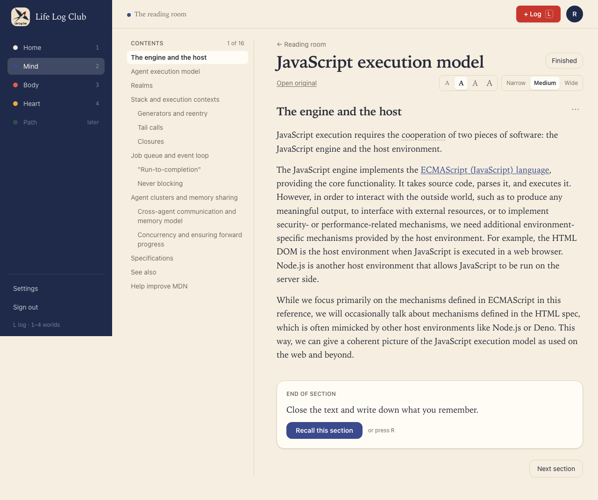
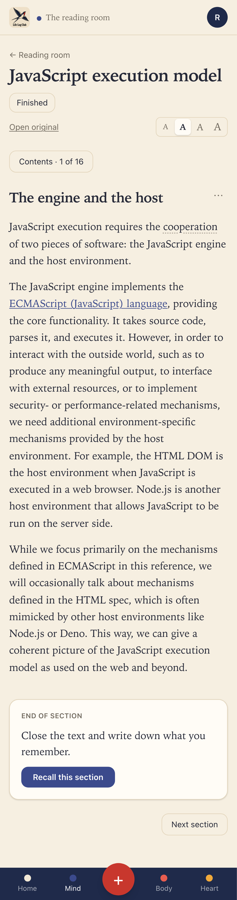
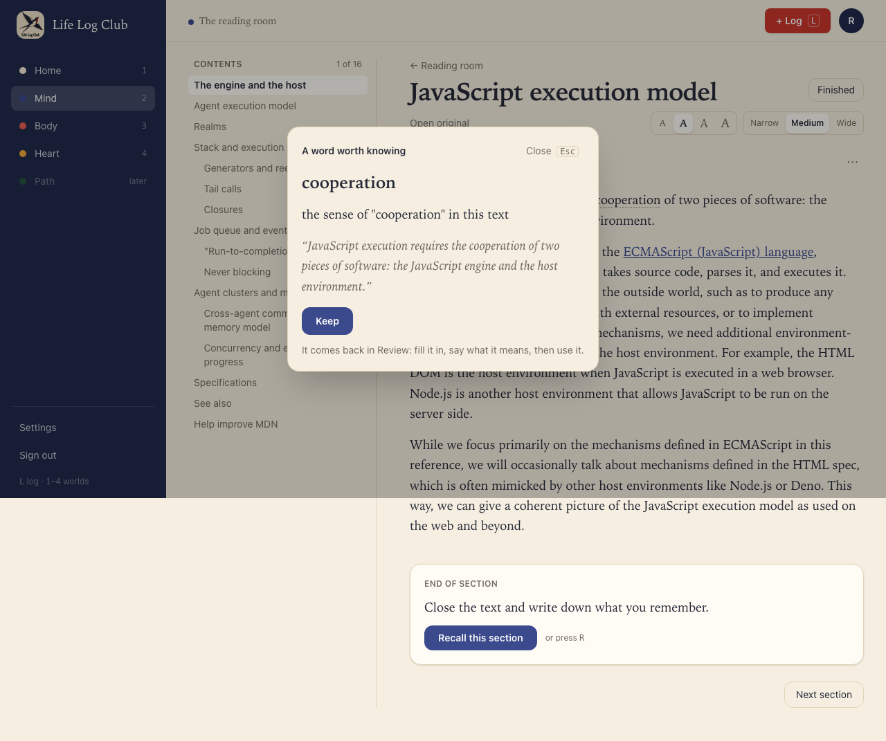
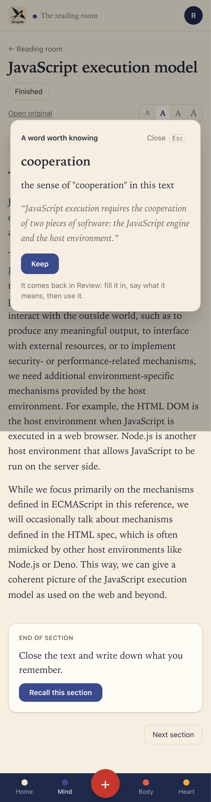
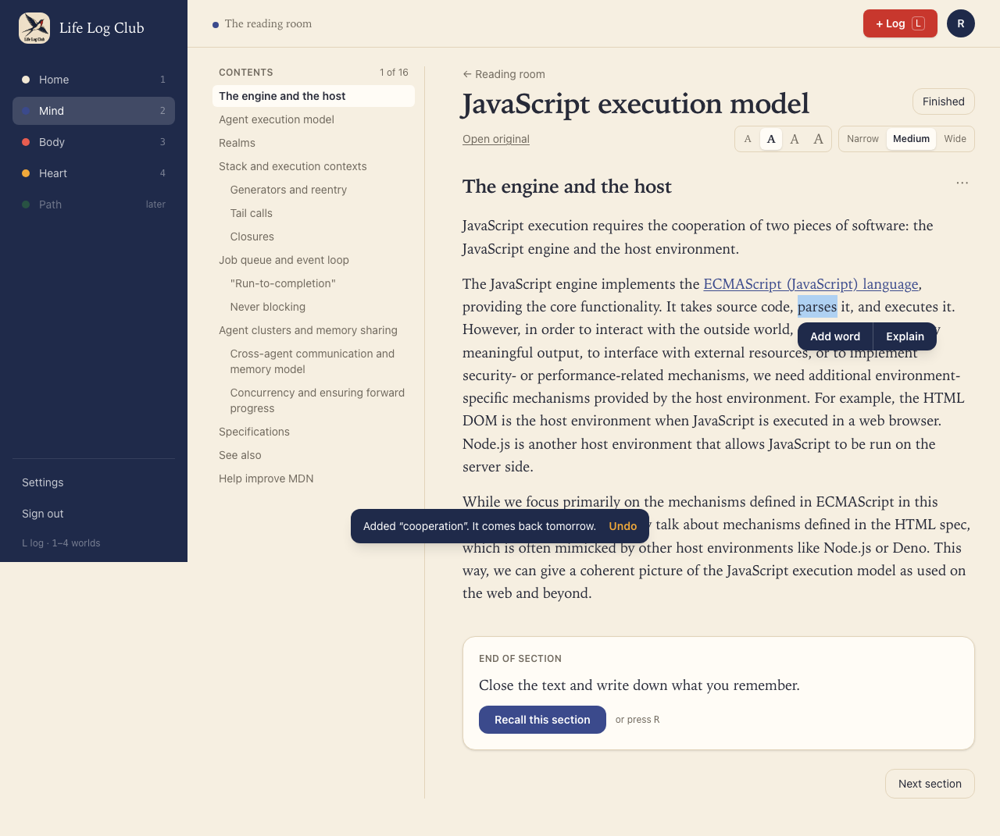
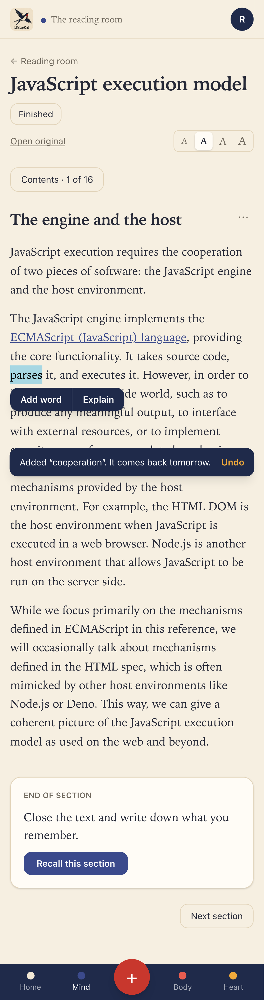
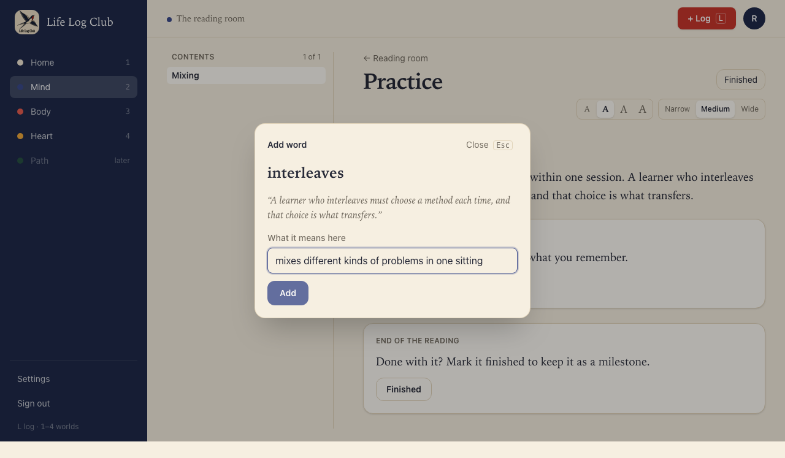
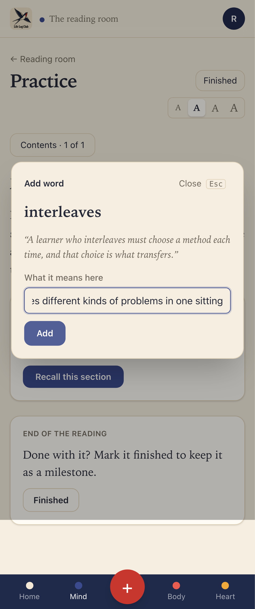
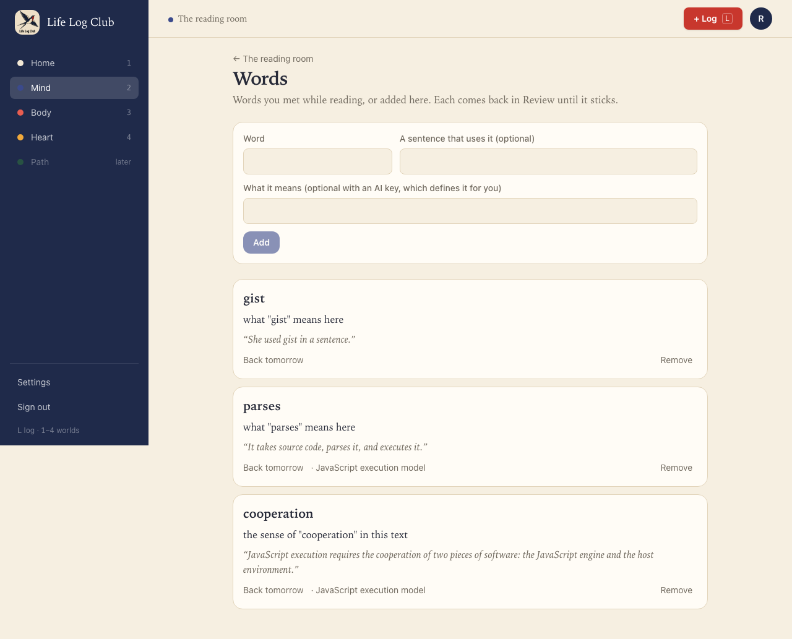
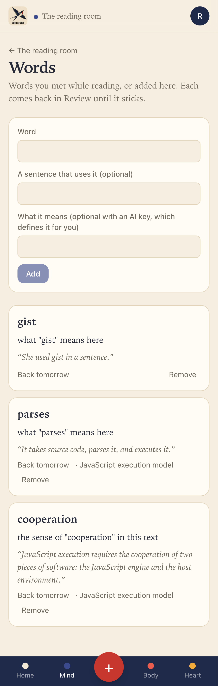

# Issue #31: Save words and get suggestions while reading

Release 6. Spec: `learning_spec.md` section 7.11 (Vocabulary).

## What was built

- **Suggested words in the reader.** When a section's key ideas are written, the same AI call now also finds up to 3 words worth learning in it (`terms`). Each suggested word has its form in the text, its dictionary form, its exact sentence, and its meaning there. In the reader the word is underlined faintly with dots, where its sentence is. A click opens "A word worth knowing" with the meaning and the sentence, and **Keep** adds it in one click. A kept word is no longer underlined. Suggested words are **never added automatically**: in the old app, up to 3 per section went straight into review, which flooded it.
- **Add word on a selection.** When the selection is a word or a short term (at most 3 words), the bar under it offers **Add word** in place of Save idea. The sentence the word starts in is captured.
  - With a key, it takes one click. The toast says "Added “parses”. Its meaning comes in a moment.", and a `define-word` job asks the member's AI what the word means in that sentence.
  - Without a key, a small form asks "What it means here". Enter adds the word.
- **Mind → Words** (`/mind/words`), linked beside Ideas:
  - **Add a word by hand**: the word, with an optional sentence and an optional meaning. With a key and no sentence, the AI writes an example sentence that uses the word. Without a key, the meaning is required, and the form says "Add what it means."
  - Every word, newest first, shows its meaning, its sentence, when it comes back, and the reading it came from, with a link to that place. A word still being defined shows "Finding what it means…", and the page checks again every 2 seconds until the meaning is in. A word the AI could not define asks for its meaning in place. **Remove** comes with Undo.
- **Data:** words are `cards` with `kind = 'word'`. `details` holds `{ word, form, sentence }`, the answer is the meaning, and the cue is "What does “word” mean?". A unique index on `(user_id, lower(details->>'word'))` keeps one card per word. Migration `0020_words` adds that index and `sections.terms`.
- **API:** `words.add`, `words.list`, `words.suggestions({ sectionId })`, `words.update` (the meaning), `words.remove` and `words.restore`.
- **LLM:** `defineWordRequest` and `parseDefinition`, and `parseTerms`, in `packages/llm/src/words.ts`, ported from Peak (`packages/llm/src/words.ts` and `generate.ts` at `4051df5^`). The write-section prompt asks for terms (`questions-v13`). `formIn` (the word as the sentence uses it, so "saturate" finds "Saturating") is in `packages/domain/src/words.ts`.

## Bug found and fixed

- **The reader did not see a section become written.** The section was loaded before the first 30-second heartbeat queued its writing, and the section was polled only while its status was `queued` or `writing`. So the reader never learned that writing had started, and it showed the result only after a reload. The heartbeat now loads the section again, and the reader follows the writing until it is done. This is how the suggested words show up while the member is still on the page.

## Decisions for the learner

- **Suggest, never add.** A suggestion asks for one click and takes nothing from the member's attention until they want it. The underline is faint, so the text still reads as the author's.
- **The meaning in its own sentence.** A word is defined in the sense it had where the member met it, not with every sense in a dictionary. This is what the word tests in #32 build on.
- **A word once.** Adding a word again, by either form or in another case, opens the first card with its first sentence: "“cooperation” is in your words already." A removed word added again comes back with its history.
- **Defining never blocks.** Add word answers at once. The meaning comes in the background, and if it fails or the budget is used, the Words page asks the member for it.
- **Proofs no longer show a faded button.** The proof helper moves the pointer away before it captures a screen, because a button the pointer rests on draws faded, as if it were disabled.

## Proof

### A suggested word, underlined where it stands

### Keep, one click

### Add word on a selected word

### Without a key: the member says what it means

### Words

### Tests

- `packages/domain/src/words.test.ts`, **formIn**: inflections, terms, whole words only ("max" is not found in "softmax").
- `packages/llm/src/write-section.test.ts`: **suggests up to 3 words per section, each in a sentence of that section** (ported `parseTerms`: a sentence not in the section, or one that does not use the word, is dropped), and **parseDefinition** (the member's sentence is kept; an example sentence must use the word).
- `e2e/review.spec.ts`, **a word is added once per member by either form, needs a sentence that uses it and a meaning without a key, and stays the member’s own** (API, the 7.11 acceptance "adding the same word twice keeps one card").
- `e2e/mind-read.spec.ts` (desktop and phone):
  - **Words while reading**: the suggestion, Keep, Add word defined by the AI in its sentence, the Words page, the same word again, a word by hand with an example sentence, Remove and Undo.
  - **Words without a key**: Add word asks for the meaning, and adding by hand needs one.

Full run: `pnpm typecheck`, `pnpm test` and `pnpm e2e` (156 passed, 36 skipped) are green.
