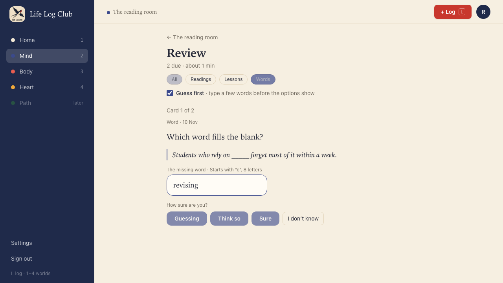
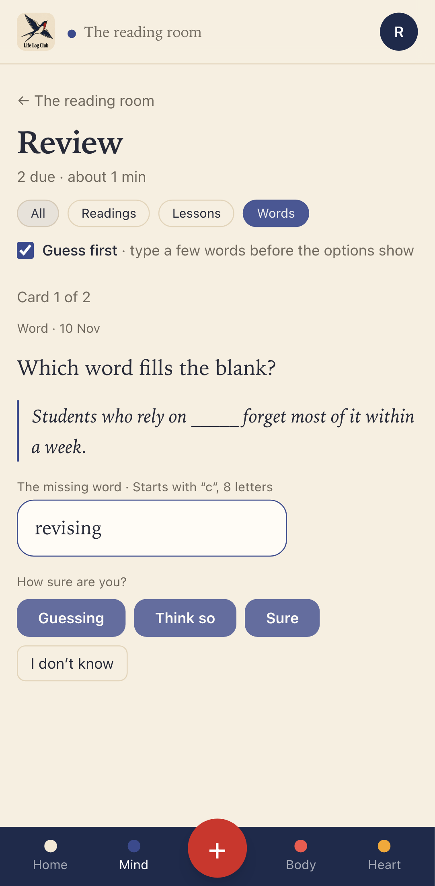
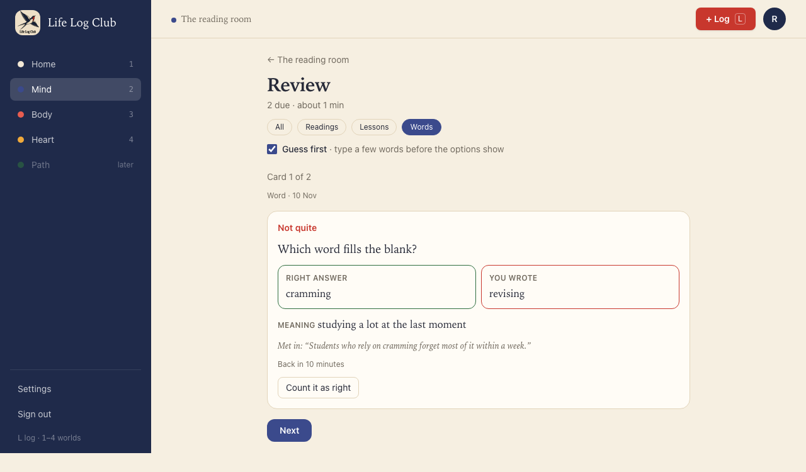
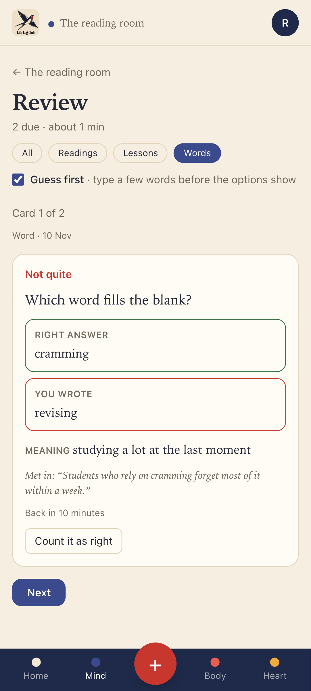
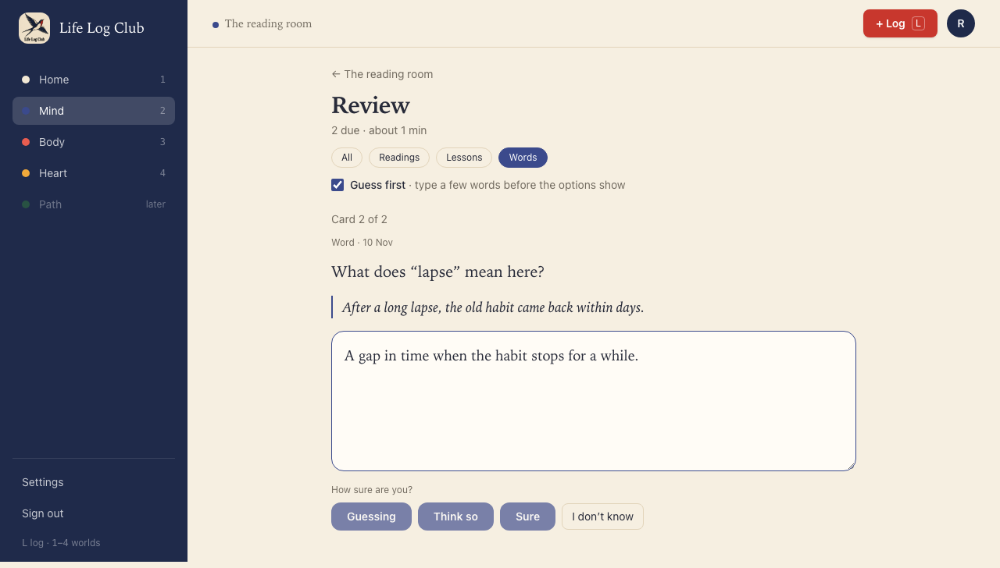
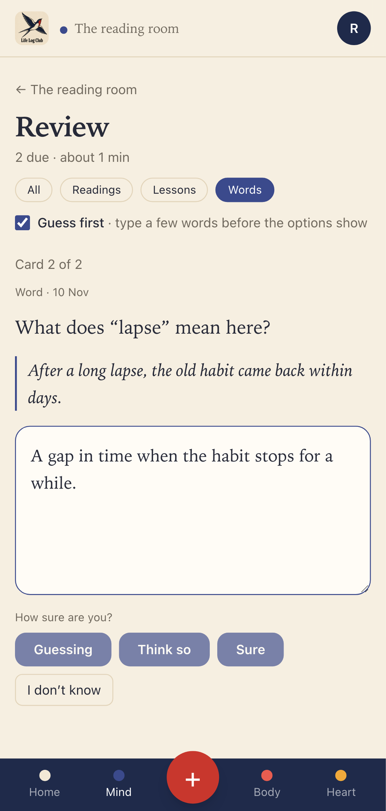
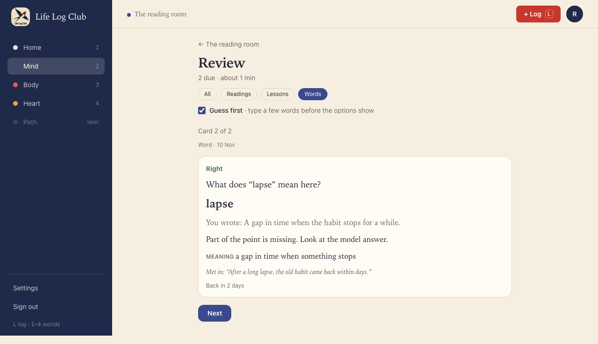
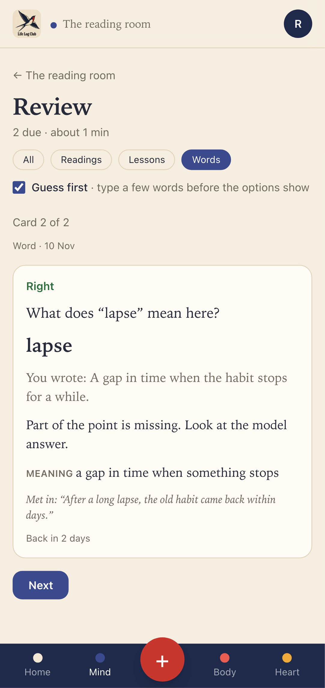
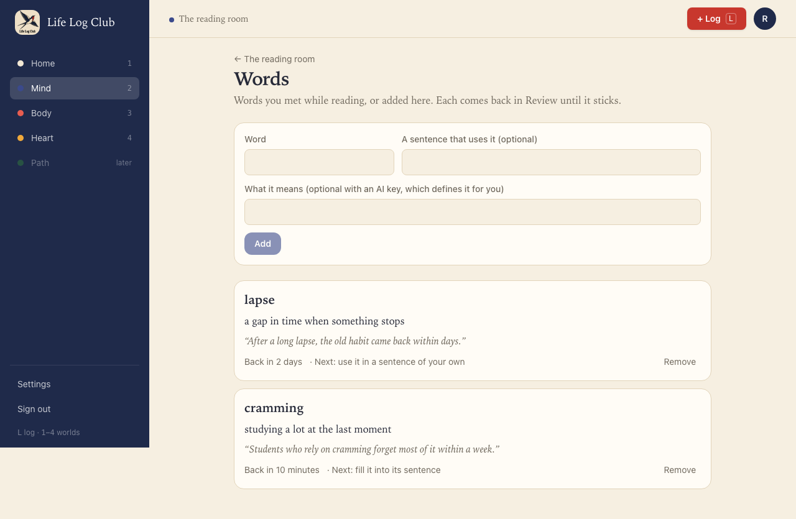
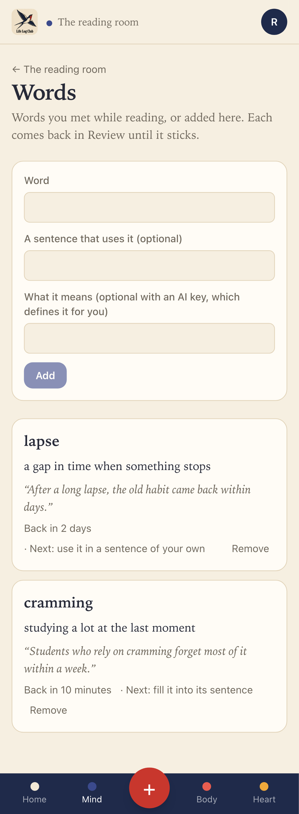

# Issue #32: Test words in the review queue

Release 6. Spec: `learning_spec.md` section 7.11 (Vocabulary).

## What was built

- **Three word tests, by level.** A word card in Review is tested by the card's level:
  - **Levels 0 and 1, fill the blank** (`word_cloze`): "Which word fills the blank?", with the word's own sentence blanked out and a hint under the field ("Starts with “c”, 8 letters"). It is checked in code, so it works without an AI key. Case does not matter, either form of the word counts (as the sentence uses it, or its dictionary form, so "saturating" or "saturate"), and one typo is allowed in a word of 6 letters or more.
  - **Level 2, say what it means** (`word_meaning`): "What does “lapse” mean here?", with the sentence shown. The member's AI judges the answer against the meaning in context.
  - **Level 3 and up, use it** (`word_use`): "Use “cramming” in a sentence of your own, with the meaning it has here." The judge checks that the word is used with that meaning, in a new sentence and not a copy of the one shown.
  - A word with no sentence starts at the meaning, since there is nothing to blank.
  - Two right answers in a row take a new word from the blank to its meaning, because the level goes up by one with each right answer.
- **Feedback on every answer.** The result shows the right word beside the member's for a cloze, and the meaning ("Meaning …") and the sentence where the word was met ("Met in: “…”") for every test. The meaning and use tests show the judge's points, as other written answers do.
- **Count it as right** works for a cloze: another form or a near miss the code did not accept can be counted, and the card's schedule and level are worked out again.
- **Without a key**, the cloze is still asked and checked. The meaning and use tests fall back to a self-rated card against the meaning, as other cards do without a key.
- **Mind → Words** shows each word's next test: "Next: fill it into its sentence", "Next: say what it means" or "Next: use it in a sentence of your own".
- **Review's Words filter** shows only word cards.
- **API:** a new answer `ask: 'word'` with a written response. The review item has a `word` ask with `test`, `prompt`, `sentence` and `hint`. The reveal gains `word: { word, test }`, and `exact.kind` gains `'word'` for the cloze. `Word.test` is the next test. `ask: 'word'` on a card that is not a word is refused.
- **Domain:** `wordTestFor`, `blankOut`, `isSameWord`, `wordPrompt` and `gradeWord` in `packages/domain/src/words.ts`. `isSameWord` and `blankOut` are ported from Peak (`packages/domain/src/words.ts` at `4051df5^`).

## Decisions for the learner

- **Recognise, then recall, then use.** Filling a blank in a known sentence is the easiest step, saying the meaning is harder, and using the word in a new sentence shows it is the member's own. The test gets harder only after the easier one is right.
- **The blank is forgiving where it should be.** A typo in a long word or another form of it is not a failed memory, so it counts. A short word must be exact, because one letter changes a short word into another word.
- **Guess first does not apply.** Guess first is for multiple choice, where the options would give the answer away. A word test asks for the word or its meaning with no options, so there is nothing to hide.
- **The word once in the result.** After a cloze, the word shows as the right answer beside the member's, not also in large type above it.

## Proof

### Fill the blank, with a hint

### A wrong word: the right one beside it, with its meaning and sentence

### At level 2: say what it means here

### The meaning judged

### Words shows each word's next test

### Tests

- `packages/domain/src/words.test.ts`, **word tests**:
  - The test for each level, and the meaning first without a sentence.
  - `blankOut` and `isSameWord` (ported): either form, case, one typo only in a word of 6 letters or more.
  - The judge grades meaning and use against the meaning in context.
- `e2e/review.spec.ts`, **a word is tested by its level** (API), the 7.11 acceptance:
  - A level-0 word is a cloze with a hint, checked in code without a key.
  - A wrong answer shows the right word beside the member's.
  - After two right answers (one with a typo), the level is 2 and the meaning is asked, self-rated without a key and judged with one.
  - At level 3, a sentence of one's own is judged.
  - Count it as right on a wrong cloze moves the level on.
  - `ask: 'word'` on an idea card is refused.
- `e2e/mind-read.spec.ts`, **Words in Review** (desktop and phone): the Words filter, the cloze with its hint and no Guess first, the wrong-answer result, the meaning test judged right, what is logged, and the next test on Words.

Full run: `pnpm typecheck`, `pnpm test` and `pnpm e2e` (159 passed, 37 skipped) are green.
