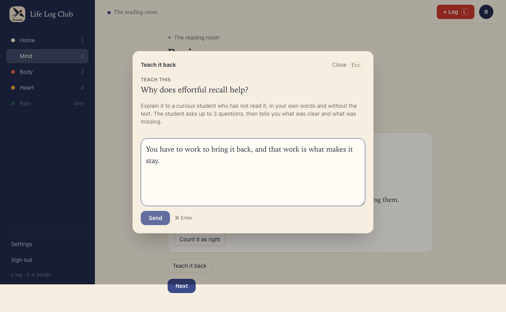
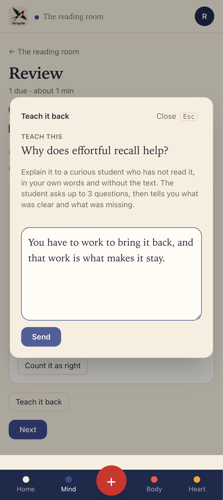
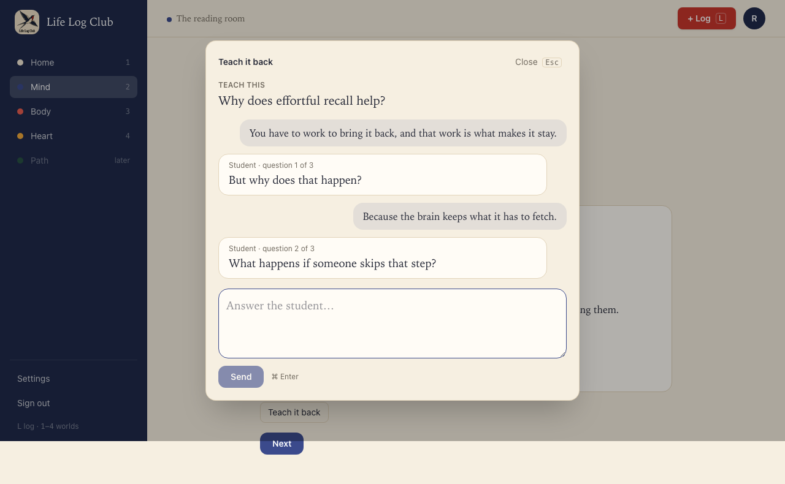
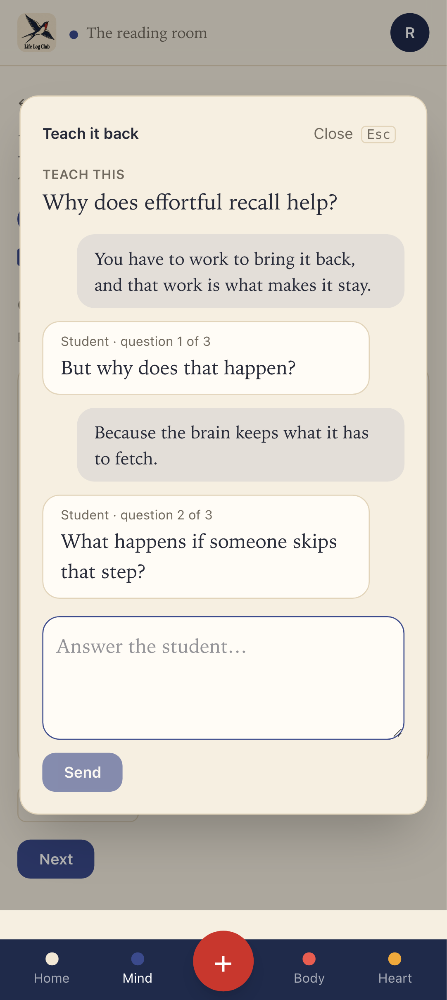
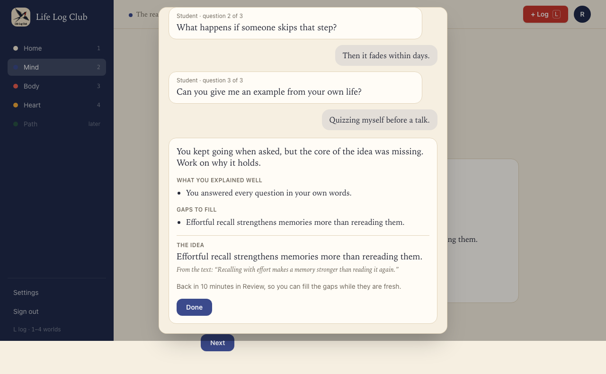
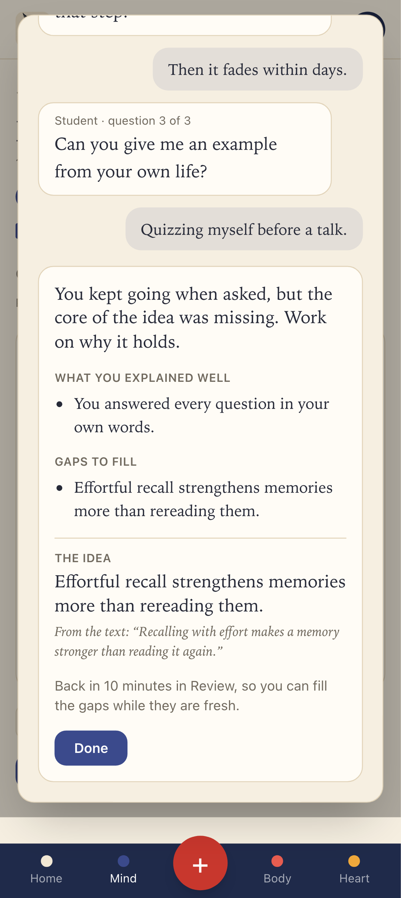
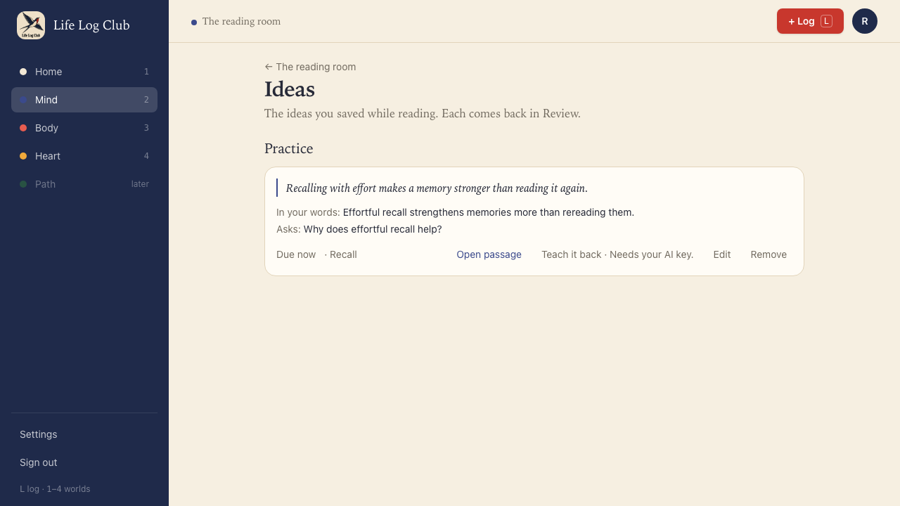
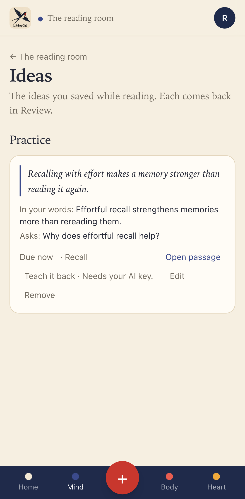

# Issue #33: Teach an idea back

Release 7. Spec: `learning_spec.md` section 7.12 (Teach-back).

## What was built

- **Teach it back, one click**, in three places:
  - on a Review result after a miss, for an idea card
  - on the recall results, for each idea the dump missed or only partly brought back, or whose question was answered wrong
  - on every saved idea in Mind → Ideas
- **The dialog.** It shows what to teach (the card's cue, "Why does effortful recall help?"), never the idea itself. The learner explains it in their own words, without the text. A curious AI student then asks up to 3 short follow-ups, one at a time ("Student · question 1 of 3"), each probing the weakest spot so far. After the third answer the student sums up:
  - a line to the learner on how well they taught it
  - **What you explained well**
  - **Gaps to fill**, each stating the fact to learn, or "No gaps. Nicely taught."
  - only then **The idea** and its quote from the text, to compare
  - what happens to the card
- **Gaps bring the card back sooner.** With gaps, the card's due time becomes the earlier of its due time and 10 minutes from now, and its memory state is left as it was. The result says "Back in 10 minutes in Review, so you can fill the gaps while they are fresh." With no gaps, nothing changes: "Its schedule stays as it was."
- **Never more than 4 AI calls.** The student has 3 follow-ups; the fourth call must sum up, and a question in its place counts as no reply.
- **The student never gives the idea away**, checked in code: a question that contains the idea's quote or the idea is replaced with "Can you say more about why?" (`safeFollowUp` in `packages/domain/src/teach.ts`).
- **Safe to retry.** Each reply names its turn, so a request sent twice keeps one message. The learner's message is kept before the AI call; when the call fails, the dialog says "The student could not answer just now. Try again.", and Try again asks the student again without sending the message twice.
- **Without a key**, the button reads "Teach it back · Needs your AI key." and leads to Settings.
- **Data:** `teach_sessions` (migration `0021_teach_sessions`): the card, the messages, the summing up, the due time it set, and when it finished. Row-level security keeps each member's own.
- **API:** `teach.start({ id, cardId })`, `teach.reply({ id, turn, text })` and `teach.get({ id })`. Only idea cards can be taught. `turn` is an addition to the spec's `reply({ id, text })`, so that a retried request is not counted twice.
- **AI:** `teachRequest` and `parseTeachTurn` in `packages/llm/src/teach.ts`, ported from Peak's `teachTurn` (`packages/llm/src/tutor.ts` at `4051df5^`), given the idea's section text and the idea.

## Decisions for the learner

- **The idea stays hidden until the end.** Teaching from memory is the exercise; showing the idea first would turn it into reading aloud. It shows with the summing up, beside the gaps, so the learner compares at once.
- **Offered, never forced.** The spec rates the evidence for an AI student as the weakest here, so the button sits quietly beside the result. Nothing asks the learner to use it.
- **Gaps are facts, not remarks.** Each gap states what to learn ("Effortful recall strengthens memories more than rereading them."), so the list is something to study, not a grade.
- **A conversation, not a form.** The learner's messages sit on the right and the student's on the left, with which question it is, so the learner knows how far along they are. ⌘ Enter (Ctrl Enter) sends.

## Proof

### Teach this: the cue, not the idea

### The student's questions, one at a time

### The summing up, the idea to compare, and the card back in 10 minutes

### Without a key

### Tests

- `e2e/review.spec.ts`, **teaching an idea back** (API), the 7.12 acceptance:
  - With the fake LLM: three follow-ups, then a summing up, and exactly 4 AI calls. Sending again after it finished makes no more calls, and a fifth turn is refused.
  - A summing up with gaps sets the card's due time within 10 minutes and leaves its memory state unchanged. With no gaps the due time does not move.
  - A question that contains the idea is replaced with "Can you say more about why?".
  - A turn sent twice is kept once; a turn out of order is refused. After a failed AI call, the explanation is kept and the same turn asks again.
  - It needs a key, works only on idea cards, and only on the member's own.
- `e2e/mind-read.spec.ts` (desktop and phone):
  - **Teach it back after a miss in Review**: the button without a key, the dialog from a Review miss with the idea hidden, three questions, the result with gaps, the idea and its quote, "Back in 10 minutes", and the button on Ideas.
  - **The recall check** test now checks that a missed idea offers Teach it back and a covered one does not.

Full run: `pnpm typecheck`, `pnpm test` and `pnpm e2e` (162 passed, 38 skipped) are green.
