# Issue #34: Skills and deliberate practice

Release 8. Spec: `learning_spec.md` section 7.14 (Skills and deliberate practice).

## What was built

- **Mind → Skills** (`/mind/skills`). **Add skill** takes a name, an optional goal ("Play the Bach prelude at 80 bpm") and an optional target in minutes a week, then **Save**. With no skills yet, the form is already open. Each skill shows this week against its target ("45 of 120 min this week · 2 sessions", with a bar), or the sessions alone when there is no target, and its next focus.
- **Log practice, one click**, on a skill (in Skills, on its page, and on Mind), or **+ Log → Practice**. The form is prefilled:
  - the skill (the one clicked; from + Log, the one practised last)
  - last time's minutes (30 for a first session)
  - **Worked on**, set to the last session's **Next time**, with the note "From last time’s Next time."
  - Then **What told you how it went**, **Next time**, and **One thing I learned (optional)**. Only Minutes (1 to 600) is needed.
- **One thing I learned becomes a lesson card**, due at once, asked as "Practising Piano: what's the lesson?".
- **A skill's page** (`/mind/skills/$skillId`): the last 8 weeks as bars against the target (a dashed line), and the trail of sessions, newest first: "worked on → next time", how it went, and what was learned. **Change** edits the name, goal and target; **Archive** hides the skill with Undo, and its sessions stay.
- **Mind** has a Skills card with each skill's week and Log practice, and a Skills link beside Ideas and Words. Practice sessions are not listed under Lessons.
- **Progress** has a Practice block: minutes a week on each skill over the 12 weeks, with its target.
- **Data:** the `skills` table (migration `0022_skills`), with row-level security. Practice is a new `practice` entry type (pillar Mind, jobs track and remember), with `{ skillId, skill, minutes, workedOn, feedback, nextTime }`. Its text is the one thing learned.
- **API:** `skills.list`, `skills.get`, `skills.create`, `skills.update`, `skills.archive`, and `skills.restore` for Undo. Practice uses `entries.create`, which checks that the skill is the member's own and not archived, and sets its name on the entry. Renaming a skill renames it on its past sessions. `progress.summary` gains `practice`.

## Decisions for the learner

- **Focus, feedback, fix, at zero clicks.** The next session starts on the last session's fix, so the *Peak* loop is what the member gets by doing nothing. The note under Worked on says where it came from.
- **A light log, not a coach.** The evidence for deliberate practice is mixed, so the app asks four short questions and nothing more. Only the minutes are required.
- **What was learned is kept, not just logged.** A practice insight comes back in Review like any lesson, asked by its skill.
- **A target is optional, and no target means no bar.** Without one, the skill shows sessions, so there is never a bar that looks like failure against a number the member never set.
- **Weeks start on Monday, in UTC**, the same as the rest of Progress.
- **One skill per name.** Adding "piano" next to "Piano" says “piano” is in your skills already, so practice does not split across two cards.

## Proof

### Add a skill

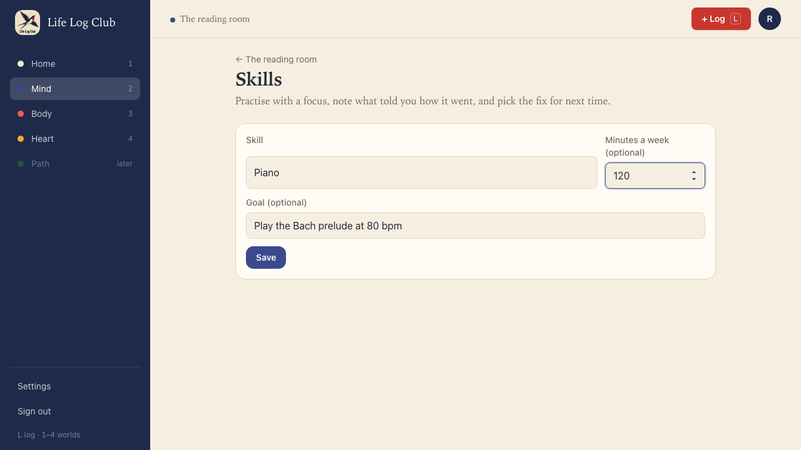

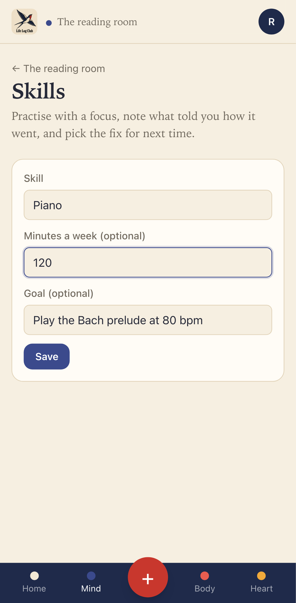

### Log practice: the first session

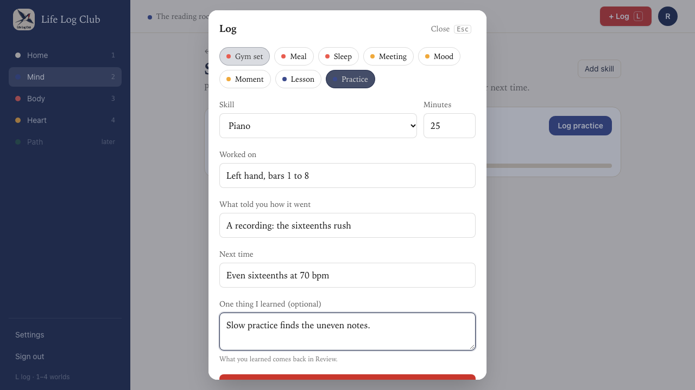

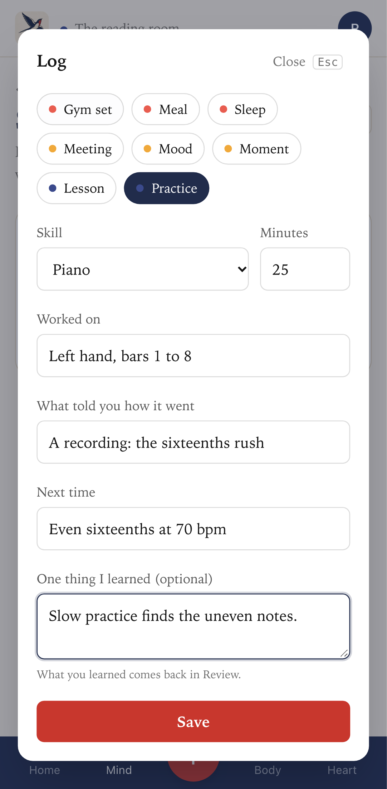

### The second session starts from the first one's Next time

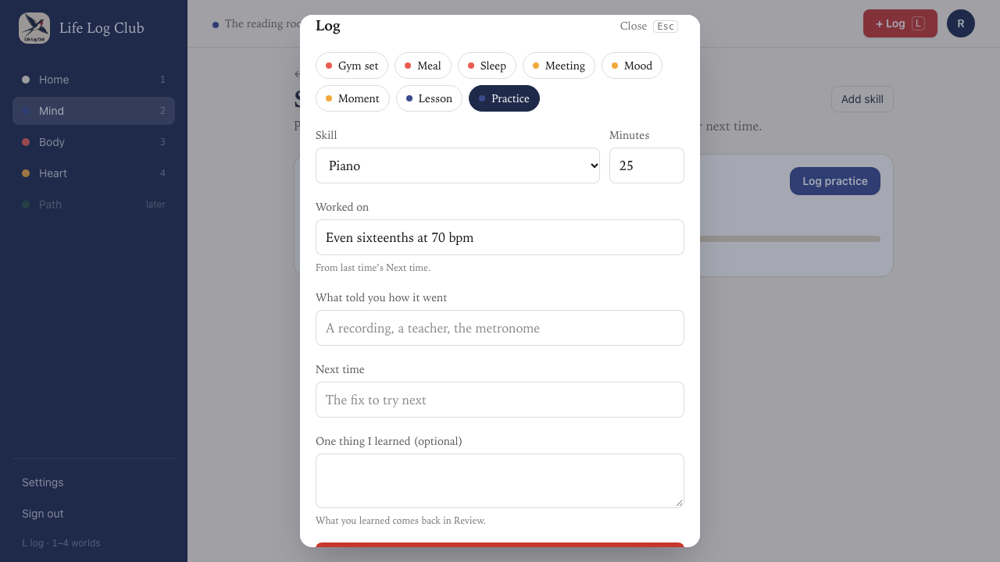

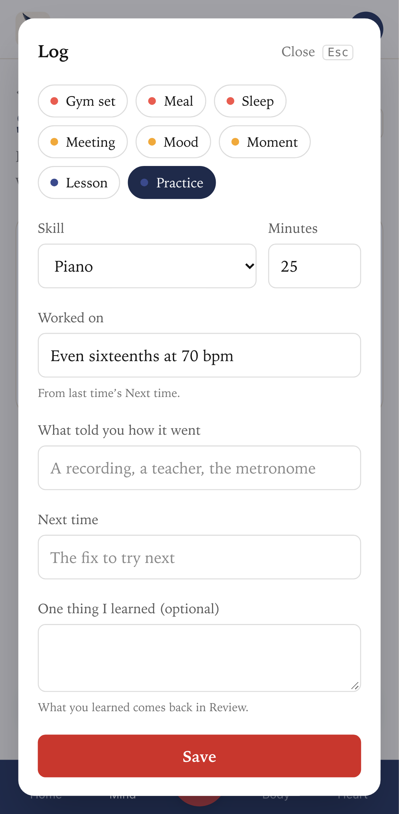

### Skills: the minutes this week against the target

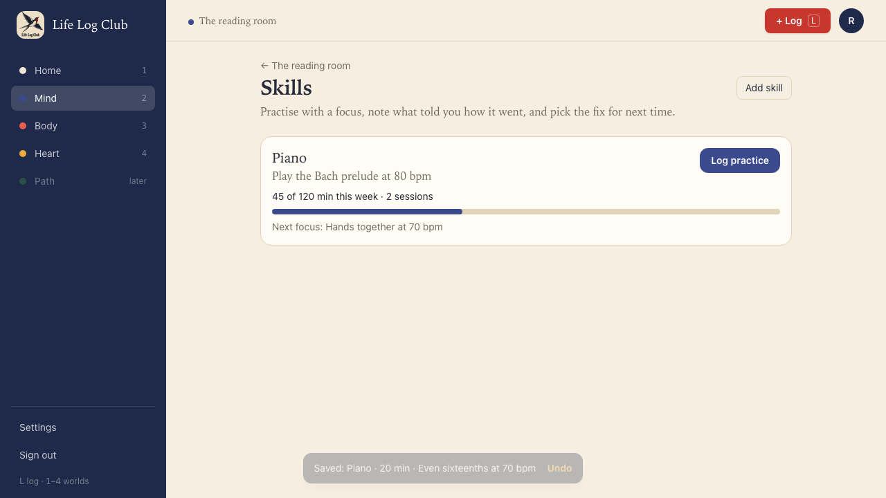

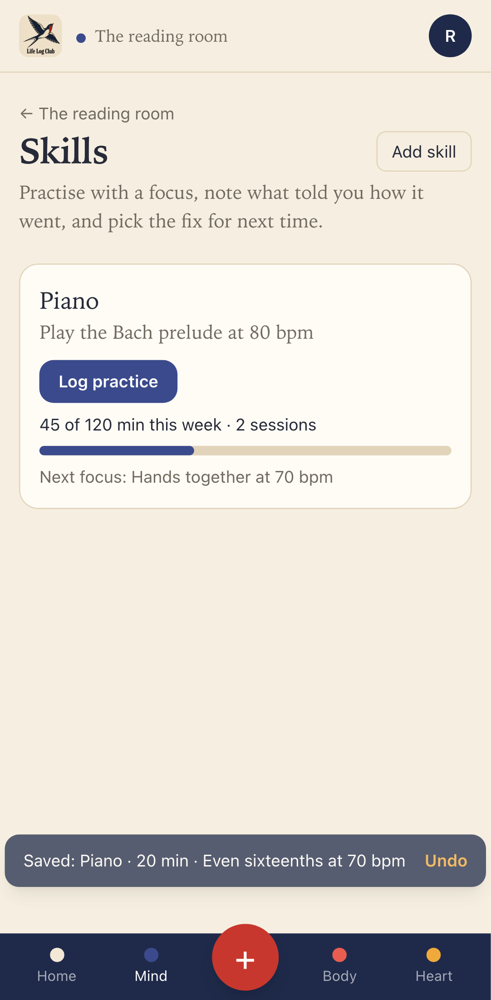

### A skill's page: the weeks and the trail

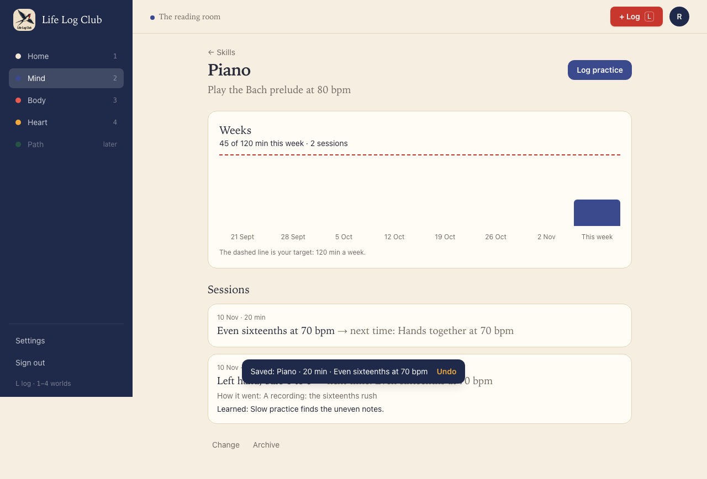

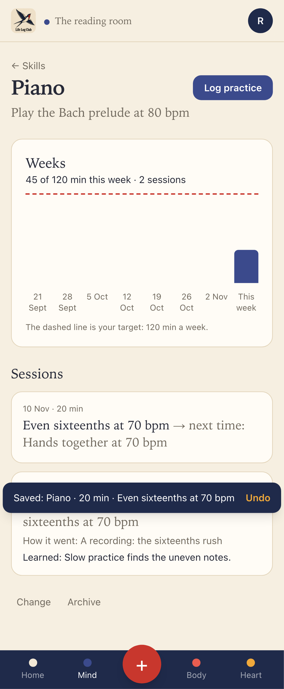

### Mind and Progress

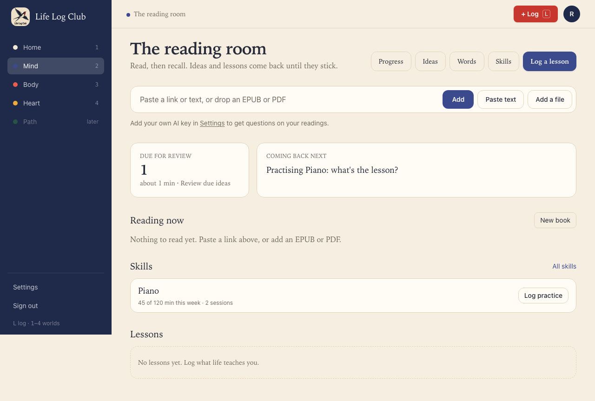

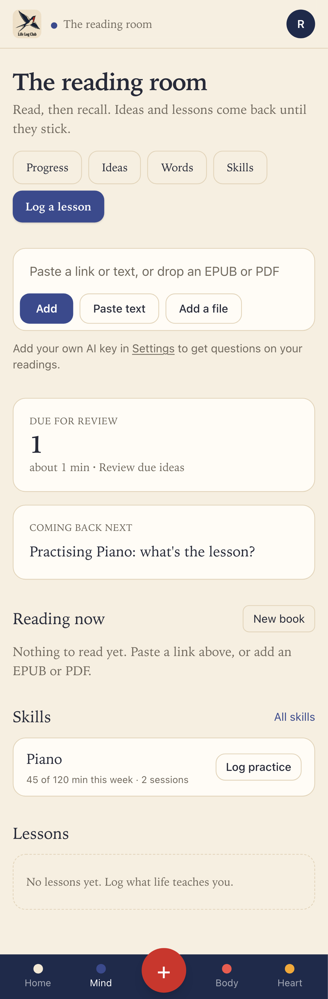

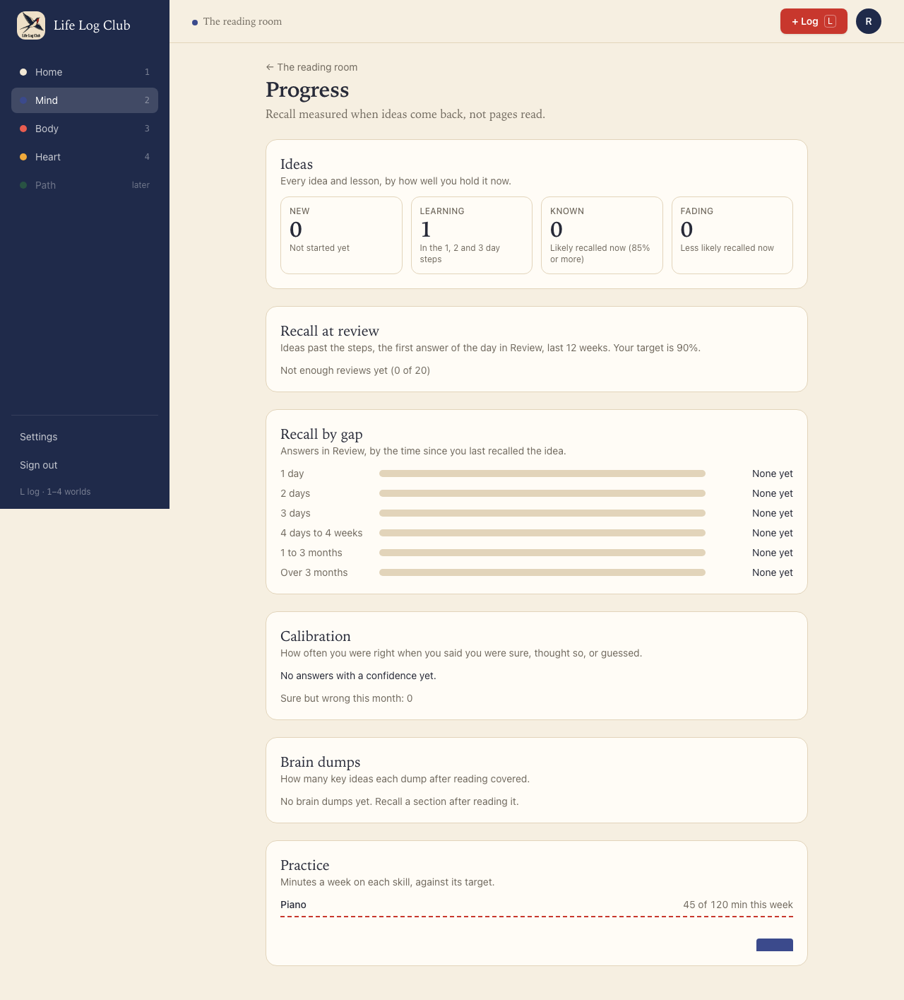

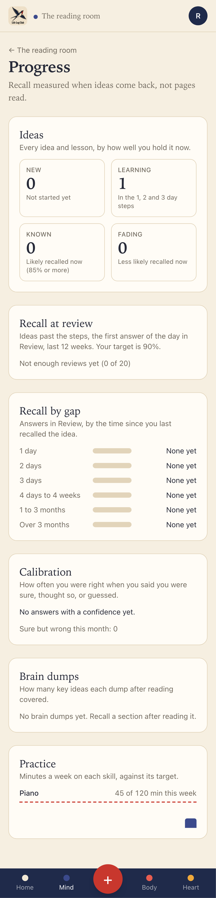

### Tests

- `e2e/worlds.spec.ts`, **a skill: practice logged twice** (desktop and phone), the 7.14 acceptance: the second form opens with Worked on equal to the first session's Next time, and the skill shows the sum of minutes this week (25 + 20 = "45 of 120 min this week · 2 sessions"). It also covers adding a skill from Mind, the skill's page and trail, the lesson card due in Review, Progress, and + Log → Practice.
- `e2e/entries.spec.ts`, **practice is logged on a member’s own skill** (API): minutes from 1 to 600; another member's skill is refused; last week's session does not count this week; one thing learned makes one lesson card; 8 weeks and the trail; Progress; a rename shows on past sessions; an edit can't move a session to another skill; an archived skill keeps its sessions and takes no new ones until restored; one skill per name.

Full run: `pnpm typecheck`, `pnpm test` and `pnpm e2e` (165 passed, 39 skipped) are green.
