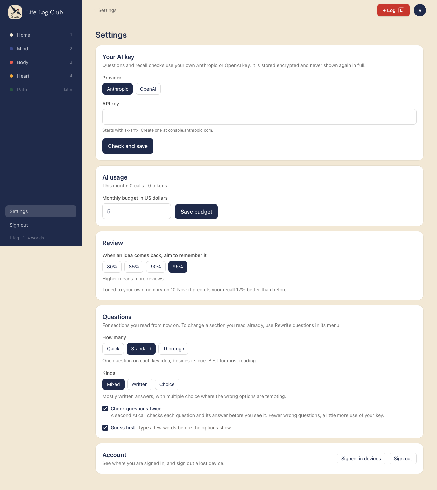
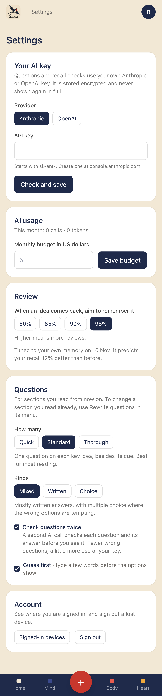

# Issue #35: Tune the schedule to each member's memory

Release 9. Spec: `learning_spec.md` sections 5.5 and 10 (Release 9).

## What was built

- **A monthly tuning job** (`tune-all`, at 04:41 UTC on the 1st). Every member with 1,000 answers or more in Recall and Review gets a `tune-schedule` job.
- **The fit** (`fitSchedule` in `apps/server/src/learning/tune.ts`):
  - The newest fifth of the answers that follow an earlier one on the same card is held out. The fit never sees them.
  - New FSRS-6 parameters are fitted on the older answers with `@open-spaced-repetition/binding` (the official FSRS optimizer, in Rust), without short-term parameters, as the scheduler uses none.
  - The parameters in use and the new ones are both scored on the held-out answers. Each card's answers are replayed through the app's own scheduler (1-2-3 day steps, then FSRS), and its predicted recall just before each held-out answer is scored against whether the answer was right (mean log loss).
  - The new parameters are kept **only when their log loss is lower**. Otherwise the parameters in use stay.
- **Every try is logged** in `scheduler_fits`: answers trained on, answers held out, the new parameters, both log losses, and whether they were kept. A kept fit is written to `preferences.fsrs_weights`.
- **Own parameters schedule the next answers.** `schedulerOf` in `learning/preferences.ts` gives the scheduler for the member's target and their own parameters. Answers scheduled with them are logged as `steps-fsrs-v1:FSRS-6:own`. Cards already scheduled keep their due times.
- **Settings → Review** has one quiet line about it:
  - before 1,000 answers: "After 1,000 answers (you have 312), the schedule tunes itself to your memory each month."
  - once tuned: "Tuned to your own memory on 1 Dec: it predicts your recall 12% better than before."
  - when a check found nothing better: it says so, and that it checks again each month.
- **Data:** `scheduler_fits` and `preferences.fsrs_weights` (migration `0023_scheduler_fits`). **API:** `preferences.tuning()`.

## Bug avoided

- **The binding's own `evaluate` is not a reliable held-out check on a member-sized log.** It filters items before scoring them. On 260 held-out items with 20 misses it returned a log loss of 0.0001 for any parameters, so every fit would have looked equal. The held-out score is computed in code instead, through the same scheduler that sets the due times.

## Decisions for the learner

- **Never worse.** A fit that does not predict the member's newest answers better is thrown away, so tuning can only help.
- **Honest about when.** A member sees how many answers they have and how many tuning needs, and after a tuning by how much the prediction improved.
- **Nothing jumps.** Tuning changes only the gaps chosen from the next answer on, never cards already scheduled.

## Proof

### Settings, before 1,000 answers

### Settings, once tuned

### Tests

- `apps/server/src/learning/tune.test.ts`, the acceptance fixture. Answers are simulated as Review produces them: the default parameters choose each due time, and a known "true" memory decides whether each answer is right.
  - Below 1,000 answers nothing is fitted.
  - A learner who forgets faster than the defaults expect, all along: the fit predicts the held-out answers better (log loss 0.509 → 0.457), so it is kept and the parameters change.
  - A learner whose memory changed after 100 days: the fit on the older answers predicts the newer ones worse (0.234 → 0.273), so it is not kept.
  - Through the database: a kept fit is written to the member's preferences and logged; tuning again on the same answers cannot beat the parameters in use, so it is logged as not kept and the parameters stay.
- `e2e/review.spec.ts`, **once tuning keeps a member’s own FSRS parameters** (API): the next answer is scheduled with them (a longer gap for a member whose memory grows faster) and logged as `:own`.
- `e2e/ai-key.spec.ts`, **Settings → Review** (desktop and phone): the line before 1,000 answers, and after a kept fit.

Full run: `pnpm typecheck`, `pnpm test` and `pnpm e2e` (166 passed, 40 skipped) are green.
