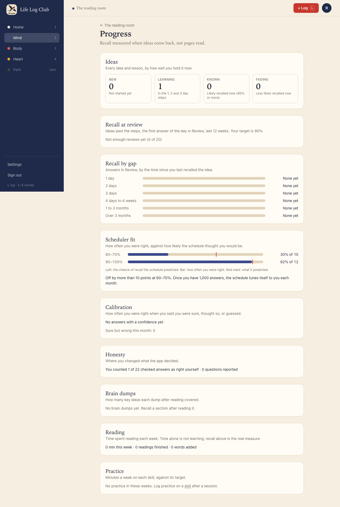
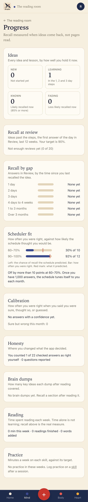
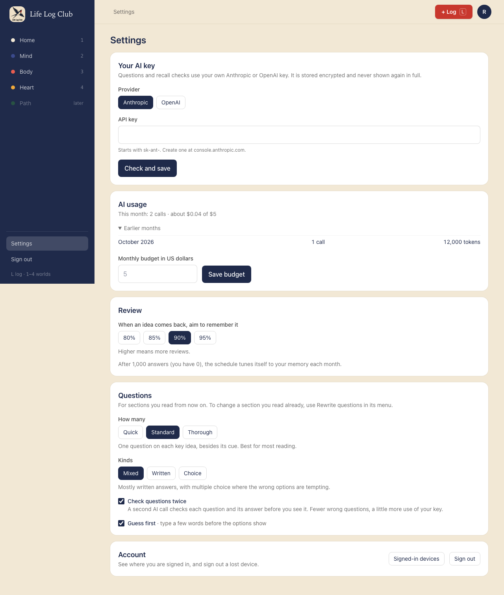
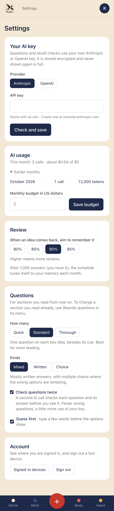

# Issue #36: The full progress view and AI usage history

Release 9. Spec: `learning_spec.md` sections 7.16 and 8.

## What was built

- **Scheduler fit** on Progress (spec §8). Answers in Recall and Review are grouped by the recall the scheduler predicted when each was asked, in tenths (0–10% up to 90–100%). For each tenth with answers, a bar shows how often the member was right and a red mark shows what was predicted, with "30% of 10" beside it.
  - Under 20 answers it says "Not enough answers yet (3 of 20)", the same rule as Recall at review.
  - Below the chart one line says whether the schedule predicts well, or names each tenth with 10 answers or more that is off by more than 10 points, and says that tuning (#35) fixes this once there are 1,000 answers.
- **Honesty**: "You counted 1 of 22 checked answers as right yourself · 0 questions reported". Checked answers are Recall and Review answers graded by code or AI; reports count questions retired with a reason in the period.
- **Reading**: minutes read this week, readings finished and words added in the period, and minutes by week. The chart is left out when nothing was read, so an empty block stays short.
- **Calibration** and **Practice** (skills, #34) were already complete. Progress now runs: Ideas, Recall at review, Recall by gap, Scheduler fit, Calibration, Honesty, Brain dumps, Reading, Practice.
- **Settings → AI usage → Earlier months**: calls and tokens in each of the last 12 calendar months (UTC) that had any, with no money, under this month's line.
- **API:** `progress.summary` gains `schedulerFit`, `honesty` and `reading`; new `ai.usageHistory()`.

## Decisions for the learner

- **The fit chart answers one question:** does the schedule know my memory? A bar that reaches its mark says yes. When it does not, the line says where and what will fix it, instead of leaving a chart to interpret.
- **Honesty is a count, not a score.** It says plainly how often the member overrode a check. The spec's grading-trust metric (overrides per 100 judged answers) can be read from it.
- **Time read is shown below recall, with a note**: time alone is not learning, so the honest signal stays on top.

## Proof

### Scheduler fit

### Honesty and Reading

### Settings: earlier months

### Tests

- `apps/server/src/learning/progress.test.ts`, **scheduler fit groups answers by predicted recall in tenths** (the fixture the issue asks for): answers at 95%, 91%, 100% and 90% fall in 90–100% (4 answers, 3 right, mean 0.94); 62% and 68% in 60–70%; a recall answer at 5% in 0–10%. Practice, answers without a prediction, and answers before the period are left out. Honesty counts 1 of 4 checked answers; Reading has 13 weeks for 84 days.
- `e2e/mind-read.spec.ts`, **Progress shows how well the schedule predicts recall** (desktop and phone): the not-enough line, then the two tenths with their counts, the verdict naming 60–70%, Honesty, and Reading without an empty chart.
- `e2e/ai-key.spec.ts`, **Settings shows this month’s AI use**: Earlier months lists the month 40 days ago with 1 call and 12,000 tokens.

Full run: `pnpm typecheck`, `pnpm test` and `pnpm e2e` (168 passed, 40 skipped) are green.
